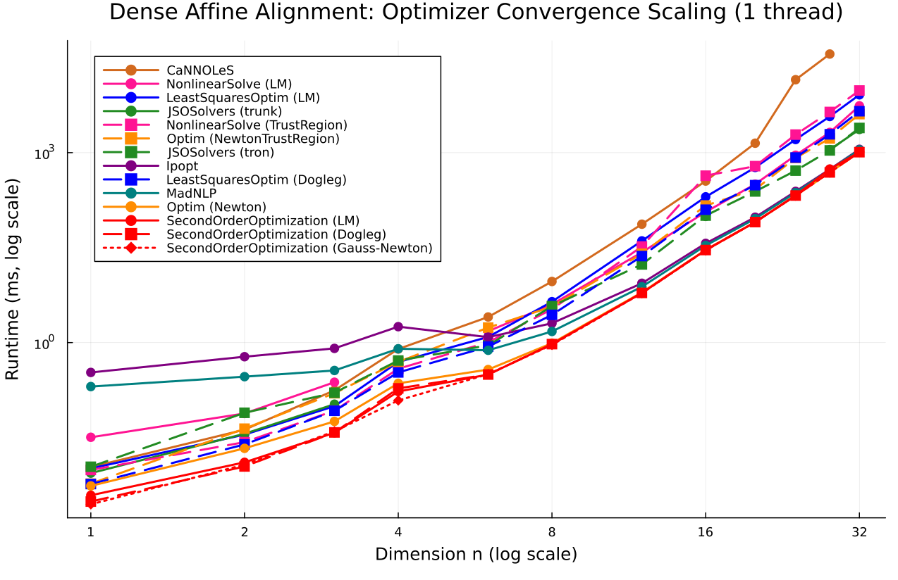

# Dense Affine Alignment

- **Category**: `small_dense`
- **Scaling Metric**: Dimension n
- **Problem Sizes Evaluated**: 1, 2, 3, 4, 6, 8, 12, 16, 20, 24, 28, 32 (12 sizes)
- **Standard Baseline Model for Optimizers**: `Standalone`
- **Derivatives**: analytic

**Derivatives: analytic, not yet in place.** A cost of this problem depends on more than 8 scalar inputs (all ``n(n+1)`` of the affine map's), so by the benchmark's rule its costs are to have hand-written Jacobians shared by every model. They do not yet: the problem has one model, `Standalone`, which computes the Jacobian of the whole residual vector by LeastSquaresOptim's forward-mode automatic differentiation (`autodiff = :forward`), and every row, SecondOrderOptimization's included, runs on it.

---

## The Problem

Two clouds of points in ``n`` dimensions, ``x_1, \dots, x_{2n}`` and ``y_1, \dots, y_{2n}``. The first cloud is to be moved by an unknown *affine map*, ``x \mapsto M x + t``: a matrix ``M`` that can rotate, stretch and shear it, and a shift ``t``. What is known is a table of distances ``D_{ij}``, from each moved point of the first cloud to each point of the second. The optimizer looks for the map that reproduces the whole table:

```math
f(M, t) = \tfrac12 \sum_{i=1}^{2n} \sum_{j=1}^{2n} \bigl(D_{ij} - \lVert M x_i + t - y_j \rVert\bigr)^2 .
```

The table is generated from a true map (``M`` close to the identity, ``t`` random) with no noise, so the minimum is zero. The optimizers start from ``M = I``, ``t = 0``.

### Where it is used

It is a synthetic problem, modelled on registration from range measurements: working out how one set of devices or landmarks sits relative to another when only the distances between them can be measured, as with radio ranging between two groups of sensors, or when fitting a shape to distance data in chemistry and statistics (distance geometry, multidimensional scaling).

### Similar problems

Dense problems in which every residual depends on every unknown, so there is no structure to exploit: fitting a small neural network or another model with a few hundred to a thousand parameters, estimating one global transformation from many measurements, calibrating all the parameters of an instrument at once. It is the largest dense problem in the benchmark: at the top size the Jacobian has over four million entries, and the time is spent in dense linear algebra (matrix products and factorizations), which is where the choice of linear-algebra library and its threading show.

### How it scales

The size is the dimension, ``n``. The unknowns (the ``n^2`` entries of ``M`` and the ``n`` of ``t``) and the residuals (one per pair of points) both grow as ``n^2``, so the Jacobian grows as ``n^4``, and assembling and factorizing ``J^T J`` as ``n^6``.

| | In terms of the size | Smallest | Largest |
|:---|:---|---:|---:|
| Size | ``n`` | 1 | 32 |
| Variables | 1, of size ``n(n+1)`` | 1 | 1 |
| Unknowns in total | ``n(n+1)`` | 2 | 1056 |
| Costs | ``(2n)^2`` residuals, one per pair of points, each depending on the whole variable | 4 | 4096 |
| Residuals in total | ``4n^2`` | 4 | 4096 |
| Jacobian | ``4n^2 \times n(n+1)``, dense | 4 × 2 | 4096 × 1056 |
| Hessian ``J^T J`` | ``n(n+1) \times n(n+1)``, dense | 2 × 2 | 1056 × 1056 |

---

## The SecondOrderOptimization rows

- **`SecondOrderOptimization (Gauss-Newton)`** is `iterator = :newton` on the normal equations: Gauss–Newton, since the Hessian it is given is ``J^T J``. It takes the full step, with no line search or trust region (a diagonal shift only when the system cannot be solved), so a step that raises the cost is caught only by the stall test, and the row then ends `not_converged`. **`CaNNOLeS`** (`method = :Newton_noFHess`) is Gauss–Newton too, globalized: an ``LDL^T`` factorization of the augmented system ``[\rho I\ \ J^T;\ J\ \ {-I}]``, with ``\rho`` raised from 0 only when the factorization fails or has the wrong inertia, then an Armijo backtracking line search on ``\tfrac12\|F\|^2``.

---

## 1. Model Evaluation Scaling

This problem uses `Standalone` universally across all solvers via its built-in adapters; Phase 1 comparative model evaluation is omitted.

---

## 2. Optimizer Evaluation Scaling

The plot below shows the log-log scaling of **Optimizer Runtime to Convergence** across all tested solvers, where each solver is evaluated on its optimal problem representation (e.g. `NLLSModel` for `SecondOrderOptimization`, `LeastSquaresProblem` for `LeastSquaresOptim`, `NLPModels` for JSO/interior-point solvers, and `Manifolds` for `Manopt`). Non-converged runs are omitted.


---

## 3. Single-Threaded Results

The same benchmark with NLLSModel and BLAS on one thread (`set_benchmark_threads!(numthreads = 1, blas_threads = 1)`),
stored separately from the threaded table. Comparing the two shows what threading gains or costs at each size.



- [View Single-Threaded Raw Benchmark Results Data (Markdown Table)](../data/single_threaded/affine_alignment.md)

---

## 4. Raw Data

The full numeric benchmark measurements (cost, linear system assembly times, outer iterations, memory, and convergence status across all sizes) are persisted in the streaming Markdown data file:

- [View Full Raw Benchmark Results Data (Markdown Table)](../data/affine_alignment.md)

---

## 5. Analysis & Key Takeaways

- **Model Architecture**: Handled universally via `Standalone` with built-in zero-allocation adapters.
- **Top Converged Optimizer**: At Dimension n = `32` (13/14 solvers converged), **`SecondOrderOptimization (Gauss-Newton)`** is fastest at **1.03 s** (6 iterations, final cost `4.43e-27`).
- **Convergence Filtering**: Only runs satisfying universal convergence tolerances (`gtol = 1.0e-8`, `xtol = 1.0e-8`, `ftol = 1.0e-8`) within `500` iterations and `30.0s` are plotted.
