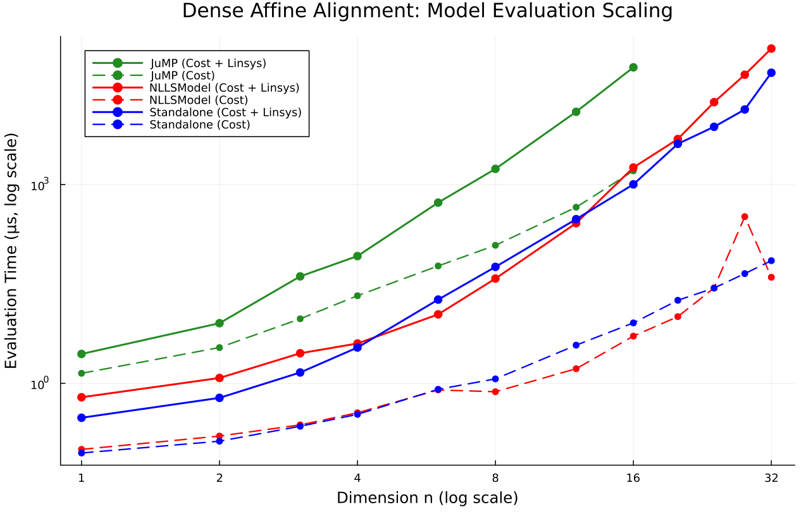
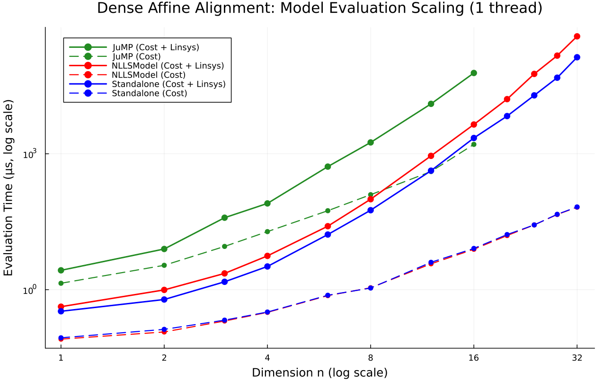

# Dense Affine Alignment

- **Category**: `small_dense`
- **Scaling Metric**: Dimension n
- **Problem Sizes Evaluated**: 1, 2, 3, 4, 6, 8, 12, 16, 20, 24, 28, 32 (12 sizes)
- **Standard Baseline Model for Optimizers**: `Standalone`
- **Derivatives**: analytic

**Derivatives: analytic.** A cost of this problem depends on more than 8 scalar inputs, so each cost has a hand-written Jacobian. NLLSModel calls it through `computeresjac`, and the `Standalone` model fills its residual vector and Jacobian by calling the same function for each cost in a plain single-threaded loop, so the NLLSModel and Standalone models evaluate a cost with the same code. The mode applies to the NLLSModel and Standalone models. The `JuMP` model, the native model of JSOSolvers, Ipopt, MadNLP and CaNNOLeS, is differentiated by JuMP's own automatic differentiation, exactly and with exact second derivatives, whatever the problem's mode: a native model's derivatives are part of the package under test.

---

## The Problem

Two clouds of points in ``n`` dimensions, ``\mathbf{x}_1, \dots, \mathbf{x}_{2n}`` and ``\mathbf{y}_1, \dots, \mathbf{y}_{2n}``. The first cloud is to be moved by an unknown *affine map*, ``\mathbf{x} \mapsto \mathbf{M} \mathbf{x} + \mathbf{t}``: a matrix ``\mathbf{M}`` that can rotate, stretch and shear it, and a shift ``\mathbf{t}``. What is known is a table of distances ``D_{ij}``, from each moved point of the first cloud to each point of the second. The optimizer looks for the map that reproduces the whole table:

```math
f(\mathbf{M}, \mathbf{t}) = \tfrac12 \sum_{i=1}^{2n} \sum_{j=1}^{2n} \bigl(D_{ij} - \lVert \mathbf{M} \mathbf{x}_i + \mathbf{t} - \mathbf{y}_j \rVert\bigr)^2 .
```

The table is generated from a true map (``\mathbf{M}`` close to the identity, ``\mathbf{t}`` random) with no noise, so the minimum is zero. The optimizers start from ``\mathbf{M} = \mathbf{I}``, ``\mathbf{t} = \mathbf{0}``.

### Where it is used

It is a synthetic problem, modelled on registration from range measurements: working out how one set of devices or landmarks sits relative to another when only the distances between them can be measured, as with radio ranging between two groups of sensors, or when fitting a shape to distance data in chemistry and statistics (distance geometry, multidimensional scaling).

### Similar problems

Dense problems in which every residual depends on every unknown, so there is no structure to exploit: fitting a small neural network or another model with a few hundred to a thousand parameters, estimating one global transformation from many measurements, calibrating all the parameters of an instrument at once. It is the largest dense problem in the benchmark: at the top size the Jacobian has over four million entries, and the time is spent in dense linear algebra (matrix products and factorizations), which is where the choice of linear-algebra library and its threading show.

### How it scales

The size is the dimension, ``n``. The unknowns (the ``n^2`` entries of ``\mathbf{M}`` and the ``n`` of ``\mathbf{t}``) and the residuals (one per pair of points) both grow as ``n^2``, so the Jacobian grows as ``n^4``, and assembling and factorizing ``\mathbf{J}^T \mathbf{J}`` as ``n^6``.

| | In terms of the size | Smallest | Largest |
|:---|:---|---:|---:|
| Size | ``n`` | 1 | 32 |
| Variables | 1, of size ``n(n+1)`` | 1 | 1 |
| Unknowns in total | ``n(n+1)`` | 2 | 1056 |
| Costs | ``(2n)^2`` residuals, one per pair of points, each depending on the whole variable | 4 | 4096 |
| Residuals in total | ``4n^2`` | 4 | 4096 |
| Jacobian | ``4n^2 \times n(n+1)``, dense | 4 × 2 | 4096 × 1056 |
| Hessian ``\mathbf{J}^T \mathbf{J}`` | ``n(n+1) \times n(n+1)``, dense | 2 × 2 | 1056 × 1056 |

---

## Which model each row runs on, and how it stops

Each row runs on its package's native model, or on the `Standalone` model if its package has none here (see the overview). The criteria are the benchmark's gradient, step and relative cost-change tolerances, as far as the package offers them; the overview's table says what each is called in each package.

| Row | Model | Stopping criteria given |
|:---|:---|:---|
| `CaNNOLeS` | `JuMP` | gradient |
| `Ipopt` | `JuMP` | gradient, step, relative cost change |
| `JSOSolvers (tron)` | `JuMP` | gradient |
| `JSOSolvers (trunk)` | `JuMP` | gradient |
| `LeastSquaresOptim (Dogleg)` | `Standalone` | gradient, step, relative cost change |
| `LeastSquaresOptim (LM)` | `Standalone` | gradient, step, relative cost change |
| `MadNLP` | `JuMP` | gradient |
| `NonlinearSolve (LM)` | `Standalone` | its own defaults |
| `NonlinearSolve (TrustRegion)` | `Standalone` | its own defaults |
| `Optim (Newton)` | `Standalone` | gradient, step, relative cost change |
| `Optim (NewtonTrustRegion)` | `Standalone` | gradient, step, relative cost change |
| `SecondOrderOptimization` | `NLLSModel` | gradient, step, relative cost change |

The `SecondOrderOptimization` row runs `iterator = :levenbergmarquardt`, `linsolver = :cholesky`, `formulation = :jacobian`, `reduction = :none`, `storage = :dense`: the configuration NLLSModel's `recommendoptimizer` chose for this problem at its largest size, Dimension n = 32, with one thread (then fixed in the problem's code, the same at every size).

The `JuMP` model is built up to ``n = 16`` and not above: its build took 16 s at ``n = 12``, 189 s at ``n = 16`` and over 300 s at ``n = 20`` (measured 2026-11-19), so at ``n = 20`` and above the rows that run on it (CaNNOLeS, Ipopt, JSOSolvers, MadNLP) are `skipped`, with that reason in the data.

---


## 1. Model Evaluation Scaling

The plot below shows the log-log scaling of **Pure Cost Evaluation** (dashed/dotted lines) and **Cost + Linear System Assembly** (solid/dash-dot lines) across problem sizes.



---

## 2. Optimizer Evaluation Scaling

The plot below shows the log-log scaling of **Optimizer Runtime to Convergence** across all tested solvers, each on the model given in the table above (its package's native model, or the `Standalone` model). Only `ok` rows are plotted.


---

## 3. Single-Threaded Results

The same benchmark with NLLSModel and BLAS on one thread (`set_benchmark_threads!(numthreads = 1, blas_threads = 1)`),
stored separately from the multi-threaded table. Comparing the two shows what threading gains or costs at each size.




- [View Single-Threaded Raw Benchmark Results Data (Markdown Table)](../data/single_threaded/affine_alignment.md)

---

## 4. Raw Data

The full numeric benchmark measurements (cost, linear system assembly times, outer iterations, memory, and convergence status across all sizes) are persisted in the streaming Markdown data file:

- [View Full Raw Benchmark Results Data (Markdown Table)](../data/affine_alignment.md)

---

## 5. Analysis & Key Takeaways

- **Model Efficiency**: At Dimension n = `32`, **`Standalone`** achieves the fastest Cost + Linear System evaluation at **41.53 ms** (32 B allocated).
- **Top Converged Optimizer**: At Dimension n = `32` (7/12 solvers converged), **`Optim (Newton)`** is fastest at **320.27 ms** (6 iterations, final cost `4.12e-27`).
- **Convergence Filtering**: Only runs satisfying universal convergence tolerances (`gtol = 1.0e-8`, `xtol = 1.0e-8`, `ftol = 1.0e-8`) within `500` iterations and `30.0s` are plotted.
