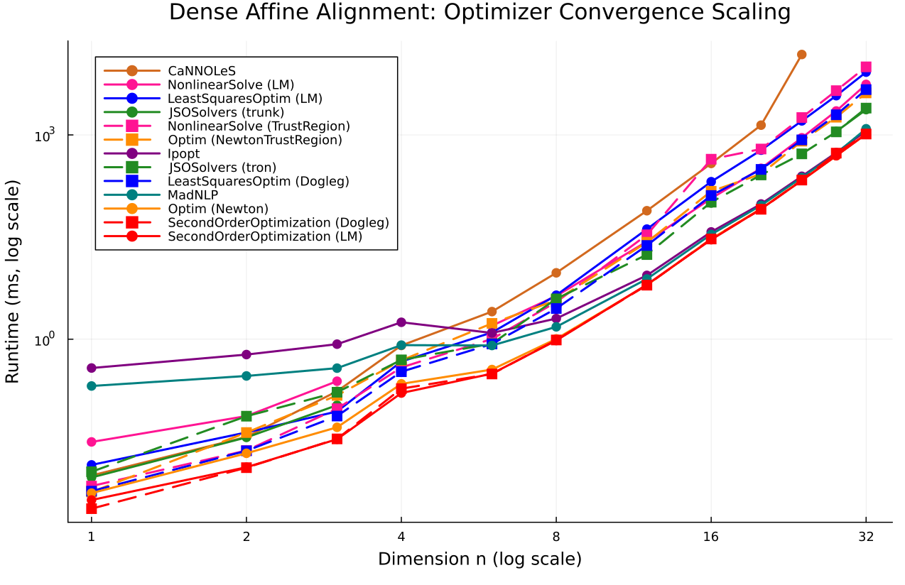

# Dense Affine Alignment

- **Category**: `small_dense`
- **Scaling Metric**: Dimension n
- **Problem Sizes Evaluated**: 1, 2, 3, 4, 6, 8, 12, 16, 20, 24, 28, 32 (12 sizes)
- **Standard Baseline Model for Solvers**: `Standalone`

---

## 1. Model Evaluation Scaling

This problem uses `Standalone` universally across all solvers via its built-in adapters; Phase 1 comparative model evaluation is omitted.

---

## 2. Optimizer Evaluation Scaling

The plot below shows the log-log scaling of **Optimizer Runtime to Convergence** across all tested solvers, where each solver is evaluated on its optimal problem representation (e.g. `NLLSModel` for `SecondOrderOptimization`, `LeastSquaresProblem` for `LeastSquaresOptim`, `NLPModels` for JSO/interior-point solvers, and `Manifolds` for `Manopt`). Non-converged runs are omitted.

---

## 3. Single-Threaded Results

The same benchmark with NLLSModel and BLAS on one thread (`set_benchmark_threads!(numthreads = 1, blas_threads = 1)`),
stored separately from the threaded table. Comparing the two shows what threading gains or costs at each size.

- [View Single-Threaded Raw Benchmark Results Data (Markdown Table)](../data/single_threaded/affine_alignment.md)

---

## 4. Raw Data

The full numeric benchmark measurements (cost, linear system assembly times, outer iterations, memory, and convergence status across all sizes) are persisted in the streaming Markdown data file:

- [View Full Raw Benchmark Results Data (Markdown Table)](../data/affine_alignment.md)

---

## 5. Analysis & Key Takeaways

- **Model Architecture**: Handled universally via `Standalone` with built-in zero-allocation adapters.
- **Top Converged Optimizer**: At Dimension n = `32` (12/13 solvers converged), **`SecondOrderOptimization (LM)`** is fastest at **1.02 s** (6 iterations, final cost `4.74e-27`).
- **Convergence Filtering**: Only runs satisfying universal convergence tolerances (`gtol = 1.0e-8`, `xtol = 1.0e-8`, `ftol = 1.0e-8`) within `500` iterations and `30.0s` are plotted.
