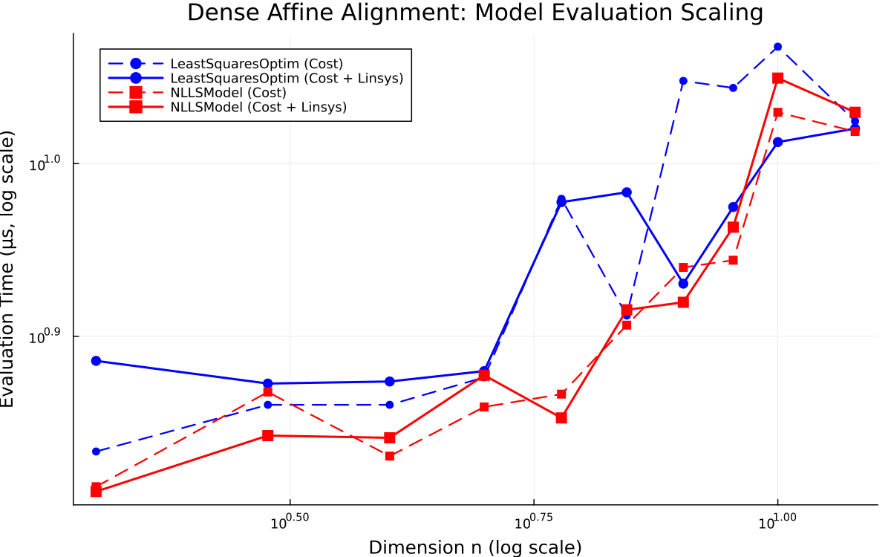
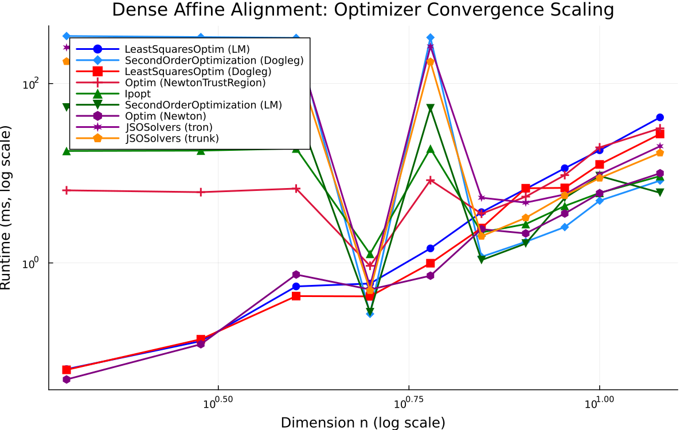

# Dense Affine Alignment

- **Category**: `large_dense`
- **Scaling Metric**: Dimension n
- **Problem Sizes Evaluated**: 2, 3, 4, 5, 6, 7, 8, 9, 10, 12 (10 sizes)

---

## 1. Model Evaluation Scaling

The plot below shows the log-log scaling of **Pure Cost Evaluation** (dashed lines) and **Cost + Linear System Assembly** (solid lines) across problem sizes.

### Model Evaluation Timings

| Dimension n | Model | Cost Time | Cost Allocs | Linsys Time | Linsys Allocs | Linsys Memory |
|:---|:---|:---|:---|:---|:---|:---|
| 2 | LeastSquaresOptim | 6.81 μs | 16 | 7.69 μs | 16 | 1.2 KiB |
| 2 | NLLSModel ★ | 6.50 μs | 16 | 6.46 μs | 16 | 1.2 KiB |
| 3 | LeastSquaresOptim | 7.25 μs | 16 | 7.46 μs | 16 | 1.9 KiB |
| 3 | NLLSModel ★ | 7.38 μs | 16 | 6.96 μs | 16 | 1.9 KiB |
| 4 | LeastSquaresOptim | 7.25 μs | 16 | 7.48 μs | 16 | 2.8 KiB |
| 4 | NLLSModel ★ | 6.77 μs | 16 | 6.94 μs | 16 | 2.8 KiB |
| 5 | LeastSquaresOptim | 7.52 μs | 16 | 7.58 μs | 16 | 4.1 KiB |
| 5 | NLLSModel ★ | 7.23 μs | 16 | 7.54 μs | 16 | 4.1 KiB |
| 6 | LeastSquaresOptim | 9.54 μs | 16 | 9.50 μs | 16 | 5.5 KiB |
| 6 | NLLSModel ★ | 7.35 μs | 16 | 7.12 μs | 16 | 5.5 KiB |
| 7 | LeastSquaresOptim | 8.17 μs | 16 | 9.62 μs | 16 | 7.1 KiB |
| 7 | NLLSModel ★ | 8.06 μs | 16 | 8.23 μs | 16 | 7.1 KiB |
| 8 | LeastSquaresOptim | 11.17 μs | 19 | 8.52 μs | 19 | 8.9 KiB |
| 8 | NLLSModel ★ | 8.71 μs | 19 | 8.31 μs | 19 | 8.9 KiB |
| 9 | LeastSquaresOptim | 11.06 μs | 19 | 9.44 μs | 19 | 12.5 KiB |
| 9 | NLLSModel ★ | 8.79 μs | 19 | 9.19 μs | 19 | 12.5 KiB |
| 10 | LeastSquaresOptim ★ | 11.69 μs | 19 | 10.29 μs | 19 | 14.6 KiB |
| 10 | NLLSModel | 10.71 μs | 19 | 11.21 μs | 19 | 14.6 KiB |
| 12 | LeastSquaresOptim ★ | 10.58 μs | 21 | 10.48 μs | 21 | 21.0 KiB |
| 12 | NLLSModel | 10.44 μs | 21 | 10.71 μs | 21 | 21.0 KiB |

---

## 2. Optimizer Evaluation Scaling

The plot below shows the log-log scaling of **Optimizer Runtime to Convergence** across all compatible optimizer families.

### Optimizer Results Summary

| Dimension n | Optimizer | Runtime | Allocs | Memory | Iterations | Final Cost | Converged |
|:---|:---|:---|:---|:---|:---|:---|:---|
| 2 | LeastSquaresOptim (LM) | 65.46 μs | 541968 | 529.3 KiB | 9 | 2.0176e-26 | ✓ Yes |
| 2 | SecondOrderOptimization (Dogleg) | 338.61 ms | 61904 | 60.5 KiB | 6 | 6.9025e-31 | ✓ Yes |
| 2 | LeastSquaresOptim (Dogleg) | 64.31 μs | 365568 | 357.0 KiB | 6 | 1.2819e-30 | ✓ Yes |
| 2 | Ipopt | 17.72 ms | 64928 | 63.4 KiB | 5 | 4.4267e-28 | ✓ Yes |
| 2 | Optim (NewtonTrustRegion) | 6.45 ms | 126576 | 123.6 KiB | 5 | 1.7417e-28 | ✓ Yes |
| 2 | JSOSolvers (tron) | 252.66 ms | 85488 | 83.5 KiB | 8 | 9.0168e-14 | ✓ Yes |
| 2 | Optim (Newton) | 50.23 μs | 104784 | 102.3 KiB | 5 | 4.4287e-28 | ✓ Yes |
| 2 | SecondOrderOptimization (LM) | 54.05 ms | 61392 | 60.0 KiB | 6 | 1.8735e-30 | ✓ Yes |
| 2 | JSOSolvers (trunk) | 176.12 ms | 82800 | 80.9 KiB | 8 | 7.7333e-21 | ✓ Yes |
| 3 | LeastSquaresOptim (LM) | 134.33 μs | 787264 | 768.8 KiB | 10 | 1.4699e-24 | ✓ Yes |
| 3 | SecondOrderOptimization (Dogleg) | 329.90 ms | 252864 | 246.9 KiB | 9 | 9.4294e-31 | ✓ Yes |
| 3 | LeastSquaresOptim (Dogleg) | 141.02 μs | 710704 | 694.0 KiB | 9 | 1.0415e-30 | ✓ Yes |
| 3 | Ipopt | 17.88 ms | 238720 | 233.1 KiB | 8 | 4.0949e-21 | ✓ Yes |
| 3 | Optim (NewtonTrustRegion) | 6.15 ms | 527680 | 515.3 KiB | 8 | 2.9832e-20 | ✓ Yes |
| 3 | JSOSolvers (tron) | 270.36 ms | 302576 | 295.5 KiB | 11 | 8.3278e-16 | ✓ Yes |
| 3 | Optim (Newton) | 124.00 μs | 443952 | 433.5 KiB | 8 | 4.0949e-21 | ✓ Yes |
| 3 | SecondOrderOptimization (LM) | 52.84 ms | 257856 | 251.8 KiB | 9 | 8.8747e-31 | ✓ Yes |
| 3 | JSOSolvers (trunk) | 174.84 ms | 300080 | 293.0 KiB | 11 | 2.4938e-22 | ✓ Yes |
| 4 | LeastSquaresOptim (LM) | 547.31 μs | 2387888 | 2.3 MiB | 23 | 1.8934e-27 | ✓ Yes |
| 4 | SecondOrderOptimization (Dogleg) | 322.79 ms | 875200 | 854.7 KiB | 13 | 2.3173e-30 | ✓ Yes |
| 4 | LeastSquaresOptim (Dogleg) | 426.92 μs | 1878672 | 1.8 MiB | 22 | 4.7085e-30 | ✓ Yes |
| 4 | Ipopt | 18.87 ms | 1081936 | 1.0 MiB | 15 | 1.1585e-21 | ✓ Yes |
| 4 | Optim (NewtonTrustRegion) | 6.75 ms | 1701584 | 1.6 MiB | 10 | 7.5511e-20 | ✓ Yes |
| 4 | JSOSolvers (tron) | 272.70 ms | 1166992 | 1.1 MiB | 19 | 1.2355e-15 | ✓ Yes |
| 4 | Optim (Newton) | 742.48 μs | 3999616 | 3.8 MiB | 23 | 1.0943e-28 | ✓ Yes |
| 4 | SecondOrderOptimization (LM) | 52.93 ms | 1176752 | 1.1 MiB | 15 | 2.2564e-28 | ✓ Yes |
| 4 | JSOSolvers (trunk) | 175.98 ms | 691456 | 675.2 KiB | 10 | 2.5726e-17 | ✓ Yes |
| 5 | LeastSquaresOptim (LM) | 589.08 μs | 1855824 | 1.8 MiB | 9 | 5.0327e-24 | ✓ Yes |
| 5 | SecondOrderOptimization (Dogleg) | 270.31 μs | 1109392 | 1.1 MiB | 7 | 8.8993e-30 | ✓ Yes |
| 5 | LeastSquaresOptim (Dogleg) | 424.04 μs | 1457264 | 1.4 MiB | 7 | 8.7761e-30 | ✓ Yes |
| 5 | Ipopt | 1.26 ms | 1172272 | 1.1 MiB | 7 | 9.1952e-30 | ✓ Yes |
| 5 | Optim (NewtonTrustRegion) | 928.79 μs | 2400928 | 2.3 MiB | 6 | 3.1661e-18 | ✓ Yes |
| 5 | JSOSolvers (tron) | 548.19 μs | 1446848 | 1.4 MiB | 9 | 4.9178e-15 | ✓ Yes |
| 5 | Optim (Newton) | 505.42 μs | 2285744 | 2.2 MiB | 7 | 7.5928e-30 | ✓ Yes |
| 5 | SecondOrderOptimization (LM) | 282.12 μs | 1228112 | 1.2 MiB | 7 | 1.1759e-29 | ✓ Yes |
| 5 | JSOSolvers (trunk) | 492.73 μs | 1583728 | 1.5 MiB | 10 | 1.4509e-17 | ✓ Yes |
| 6 | LeastSquaresOptim (LM) | 1.45 ms | 3256304 | 3.1 MiB | 10 | 1.4863e-24 | ✓ Yes |
| 6 | SecondOrderOptimization (Dogleg) | 326.49 ms | 2536224 | 2.4 MiB | 9 | 2.1324e-29 | ✓ Yes |
| 6 | LeastSquaresOptim (Dogleg) | 992.77 μs | 2622448 | 2.5 MiB | 8 | 1.1340e-29 | ✓ Yes |
| 6 | Ipopt | 18.82 ms | 2113616 | 2.0 MiB | 7 | 1.3016e-29 | ✓ Yes |
| 6 | Optim (NewtonTrustRegion) | 8.37 ms | 6112160 | 5.8 MiB | 9 | 1.9549e-29 | ✓ Yes |
| 6 | JSOSolvers (tron) | 259.49 ms | 3368736 | 3.2 MiB | 12 | 1.2747e-14 | ✓ Yes |
| 6 | Optim (Newton) | 720.35 μs | 4149808 | 4.0 MiB | 7 | 1.6961e-29 | ✓ Yes |
| 6 | SecondOrderOptimization (LM) | 53.00 ms | 2489632 | 2.4 MiB | 8 | 1.2992e-29 | ✓ Yes |
| 6 | JSOSolvers (trunk) | 174.91 ms | 2864864 | 2.7 MiB | 10 | 7.4532e-14 | ✓ Yes |
| 7 | LeastSquaresOptim (LM) | 3.68 ms | 5273680 | 5.0 MiB | 10 | 1.1284e-26 | ✓ Yes |
| 7 | SecondOrderOptimization (Dogleg) | 1.17 ms | 4456304 | 4.2 MiB | 9 | 1.6098e-29 | ✓ Yes |
| 7 | LeastSquaresOptim (Dogleg) | 2.45 ms | 4259472 | 4.1 MiB | 8 | 2.0289e-29 | ✓ Yes |
| 7 | Ipopt | 2.19 ms | 3689504 | 3.5 MiB | 7 | 1.9251e-24 | ✓ Yes |
| 7 | Optim (NewtonTrustRegion) | 3.54 ms | 8621776 | 8.2 MiB | 7 | 4.3531e-21 | ✓ Yes |
| 7 | JSOSolvers (tron) | 5.33 ms | 5883008 | 5.6 MiB | 12 | 6.7325e-15 | ✓ Yes |
| 7 | Optim (Newton) | 2.38 ms | 7293472 | 7.0 MiB | 7 | 1.9248e-24 | ✓ Yes |
| 7 | SecondOrderOptimization (LM) | 1.08 ms | 4414192 | 4.2 MiB | 8 | 2.0362e-29 | ✓ Yes |
| 7 | JSOSolvers (trunk) | 1.99 ms | 5004864 | 4.8 MiB | 10 | 3.6140e-17 | ✓ Yes |
| 8 | LeastSquaresOptim (LM) | 6.69 ms | 7531360 | 7.2 MiB | 9 | 6.0110e-22 | ✓ Yes |
| 8 | SecondOrderOptimization (Dogleg) | 1.72 ms | 6561088 | 6.3 MiB | 8 | 2.9385e-29 | ✓ Yes |
| 8 | LeastSquaresOptim (Dogleg) | 6.80 ms | 5904608 | 5.6 MiB | 7 | 3.1554e-29 | ✓ Yes |
| 8 | Ipopt | 2.71 ms | 5351472 | 5.1 MiB | 6 | 6.6899e-26 | ✓ Yes |
| 8 | Optim (NewtonTrustRegion) | 5.48 ms | 13740560 | 13.1 MiB | 7 | 3.1949e-29 | ✓ Yes |
| 8 | JSOSolvers (tron) | 4.70 ms | 8983744 | 8.6 MiB | 11 | 1.2329e-16 | ✓ Yes |
| 8 | Optim (Newton) | 2.13 ms | 10619104 | 10.1 MiB | 6 | 6.6749e-26 | ✓ Yes |
| 8 | SecondOrderOptimization (LM) | 1.65 ms | 6530576 | 6.2 MiB | 7 | 3.5795e-29 | ✓ Yes |
| 8 | JSOSolvers (trunk) | 3.19 ms | 8257504 | 7.9 MiB | 10 | 3.8467e-16 | ✓ Yes |
| 9 | LeastSquaresOptim (LM) | 11.37 ms | 16966832 | 16.2 MiB | 10 | 1.8320e-24 | ✓ Yes |
| 9 | SecondOrderOptimization (Dogleg) | 2.51 ms | 13594016 | 13.0 MiB | 8 | 4.8121e-29 | ✓ Yes |
| 9 | LeastSquaresOptim (Dogleg) | 6.87 ms | 12016560 | 11.5 MiB | 7 | 3.9542e-29 | ✓ Yes |
| 9 | Ipopt | 4.31 ms | 11328208 | 10.8 MiB | 6 | 5.9603e-21 | ✓ Yes |
| 9 | Optim (NewtonTrustRegion) | 9.53 ms | 28540912 | 27.2 MiB | 7 | 6.8250e-27 | ✓ Yes |
| 9 | JSOSolvers (tron) | 5.81 ms | 17576560 | 16.8 MiB | 10 | 3.9025e-13 | ✓ Yes |
| 9 | Optim (Newton) | 3.56 ms | 22547392 | 21.5 MiB | 6 | 5.9606e-21 | ✓ Yes |
| 9 | SecondOrderOptimization (LM) | 5.30 ms | 13548784 | 12.9 MiB | 7 | 4.7430e-29 | ✓ Yes |
| 9 | JSOSolvers (trunk) | 5.65 ms | 17577344 | 16.8 MiB | 10 | 1.0948e-13 | ✓ Yes |
| 10 | LeastSquaresOptim (LM) | 18.04 ms | 21134992 | 20.2 MiB | 10 | 9.6849e-24 | ✓ Yes |
| 10 | SecondOrderOptimization (Dogleg) | 4.94 ms | 19248704 | 18.4 MiB | 9 | 5.5911e-29 | ✓ Yes |
| 10 | LeastSquaresOptim (Dogleg) | 12.54 ms | 17001488 | 16.2 MiB | 8 | 5.6897e-29 | ✓ Yes |
| 10 | Ipopt | 6.04 ms | 16168752 | 15.4 MiB | 7 | 5.3445e-29 | ✓ Yes |
| 10 | Optim (NewtonTrustRegion) | 19.42 ms | 41665760 | 39.7 MiB | 8 | 8.6856e-24 | ✓ Yes |
| 10 | JSOSolvers (tron) | 9.73 ms | 23967536 | 22.9 MiB | 11 | 5.2983e-14 | ✓ Yes |
| 10 | Optim (Newton) | 5.99 ms | 32168368 | 30.7 MiB | 7 | 8.3619e-29 | ✓ Yes |
| 10 | SecondOrderOptimization (LM) | 9.31 ms | 19186560 | 18.3 MiB | 8 | 4.1317e-29 | ✓ Yes |
| 10 | JSOSolvers (trunk) | 8.83 ms | 23968320 | 22.9 MiB | 11 | 4.0562e-17 | ✓ Yes |
| 12 | LeastSquaresOptim (LM) | 41.96 ms | 37662928 | 35.9 MiB | 10 | 5.6461e-24 | ✓ Yes |
| 12 | SecondOrderOptimization (Dogleg) | 8.27 ms | 31188256 | 29.7 MiB | 8 | 1.1872e-28 | ✓ Yes |
| 12 | LeastSquaresOptim (Dogleg) | 27.38 ms | 26714784 | 25.5 MiB | 7 | 1.2336e-28 | ✓ Yes |
| 12 | Ipopt | 9.29 ms | 25667792 | 24.5 MiB | 6 | 1.0492e-28 | ✓ Yes |
| 12 | Optim (NewtonTrustRegion) | 31.69 ms | 82241648 | 78.4 MiB | 9 | 6.1704e-24 | ✓ Yes |
| 12 | JSOSolvers (tron) | 20.00 ms | 43195072 | 41.2 MiB | 11 | 1.2921e-14 | ✓ Yes |
| 12 | Optim (Newton) | 10.00 ms | 51136736 | 48.8 MiB | 6 | 1.1784e-28 | ✓ Yes |
| 12 | SecondOrderOptimization (LM) | 6.06 ms | 31177520 | 29.7 MiB | 7 | 1.0088e-28 | ✓ Yes |
| 12 | JSOSolvers (trunk) | 16.86 ms | 43198576 | 41.2 MiB | 11 | 5.6122e-14 | ✓ Yes |

---

## 3. Analysis & Key Takeaways

- **Asymptotic Complexity**: Log-log scaling indicates the empirical runtime growth rate as Dimension n expands.
- **Fastest Model**: The fastest linear system assembly was consistently achieved by `NLLSModel`.
- **Top Optimizer**: Solvers leveraging specialized structure (e.g. sparse block factorization in SecondOrderOptimization) demonstrate superior scaling exponents on large problem regimes.
