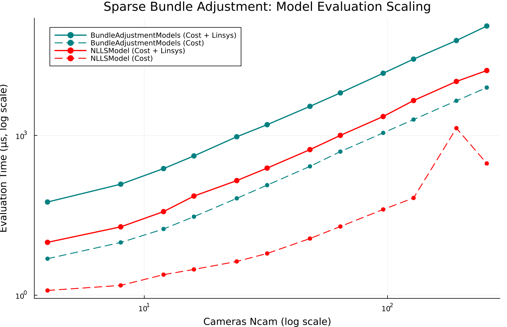
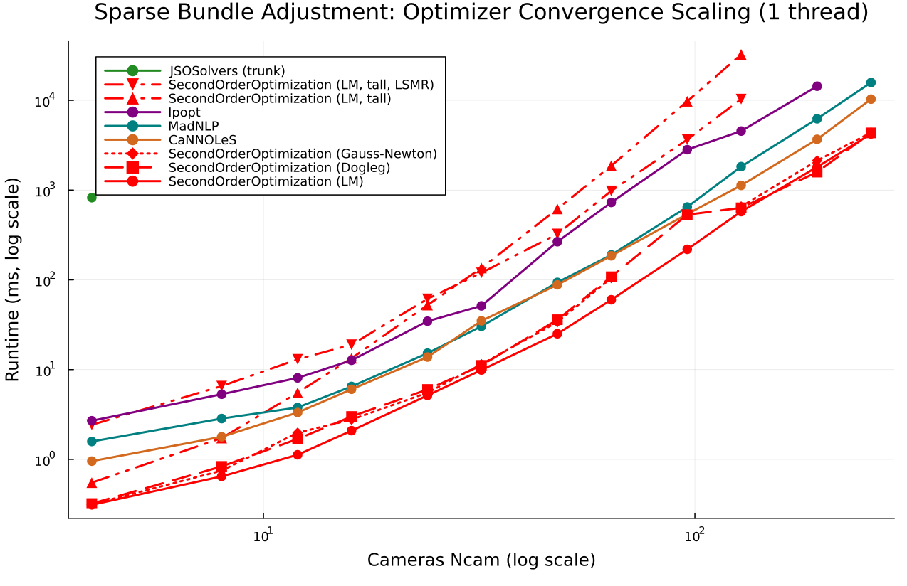

# Sparse Bundle Adjustment

- **Category**: `large_sparse`
- **Scaling Metric**: Cameras Ncam
- **Problem Sizes Evaluated**: 4, 8, 12, 16, 24, 32, 48, 64, 96, 128, 192, 256 (12 sizes)
- **Standard Baseline Model for Solvers**: `BundleAdjustmentModels`
- **Derivatives**: mixed

**Derivatives: mixed, exempt from the rule.** Each observation depends on a camera and a point, 12 scalar inputs, but this problem is exempt from the rule: its two models are separate formulations of the problem, not two uses of the same per-cost code, so no equivalent pair of rows is being compared. The `NLLSModel` model differentiates each observation automatically (NLLSModel's `computeresjac`); `BundleAdjustmentModels` evaluates its own Jacobian.

---

## The SecondOrderOptimization rows

- **`SecondOrderOptimization (LM)`** and **`(Dogleg)`** solve the normal equations with the points eliminated by a Schur complement (`reduction = :eliminate`); LM uses `:levenbergmarquardt_dtd`, whose damping is scaled by the running maximum of the squared column norms of ``J`` (the diagonal of ``J^T J``).
- **`SecondOrderOptimization (Gauss-Newton)`** is `iterator = :newton`, with the same Schur elimination: the full Gauss–Newton step, with no line search or trust region, so a step that raises the cost is caught only by the stall test. **`CaNNOLeS`** (`method = :Newton_noFHess`, on `BundleAdjustmentModels`) is Gauss–Newton globalized by a regularized ``LDL^T`` factorization of the augmented system and an Armijo backtracking line search.
- **`SecondOrderOptimization (LM, tall)`** uses the same iterator and `reduction = :eliminate` on the residual-and-Jacobian form (`formulation = :jacobian`): the points are eliminated by QR of their blocks (square-root bundle adjustment), and the reduced camera system is stored as `storage = :auto` chooses and factorized by QR, without forming ``J^T J``.
- **`SecondOrderOptimization (LM, tall, LSMR)`** is the tall row with `linsolver = :lsmr`: the reduced least-squares problem is solved iteratively by LSMR (Krylov.jl) instead of by QR.

---

## 1. Model Evaluation Scaling

The plot below shows the log-log scaling of **Pure Cost Evaluation** (dashed/dotted lines) and **Cost + Linear System Assembly** (solid/dash-dot lines) across problem sizes.

---

## 2. Optimizer Evaluation Scaling

The plot below shows the log-log scaling of **Optimizer Runtime to Convergence** across all tested solvers, where each solver is evaluated on its optimal problem representation (e.g. `NLLSModel` for `SecondOrderOptimization`, `LeastSquaresProblem` for `LeastSquaresOptim`, `NLPModels` for JSO/interior-point solvers, and `Manifolds` for `Manopt`). Non-converged runs are omitted.

---

## 3. Single-Threaded Results

The same benchmark with NLLSModel and BLAS on one thread (`set_benchmark_threads!(numthreads = 1, blas_threads = 1)`),
stored separately from the threaded table. Comparing the two shows what threading gains or costs at each size.

- [View Single-Threaded Raw Benchmark Results Data (Markdown Table)](../data/single_threaded/bundle_adjustment.md)

---

## 4. Raw Data

The full numeric benchmark measurements (cost, linear system assembly times, outer iterations, memory, and convergence status across all sizes) are persisted in the streaming Markdown data file:

- [View Full Raw Benchmark Results Data (Markdown Table)](../data/bundle_adjustment.md)

---

## 5. Analysis & Key Takeaways

- **Model Efficiency**: At Cameras Ncam = `256`, **`NLLSModel`** achieves the fastest Cost + Linear System evaluation at **18.25 ms** (93.0 MiB allocated).
- **Top Converged Optimizer**: At Cameras Ncam = `256` (4/10 solvers converged), **`SecondOrderOptimization (LM)`** is fastest at **1.51 s** (10 iterations, final cost `1.36e-20`).
- **Convergence Filtering**: Only runs satisfying universal convergence tolerances (`gtol = 1.0e-8`, `xtol = 1.0e-8`, `ftol = 1.0e-8`) within `500` iterations and `30.0s` are plotted.
