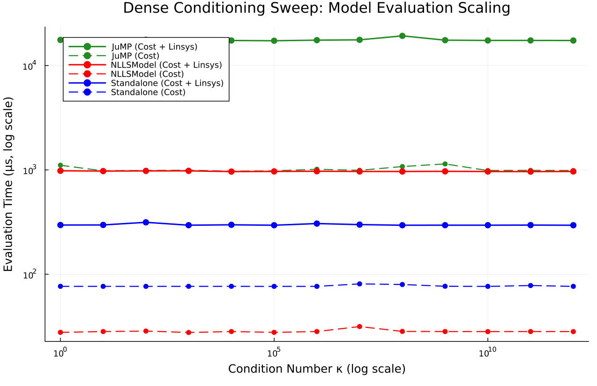
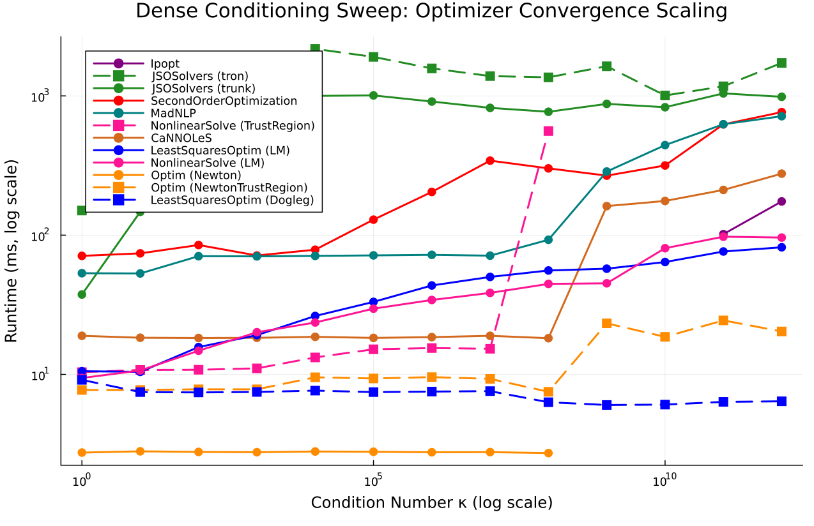
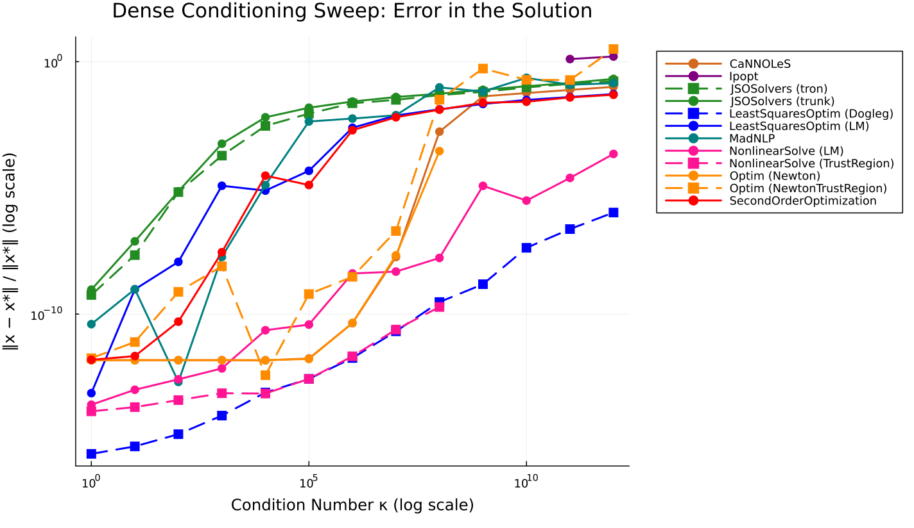
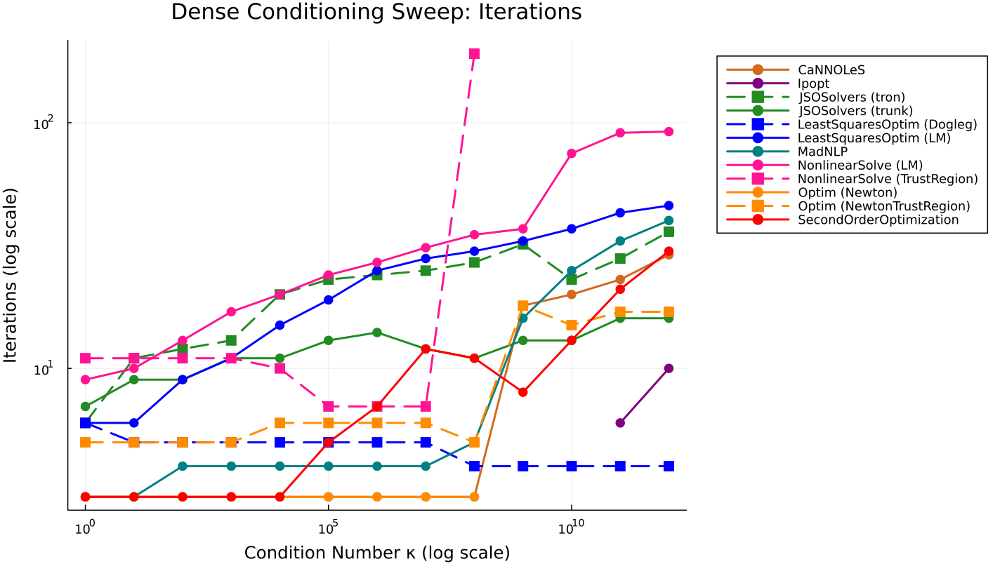
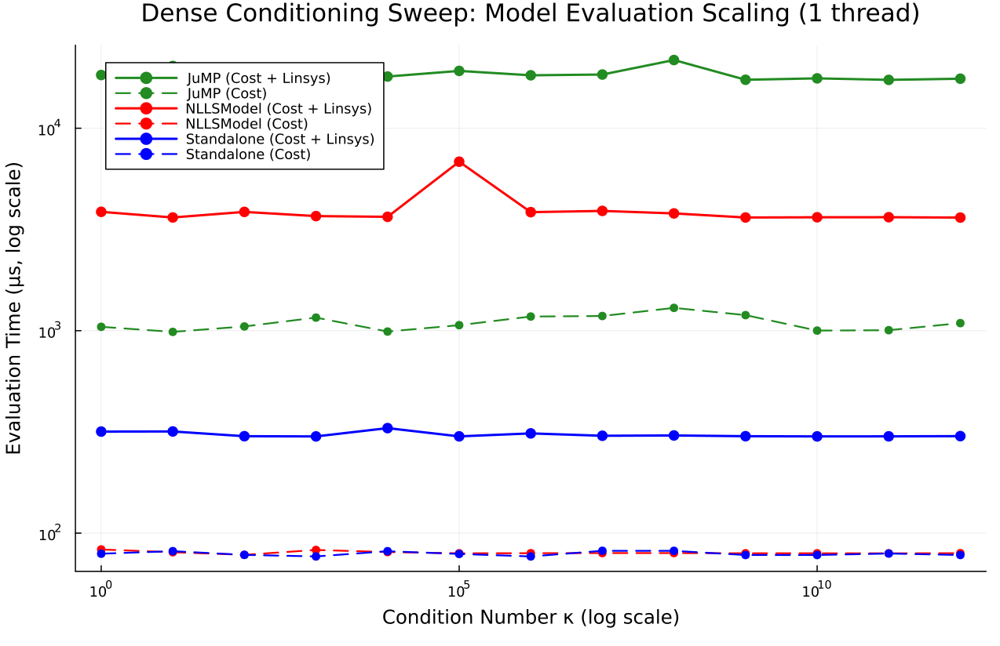
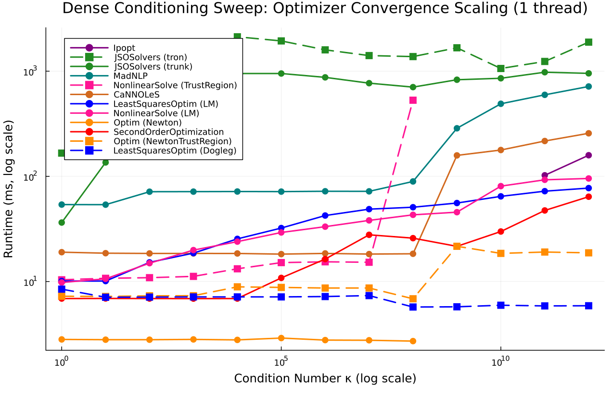
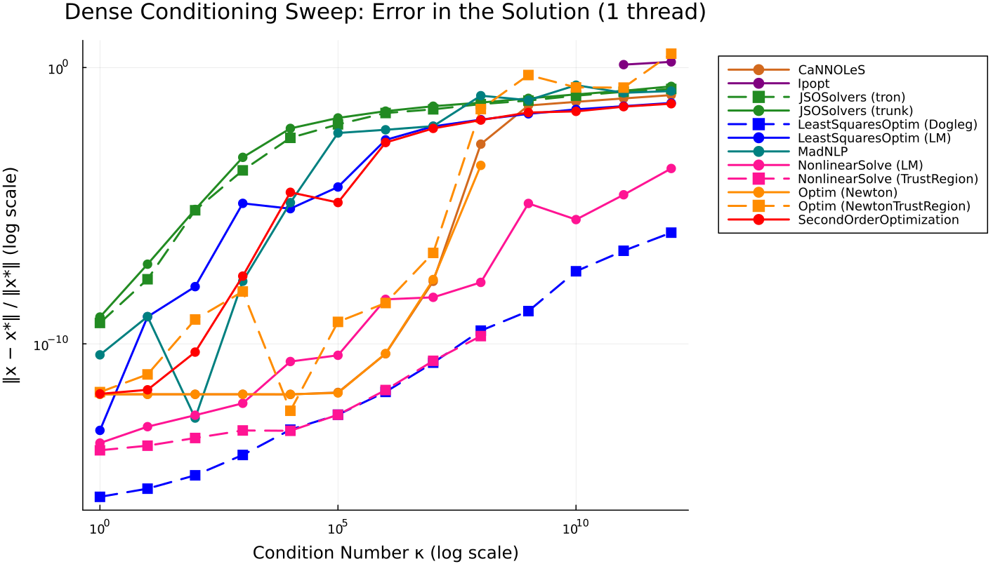
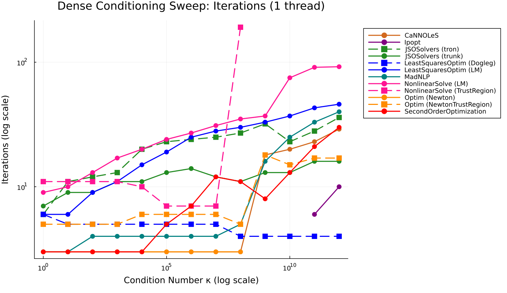

# Dense Conditioning Sweep

- **Category**: `medium_dense`
- **Scaling Metric**: Condition Number κ
- **Problem Sizes Evaluated**: 1.0, 10.0, 100.0, 1000.0, 10000.0, 100000.0, 1.0e6, 1.0e7, 1.0e8, 1.0e9, 1.0e10, 1.0e11, 1.0e12 (13 sizes)
- **Standard Baseline Model for Optimizers**: `Standalone`
- **Derivatives**: analytic

**Derivatives: analytic.** A cost of this problem depends on more than 8 scalar inputs, so each cost has a hand-written Jacobian. NLLSModel calls it through `computeresjac`, and the `Standalone` model fills its residual vector and Jacobian by calling the same function for each cost in a plain single-threaded loop, so the NLLSModel and Standalone models evaluate a cost with the same code. The mode applies to the NLLSModel and Standalone models. The `JuMP` model, the native model of JSOSolvers, Ipopt, MadNLP and CaNNOLeS, is differentiated by JuMP's own automatic differentiation, exactly and with exact second derivatives, whatever the problem's mode: a native model's derivatives are part of the package under test.

---

## The Problem

This problem has one size, and what it sweeps is the condition number ``\kappa`` of the Jacobian, from 1 to ``10^{12}``, so that the effect of ill-conditioning is seen alone. ``\kappa`` is imposed through the spectrum of a matrix ``\mathbf{A}``, so that no rescaling of the unknowns removes it. The measure to read is each row's error in the solution, plotted below beside its iterations: the residuals are zero at the solution, so an error ``e`` along the weakest direction adds only about ``(e/\kappa)^2/2`` to the cost, and every row's final cost is close to zero at every ``\kappa`` whatever its error. The final cost is still in the data file.

With ``N = 100`` unknowns and ``M = 400`` residuals,

```math
f(\mathbf{x}) = \tfrac12 \sum_{i=1}^{M} \Bigl(\sum_{k=1}^{N} A_{ik}\, \varphi(x_k) - b_i\Bigr)^2, \qquad \varphi(x) = x + 0.1 \sin x, \qquad \mathbf{A} = \mathbf{U}\, \operatorname{diag}(\boldsymbol{\sigma})\, \mathbf{V}^T, \qquad \sigma_k = \kappa^{-(k-1)/(N-1)} .
```

``\mathbf{U}`` (``M \times N``) and ``\mathbf{V}`` (``N \times N``) are cosine bases with orthonormal columns, ``U_{ik} \propto \cos\bigl(\pi(i - \tfrac12)(k-1)/M\bigr)`` and likewise for ``\mathbf{V}``, so the singular values of ``\mathbf{A}`` are ``\boldsymbol{\sigma}``, from 1 down to ``1/\kappa``, and ``\operatorname{cond}(\mathbf{A}) = \kappa`` exactly; no random numbers are used. The Jacobian is ``\mathbf{A}\, \operatorname{diag}(1 + 0.1\cos x_k)``, whose condition number is within a factor ``1.1/0.9`` of ``\kappa``: the nonlinearity is mild and the same at every ``\kappa``. The data are ``\mathbf{b} = \mathbf{A}\,\varphi(\mathbf{x}^\star)`` with ``x^\star_j = \sin j``, the stated solution, and the optimizers start from ``\mathbf{x} = \mathbf{0}``. The error in the solution is ``\lVert \mathbf{x} - \mathbf{x}^\star \rVert / \lVert \mathbf{x}^\star \rVert``.

### Where it is used

Ill-conditioned dense least squares is the core of inverse problems and parameter estimation: deblurring and tomography, fitting models whose parameters the data determine only in some combinations, and calibration. Each residual depends on every unknown, as in a dense regression.

### Similar problems

The [ill-conditioned polynomial fit](polynomial_fitting.md) holds the condition number fixed at ``4 \times 10^9`` while its size grows; this problem holds the size fixed and sweeps the condition number. The [sparse conditioning sweep](conditioning_sparse.md) does the same at a large size with a sparse, tridiagonal Jacobian.

### How it scales

The size is fixed: the counts are the same at every ``\kappa``. The work per iteration does not change with ``\kappa``; the number of iterations, and how accurately a solver can resolve the weak directions, may.

| | In terms of the size | Smallest | Largest |
|:---|:---|---:|---:|
| Size | ``\kappa`` | 1.0 | 1.0e12 |
| Variables | 1, of size ``N = 100`` | 1 | 1 |
| Unknowns in total | ``N`` | 100 | 100 |
| Costs | ``M = 400``, each one residual depending on the whole variable | 400 | 400 |
| Residuals in total | ``M`` | 400 | 400 |
| Jacobian | ``M \times N``, dense | 400 × 100 | 400 × 100 |
| Hessian ``\mathbf{J}^T \mathbf{J}`` | ``N \times N``, dense | 100 × 100 | 100 × 100 |

---

## Which model each row runs on, and how it stops

Each row runs on its package's native model, or on the `Standalone` model if its package has none here (see the overview). The criteria are the benchmark's gradient, step and relative cost-change tolerances, as far as the package offers them; the overview's table says what each is called in each package.

| Row | Model | Stopping criteria given |
|:---|:---|:---|
| `CaNNOLeS` | `JuMP` | gradient |
| `Ipopt` | `JuMP` | gradient, step, relative cost change |
| `JSOSolvers (tron)` | `JuMP` | gradient |
| `JSOSolvers (trunk)` | `JuMP` | gradient |
| `LeastSquaresOptim (Dogleg)` | `Standalone` | gradient, step, relative cost change |
| `LeastSquaresOptim (LM)` | `Standalone` | gradient, step, relative cost change |
| `MadNLP` | `JuMP` | gradient |
| `NonlinearSolve (LM)` | `Standalone` | its own defaults |
| `NonlinearSolve (TrustRegion)` | `Standalone` | its own defaults |
| `Optim (Newton)` | `Standalone` | gradient, step, relative cost change |
| `Optim (NewtonTrustRegion)` | `Standalone` | gradient, step, relative cost change |
| `SecondOrderOptimization` | `NLLSModel` | gradient, step, relative cost change |

The `SecondOrderOptimization` row runs `iterator = :levenbergmarquardt`, `linsolver = :qr`, `formulation = :jacobian`, `reduction = :none`, `storage = :dense`: the configuration NLLSModel's `recommendoptimizer` chose for this problem at the last value of its sweep, Condition Number κ = 1.0e12, with one thread (then fixed in the problem's code, the same at every value of the sweep).

---


## 1. Model Evaluation Scaling

The plot below shows the log-log scaling of **Pure Cost Evaluation** (dashed/dotted lines) and **Cost + Linear System Assembly** (solid/dash-dot lines) across problem sizes.



---

## 2. Optimizer Evaluation Scaling

The plot below shows the log-log scaling of **Optimizer Runtime to Convergence** across all tested solvers, each on the model given in the table above (its package's native model, or the `Standalone` model). Only `ok` rows are plotted.



### Error in the solution and iterations

The first plot shows each row's relative error in the solution, ``\lVert \mathbf{x} - \mathbf{x}^\star \rVert / \lVert \mathbf{x}^\star \rVert``, at the point it stopped, against Condition Number κ (an error below 1e-16 is drawn at 1e-16), and the second its iteration count. A row that is not `ok` at a value is missing there.





---

## 3. Single-Threaded Results

The same benchmark with NLLSModel and BLAS on one thread (`set_benchmark_threads!(numthreads = 1, blas_threads = 1)`),
stored separately from the multi-threaded table. Comparing the two shows what threading gains or costs at each size.





### Error in the solution and iterations, 1 thread

The first plot shows each row's relative error in the solution, ``\lVert \mathbf{x} - \mathbf{x}^\star \rVert / \lVert \mathbf{x}^\star \rVert``, at the point it stopped, against Condition Number κ (an error below 1e-16 is drawn at 1e-16), and the second its iteration count. A row that is not `ok` at a value is missing there.





- [View Single-Threaded Raw Benchmark Results Data (Markdown Table)](../data/single_threaded/conditioning_dense.md)

---

## 4. Raw Data

The full numeric benchmark measurements (cost, linear system assembly times, outer iterations, memory, and convergence status across all sizes) are persisted in the streaming Markdown data file:

- [View Full Raw Benchmark Results Data (Markdown Table)](../data/conditioning_dense.md)

---

## 5. Analysis & Key Takeaways

- **Model Efficiency**: At Condition Number κ = `1.0e12`, **`Standalone`** achieves the fastest Cost + Linear System evaluation at **294.83 μs** (32 B allocated).
- **Top Converged Optimizer**: At Condition Number κ = `1.0e12` (10/12 solvers converged), **`LeastSquaresOptim (Dogleg)`** is fastest at **6.41 ms** (4 iterations, final cost `1.74e-29`).
- **Convergence Filtering**: Only runs satisfying universal convergence tolerances (`gtol = 1.0e-8`, `xtol = 1.0e-8`, `ftol = 1.0e-8`) within `500` iterations and `30.0s` are plotted.
