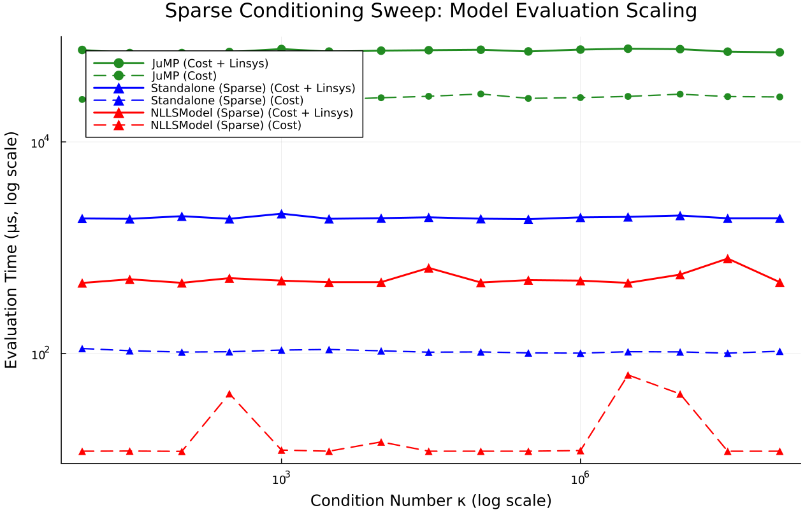
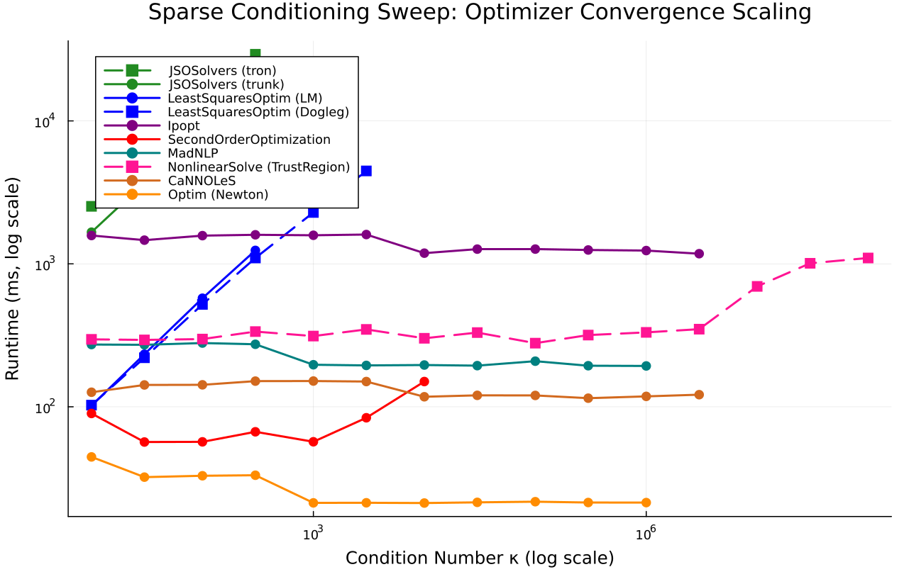
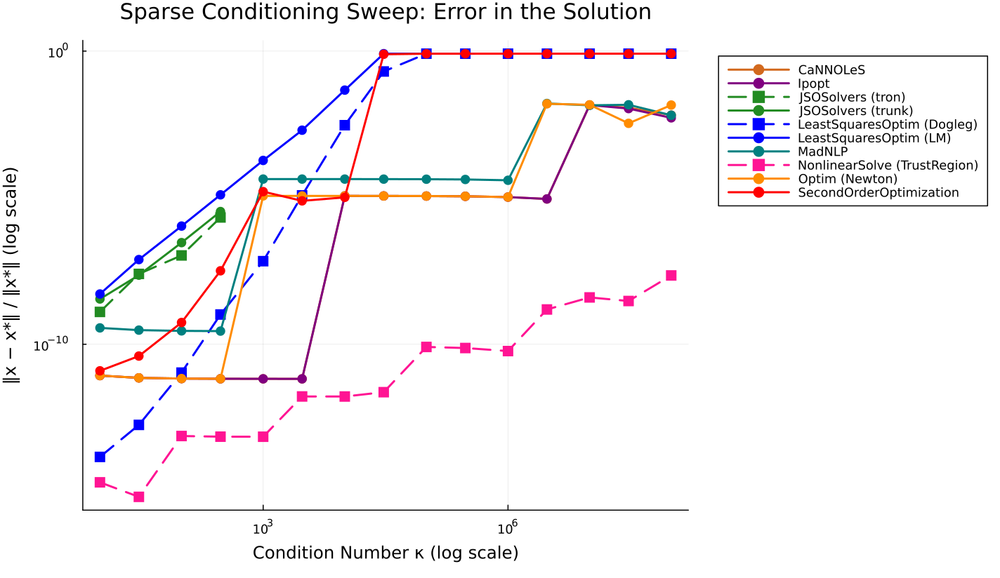
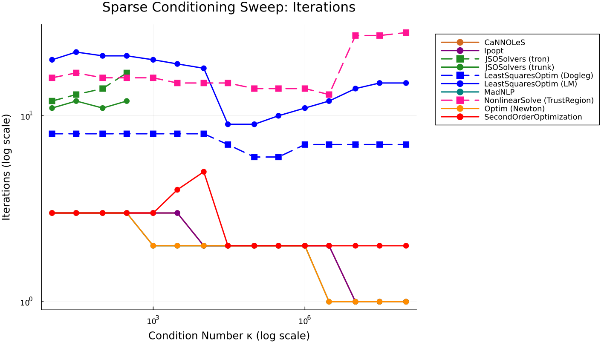
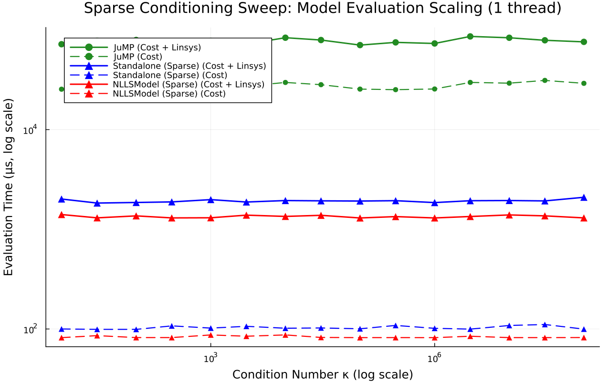
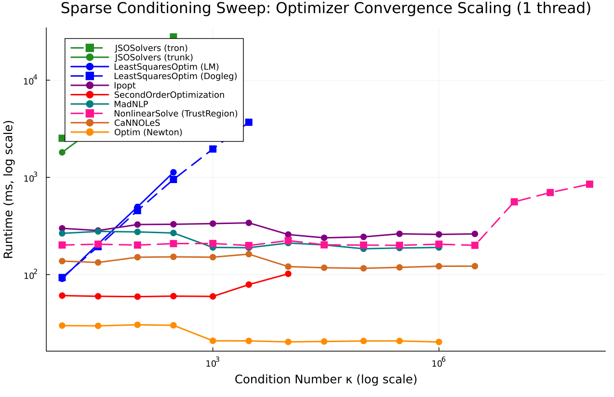
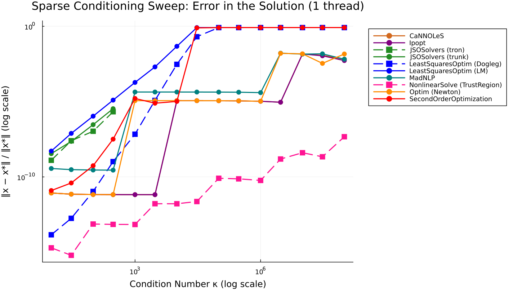
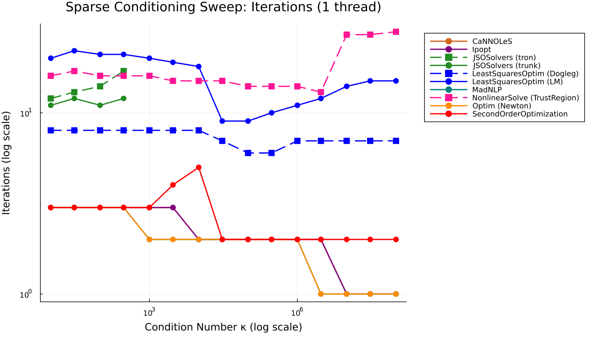

# Sparse Conditioning Sweep

- **Category**: `large_sparse`
- **Scaling Metric**: Condition Number κ
- **Problem Sizes Evaluated**: 10.0, 30.0, 100.0, 300.0, 1000.0, 3000.0, 10000.0, 30000.0, 100000.0, 300000.0, 1.0e6, 3.0e6, 1.0e7, 3.0e7, 1.0e8 (15 sizes)
- **Standard Baseline Model for Optimizers**: `Standalone (Sparse)`
- **Derivatives**: autodiff

**Derivatives: automatic.** Every cost of this problem depends on at most 8 scalar inputs, so each cost's Jacobian is computed by forward-mode automatic differentiation, with NLLSModel's `computeresjac`. The `Standalone` model fills its residual vector and Jacobian by calling that same function for each cost in a plain single-threaded loop, so the NLLSModel and Standalone models evaluate a cost with the same code; what differs between their rows is how the linear system is assembled and how the optimizer uses it. The mode applies to the NLLSModel and Standalone models. The `JuMP` model, the native model of JSOSolvers, Ipopt, MadNLP and CaNNOLeS, is differentiated by JuMP's own automatic differentiation, exactly and with exact second derivatives, whatever the problem's mode: a native model's derivatives are part of the package under test.

---

## The Problem

This problem has one size, and what it sweeps is the condition number ``\kappa`` of the Jacobian, from 10 to ``10^8``, so that the effect of ill-conditioning on a large sparse problem is seen alone. ``\kappa`` is imposed through the spectrum: a diffusion term whose weight grows with ``\kappa``, so that no rescaling of the unknowns removes it. The measure to read is each row's error in the solution, plotted below beside its iterations: the residuals are zero at the solution, so an error ``e`` along the weakest direction adds only about ``(e/\kappa)^2/2`` to the cost, and a row can stop with a cost below the status test's floor while its solution is far from the true one. The final cost is still in the data file.

With ``N = 32768`` unknowns and as many residuals,

```math
f(\mathbf{u}) = \tfrac12 \sum_{i=1}^{N} \Bigl(s\,\bigl[\alpha\,(-u_{i-1} + 2u_i - u_{i+1}) + u_i + 0.1 \sin u_i - f_i\bigr]\Bigr)^2, \qquad u_0 = u_{N+1} = 0 .
```

The Jacobian is ``s\,\bigl(\alpha\,\mathbf{L} + \operatorname{diag}(1 + 0.1\cos u_i)\bigr)``, symmetric and tridiagonal, with ``\mathbf{L}`` the second-difference matrix, whose eigenvalues lie between ``\lambda_1 = 4\sin^2\bigl(\pi/(2(N+1))\bigr)`` and 4. The weight is ``\alpha = (0.9\kappa - 1.1)/(4 - \kappa\lambda_1)`` and the scale ``s = 1/(4\alpha + 1.1)``, so that the Jacobian's eigenvalues lie between ``1/\kappa`` and 1 and its condition number is between ``\kappa/1.25`` and ``\kappa``. The scale keeps the largest singular value at 1, so that the residuals' size does not change along the sweep. The data ``f_i`` are computed from the stated solution ``u^\star_i = \sin\bigl(3\pi i/(N+1)\bigr) + 0.5\,(-1)^i``: its smooth part lies in the Jacobian's weakest directions and its alternating part in the strongest. The optimizers start from ``\mathbf{u} = \mathbf{0}``. The error in the solution is ``\lVert \mathbf{u} - \mathbf{u}^\star \rVert / \lVert \mathbf{u}^\star \rVert``.

### Where it is used

Discretized diffusion problems in which diffusion dominates the local terms: steady heat conduction and reaction–diffusion with a weak reaction, smoothing and regularization with a strong smoothness weight, and the large sparse systems of implicit time stepping. In each, the smooth components of the solution are the ones the data determine least.

### Similar problems

The [ODE boundary value problem](ode_bvp.md) has the same tridiagonal structure and sizes, with its conditioning held fixed while the size grows; this problem holds the size fixed and sweeps the condition number. The [dense conditioning sweep](conditioning_dense.md) does the same on a dense problem of 100 unknowns.

### How it scales

The size is fixed: the counts are the same at every ``\kappa``. The work per iteration of a sparse direct solver does not change with ``\kappa``; the number of iterations, and how accurately a solver can resolve the smooth part of the solution, may.

| | In terms of the size | Smallest | Largest |
|:---|:---|---:|---:|
| Size | ``\kappa`` | 10.0 | 1.0e8 |
| Variables | ``N = 32768``, each a scalar | 32768 | 32768 |
| Unknowns in total | ``N`` | 32768 | 32768 |
| Costs | ``N``, each one residual: ``N - 2`` depend on three variables, the 2 at the ends on two | 32768 | 32768 |
| Residuals in total | ``N`` | 32768 | 32768 |
| Jacobian | ``N \times N``, tridiagonal, ``3N - 2`` non-zeros | 98302 non-zeros | 98302 non-zeros |
| Hessian ``\mathbf{J}^T \mathbf{J}`` | ``N \times N``, pentadiagonal, ``5N - 6`` non-zeros | 163834 non-zeros | 163834 non-zeros |

---

## Which model each row runs on, and how it stops

Each row runs on its package's native model, or on the `Standalone` model if its package has none here (see the overview). The criteria are the benchmark's gradient, step and relative cost-change tolerances, as far as the package offers them; the overview's table says what each is called in each package.

| Row | Model | Stopping criteria given |
|:---|:---|:---|
| `CaNNOLeS` | `JuMP` | gradient |
| `Ipopt` | `JuMP` | gradient, step |
| `JSOSolvers (tron)` | `JuMP` | gradient |
| `JSOSolvers (trunk)` | `JuMP` | gradient |
| `LeastSquaresOptim (Dogleg)` | `Standalone (Sparse)` | gradient, step, relative cost change |
| `LeastSquaresOptim (LM)` | `Standalone (Sparse)` | gradient, step, relative cost change |
| `MadNLP` | `JuMP` | gradient |
| `NonlinearSolve (LM)` | `Standalone (Sparse)` | its own defaults |
| `NonlinearSolve (TrustRegion)` | `Standalone (Sparse)` | its own defaults |
| `Optim (Newton)` | `Standalone (Sparse)` | gradient, step, relative cost change |
| `Optim (NewtonTrustRegion)` | `Standalone (Sparse)` | gradient, step, relative cost change |
| `SecondOrderOptimization` | `NLLSModel (Sparse)` | gradient, step, relative cost change |

The `SecondOrderOptimization` row runs `iterator = :levenbergmarquardt`, `linsolver = :qr`, `formulation = :jacobian`, `reduction = :none`, `storage = :sparse`: the configuration NLLSModel's `recommendoptimizer` chose for this problem at the last value of its sweep, Condition Number κ = 1.0e8, with one thread (then fixed in the problem's code, the same at every value of the sweep).

---


## 1. Model Evaluation Scaling

The plot below shows the log-log scaling of **Pure Cost Evaluation** (dashed/dotted lines) and **Cost + Linear System Assembly** (solid/dash-dot lines) across problem sizes.



---

## 2. Optimizer Evaluation Scaling

The plot below shows the log-log scaling of **Optimizer Runtime to Convergence** across all tested solvers, each on the model given in the table above (its package's native model, or the `Standalone` model). Only `ok` rows are plotted.



### Error in the solution and iterations

The first plot shows each row's relative error in the solution, ``\lVert \mathbf{x} - \mathbf{x}^\star \rVert / \lVert \mathbf{x}^\star \rVert``, at the point it stopped, against Condition Number κ (an error below 1e-16 is drawn at 1e-16), and the second its iteration count. A row that is not `ok` at a value is missing there.





---

## 3. Single-Threaded Results

The same benchmark with NLLSModel and BLAS on one thread (`set_benchmark_threads!(numthreads = 1, blas_threads = 1)`),
stored separately from the multi-threaded table. Comparing the two shows what threading gains or costs at each size.





### Error in the solution and iterations, 1 thread

The first plot shows each row's relative error in the solution, ``\lVert \mathbf{x} - \mathbf{x}^\star \rVert / \lVert \mathbf{x}^\star \rVert``, at the point it stopped, against Condition Number κ (an error below 1e-16 is drawn at 1e-16), and the second its iteration count. A row that is not `ok` at a value is missing there.





- [View Single-Threaded Raw Benchmark Results Data (Markdown Table)](../data/single_threaded/conditioning_sparse.md)

---

## 4. Raw Data

The full numeric benchmark measurements (cost, linear system assembly times, outer iterations, memory, and convergence status across all sizes) are persisted in the streaming Markdown data file:

- [View Full Raw Benchmark Results Data (Markdown Table)](../data/conditioning_sparse.md)

---

## 5. Analysis & Key Takeaways

- **Model Efficiency**: At Condition Number κ = `1.0e8`, **`NLLSModel (Sparse)`** achieves the fastest Cost + Linear System evaluation at **471.88 μs** (64 B allocated).
- **Top Converged Optimizer**: At Condition Number κ = `1.0e8` (1/12 solvers converged), **`NonlinearSolve (TrustRegion)`** is fastest at **1.10 s** (28 iterations, final cost `2.38e-27`).
- **Convergence Filtering**: Only runs satisfying universal convergence tolerances (`gtol = 1.0e-8`, `xtol = 1.0e-8`, `ftol = 1.0e-8`) within `500` iterations and `30.0s` are plotted.
