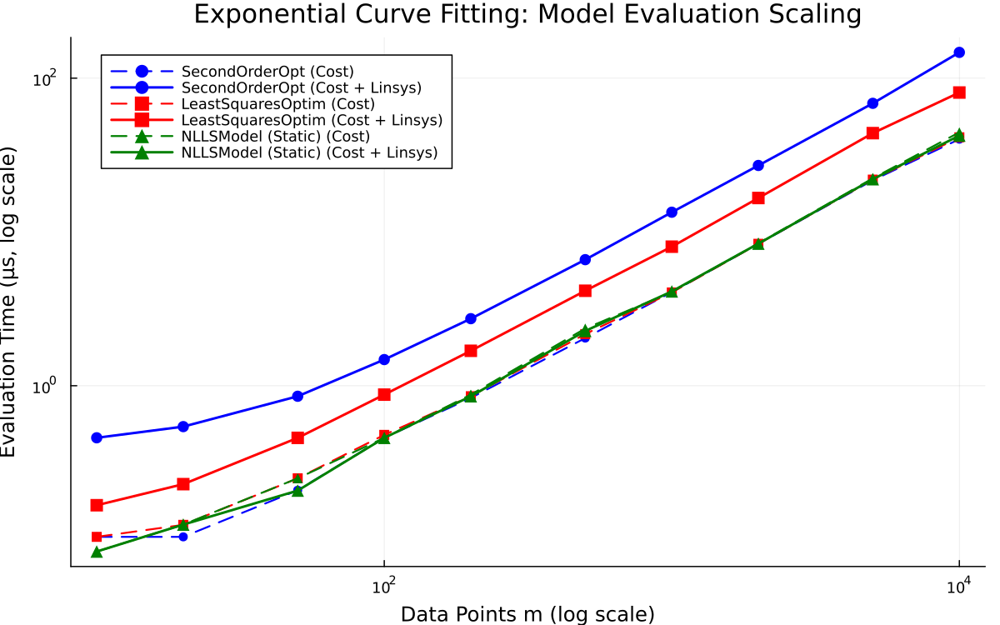
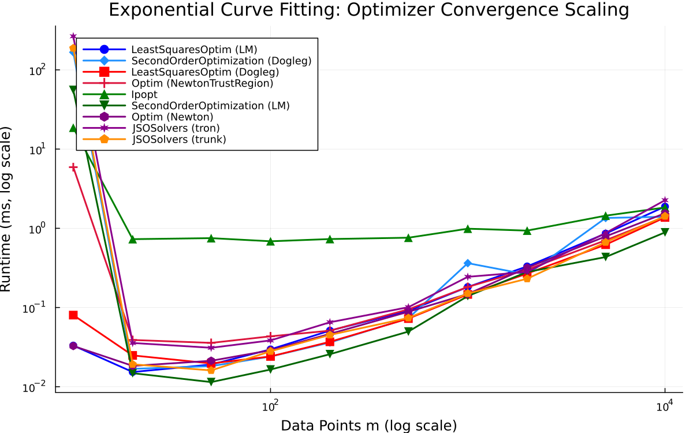

# Exponential Curve Fitting

- **Category**: `small_dense`
- **Scaling Metric**: Data Points m
- **Problem Sizes Evaluated**: 10, 20, 50, 100, 200, 500, 1000, 2000, 5000, 10000 (10 sizes)

---

## 1. Model Evaluation Scaling

The plot below shows the log-log scaling of **Pure Cost Evaluation** (dashed lines) and **Cost + Linear System Assembly** (solid lines) across problem sizes.

### Model Evaluation Timings

| Data Points m | Model | Cost Time | Cost Allocs | Linsys Time | Linsys Allocs | Linsys Memory |
|:---|:---|:---|:---|:---|:---|:---|
| 10 | SecondOrderOpt | 104.0 ns | 0 | 458.5 ns | 0 | 0 B |
| 10 | LeastSquaresOptim | 104.0 ns | 0 | 167.0 ns | 0 | 0 B |
| 10 | NLLSModel (Static) ★ | 83.5 ns | 0 | 83.5 ns | 0 | 0 B |
| 20 | SecondOrderOpt | 104.0 ns | 0 | 542.0 ns | 0 | 0 B |
| 20 | LeastSquaresOptim | 124.5 ns | 0 | 229.0 ns | 0 | 0 B |
| 20 | NLLSModel (Static) ★ | 125.0 ns | 0 | 125.0 ns | 0 | 0 B |
| 50 | SecondOrderOpt | 209.0 ns | 0 | 854.0 ns | 0 | 0 B |
| 50 | LeastSquaresOptim | 250.0 ns | 0 | 458.0 ns | 0 | 0 B |
| 50 | NLLSModel (Static) ★ | 250.0 ns | 0 | 208.0 ns | 0 | 0 B |
| 100 | SecondOrderOpt | 458.5 ns | 0 | 1.48 μs | 0 | 0 B |
| 100 | LeastSquaresOptim | 479.0 ns | 0 | 875.0 ns | 0 | 0 B |
| 100 | NLLSModel (Static) ★ | 458.0 ns | 0 | 458.0 ns | 0 | 0 B |
| 200 | SecondOrderOpt | 833.5 ns | 0 | 2.73 μs | 0 | 0 B |
| 200 | LeastSquaresOptim | 854.5 ns | 0 | 1.69 μs | 0 | 0 B |
| 200 | NLLSModel (Static) ★ | 875.0 ns | 0 | 854.0 ns | 0 | 0 B |
| 500 | SecondOrderOpt | 2.04 μs | 0 | 6.60 μs | 0 | 0 B |
| 500 | LeastSquaresOptim | 2.17 μs | 0 | 4.15 μs | 0 | 0 B |
| 500 | NLLSModel (Static) ★ | 2.35 μs | 0 | 2.27 μs | 0 | 0 B |
| 1000 | SecondOrderOpt | 4.06 μs | 0 | 13.44 μs | 0 | 0 B |
| 1000 | LeastSquaresOptim | 4.04 μs | 0 | 8.02 μs | 0 | 0 B |
| 1000 | NLLSModel (Static) ★ | 4.06 μs | 0 | 4.10 μs | 0 | 0 B |
| 2000 | SecondOrderOpt | 8.38 μs | 0 | 27.06 μs | 0 | 0 B |
| 2000 | LeastSquaresOptim | 8.38 μs | 0 | 16.62 μs | 0 | 0 B |
| 2000 | NLLSModel (Static) ★ | 8.44 μs | 0 | 8.40 μs | 0 | 0 B |
| 5000 | SecondOrderOpt | 21.69 μs | 0 | 68.62 μs | 0 | 0 B |
| 5000 | LeastSquaresOptim | 21.90 μs | 0 | 43.92 μs | 0 | 0 B |
| 5000 | NLLSModel (Static) ★ | 22.33 μs | 0 | 22.04 μs | 0 | 0 B |
| 10000 | SecondOrderOpt | 40.13 μs | 0 | 147.17 μs | 0 | 0 B |
| 10000 | LeastSquaresOptim | 41.27 μs | 0 | 80.67 μs | 0 | 0 B |
| 10000 | NLLSModel (Static) ★ | 44.46 μs | 0 | 42.33 μs | 0 | 0 B |

---

## 2. Optimizer Evaluation Scaling

The plot below shows the log-log scaling of **Optimizer Runtime to Convergence** across all compatible optimizer families.

### Optimizer Results Summary

| Data Points m | Optimizer | Runtime | Allocs | Memory | Iterations | Final Cost | Converged |
|:---|:---|:---|:---|:---|:---|:---|:---|
| 10 | LeastSquaresOptim (LM) | 33.10 μs | 410656 | 401.0 KiB | 8 | 5.4207e-04 | ✓ Yes |
| 10 | SecondOrderOptimization (Dogleg) | 167.00 ms | 5264 | 5.1 KiB | 7 | 5.4207e-04 | ✓ Yes |
| 10 | LeastSquaresOptim (Dogleg) | 80.21 μs | 257968 | 251.9 KiB | 5 | 5.4207e-04 | ✓ Yes |
| 10 | Ipopt | 18.63 ms | 15456 | 15.1 KiB | 6 | 5.4207e-04 | ✓ Yes |
| 10 | Optim (NewtonTrustRegion) | 5.91 ms | 19088 | 18.6 KiB | 5 | 5.4207e-04 | ✓ Yes |
| 10 | JSOSolvers (tron) | 265.52 ms | 9904 | 9.7 KiB | 5 | 5.4207e-04 | ✓ Yes |
| 10 | Optim (Newton) | 32.69 μs | 10000 | 9.8 KiB | 6 | 5.4207e-04 | ✓ Yes |
| 10 | SecondOrderOptimization (LM) | 55.78 ms | 4720 | 4.6 KiB | 6 | 5.4207e-04 | ✓ Yes |
| 10 | JSOSolvers (trunk) | 187.93 ms | 6352 | 6.2 KiB | 6 | 5.4207e-04 | ✓ Yes |
| 20 | LeastSquaresOptim (LM) | 15.33 μs | 360800 | 352.3 KiB | 7 | 2.3411e-03 | ✓ Yes |
| 20 | SecondOrderOptimization (Dogleg) | 16.81 μs | 6128 | 6.0 KiB | 7 | 2.3411e-03 | ✓ Yes |
| 20 | LeastSquaresOptim (Dogleg) | 24.85 μs | 310000 | 302.7 KiB | 6 | 2.3411e-03 | ✓ Yes |
| 20 | Ipopt | 729.29 μs | 15888 | 15.5 KiB | 6 | 2.3411e-03 | ✓ Yes |
| 20 | Optim (NewtonTrustRegion) | 38.92 μs | 19952 | 19.5 KiB | 5 | 2.3411e-03 | ✓ Yes |
| 20 | JSOSolvers (tron) | 35.67 μs | 10336 | 10.1 KiB | 6 | 2.3411e-03 | ✓ Yes |
| 20 | Optim (Newton) | 18.33 μs | 10864 | 10.6 KiB | 6 | 2.3411e-03 | ✓ Yes |
| 20 | SecondOrderOptimization (LM) | 14.81 μs | 7168 | 7.0 KiB | 7 | 2.3411e-03 | ✓ Yes |
| 20 | JSOSolvers (trunk) | 19.19 μs | 6784 | 6.6 KiB | 6 | 2.3411e-03 | ✓ Yes |
| 50 | LeastSquaresOptim (LM) | 19.06 μs | 364064 | 355.5 KiB | 7 | 9.8611e-03 | ✓ Yes |
| 50 | SecondOrderOptimization (Dogleg) | 18.19 μs | 8560 | 8.4 KiB | 7 | 9.8611e-03 | ✓ Yes |
| 50 | LeastSquaresOptim (Dogleg) | 19.67 μs | 262272 | 256.1 KiB | 5 | 9.8611e-03 | ✓ Yes |
| 50 | Ipopt | 751.25 μs | 17104 | 16.7 KiB | 6 | 9.8611e-03 | ✓ Yes |
| 50 | Optim (NewtonTrustRegion) | 35.75 μs | 22384 | 21.9 KiB | 5 | 9.8611e-03 | ✓ Yes |
| 50 | JSOSolvers (tron) | 31.02 μs | 11552 | 11.3 KiB | 5 | 9.8611e-03 | ✓ Yes |
| 50 | Optim (Newton) | 21.25 μs | 13296 | 13.0 KiB | 6 | 9.8611e-03 | ✓ Yes |
| 50 | SecondOrderOptimization (LM) | 11.44 μs | 8016 | 7.8 KiB | 6 | 9.8611e-03 | ✓ Yes |
| 50 | JSOSolvers (trunk) | 16.06 μs | 8000 | 7.8 KiB | 4 | 9.8611e-03 | ✓ Yes |
| 100 | LeastSquaresOptim (LM) | 29.62 μs | 420704 | 410.8 KiB | 8 | 2.0894e-02 | ✓ Yes |
| 100 | SecondOrderOptimization (Dogleg) | 24.06 μs | 13040 | 12.7 KiB | 7 | 2.0894e-02 | ✓ Yes |
| 100 | LeastSquaresOptim (Dogleg) | 24.10 μs | 268096 | 261.8 KiB | 5 | 2.0894e-02 | ✓ Yes |
| 100 | Ipopt | 685.81 μs | 19344 | 18.9 KiB | 6 | 2.0894e-02 | ✓ Yes |
| 100 | Optim (NewtonTrustRegion) | 43.29 μs | 26864 | 26.2 KiB | 5 | 2.0894e-02 | ✓ Yes |
| 100 | JSOSolvers (tron) | 38.42 μs | 13792 | 13.5 KiB | 5 | 2.0894e-02 | ✓ Yes |
| 100 | Optim (Newton) | 28.88 μs | 17776 | 17.4 KiB | 6 | 2.0894e-02 | ✓ Yes |
| 100 | SecondOrderOptimization (LM) | 16.48 μs | 12496 | 12.2 KiB | 6 | 2.0894e-02 | ✓ Yes |
| 100 | JSOSolvers (trunk) | 28.02 μs | 10240 | 10.0 KiB | 6 | 2.0894e-02 | ✓ Yes |
| 200 | LeastSquaresOptim (LM) | 51.12 μs | 431152 | 421.0 KiB | 8 | 4.1164e-02 | ✓ Yes |
| 200 | SecondOrderOptimization (Dogleg) | 36.17 μs | 21104 | 20.6 KiB | 7 | 4.1164e-02 | ✓ Yes |
| 200 | LeastSquaresOptim (Dogleg) | 36.90 μs | 278368 | 271.8 KiB | 5 | 4.1164e-02 | ✓ Yes |
| 200 | Ipopt | 731.65 μs | 23376 | 22.8 KiB | 6 | 4.1164e-02 | ✓ Yes |
| 200 | Optim (NewtonTrustRegion) | 51.00 μs | 32960 | 32.2 KiB | 4 | 4.1164e-02 | ✓ Yes |
| 200 | JSOSolvers (tron) | 65.10 μs | 17824 | 17.4 KiB | 6 | 4.1164e-02 | ✓ Yes |
| 200 | Optim (Newton) | 46.50 μs | 25840 | 25.2 KiB | 6 | 4.1164e-02 | ✓ Yes |
| 200 | SecondOrderOptimization (LM) | 25.73 μs | 20560 | 20.1 KiB | 6 | 4.1164e-02 | ✓ Yes |
| 200 | JSOSolvers (trunk) | 45.08 μs | 14272 | 13.9 KiB | 6 | 4.1164e-02 | ✓ Yes |
| 500 | LeastSquaresOptim (LM) | 90.75 μs | 411856 | 402.2 KiB | 7 | 1.0475e-01 | ✓ Yes |
| 500 | SecondOrderOptimization (Dogleg) | 73.25 μs | 45424 | 44.4 KiB | 7 | 1.0475e-01 | ✓ Yes |
| 500 | LeastSquaresOptim (Dogleg) | 72.48 μs | 310176 | 302.9 KiB | 5 | 1.0475e-01 | ✓ Yes |
| 500 | Ipopt | 760.69 μs | 35536 | 34.7 KiB | 6 | 1.0475e-01 | ✓ Yes |
| 500 | Optim (NewtonTrustRegion) | 94.81 μs | 59248 | 57.9 KiB | 5 | 1.0475e-01 | ✓ Yes |
| 500 | JSOSolvers (tron) | 100.96 μs | 29984 | 29.3 KiB | 5 | 1.0475e-01 | ✓ Yes |
| 500 | Optim (Newton) | 88.35 μs | 50160 | 49.0 KiB | 6 | 1.0475e-01 | ✓ Yes |
| 500 | SecondOrderOptimization (LM) | 49.69 μs | 44880 | 43.8 KiB | 6 | 1.0475e-01 | ✓ Yes |
| 500 | JSOSolvers (trunk) | 73.85 μs | 26432 | 25.8 KiB | 5 | 1.0475e-01 | ✓ Yes |
| 1000 | LeastSquaresOptim (LM) | 181.75 μs | 465104 | 454.2 KiB | 7 | 2.0242e-01 | ✓ Yes |
| 1000 | SecondOrderOptimization (Dogleg) | 362.96 μs | 87104 | 85.1 KiB | 7 | 2.0242e-01 | ✓ Yes |
| 1000 | LeastSquaresOptim (Dogleg) | 146.25 μs | 363424 | 354.9 KiB | 5 | 2.0242e-01 | ✓ Yes |
| 1000 | Ipopt | 988.60 μs | 54768 | 53.5 KiB | 5 | 2.0242e-01 | ✓ Yes |
| 1000 | Optim (NewtonTrustRegion) | 181.92 μs | 100208 | 97.9 KiB | 5 | 2.0242e-01 | ✓ Yes |
| 1000 | JSOSolvers (tron) | 244.04 μs | 50464 | 49.3 KiB | 6 | 2.0242e-01 | ✓ Yes |
| 1000 | Optim (Newton) | 148.19 μs | 90624 | 88.5 KiB | 5 | 2.0242e-01 | ✓ Yes |
| 1000 | SecondOrderOptimization (LM) | 139.46 μs | 86704 | 84.7 KiB | 6 | 2.0242e-01 | ✓ Yes |
| 1000 | JSOSolvers (trunk) | 150.35 μs | 46912 | 45.8 KiB | 5 | 2.0242e-01 | ✓ Yes |
| 2000 | LeastSquaresOptim (LM) | 330.46 μs | 571600 | 558.2 KiB | 7 | 4.0190e-01 | ✓ Yes |
| 2000 | SecondOrderOptimization (Dogleg) | 261.02 μs | 168304 | 164.4 KiB | 7 | 4.0190e-01 | ✓ Yes |
| 2000 | LeastSquaresOptim (Dogleg) | 268.54 μs | 469920 | 458.9 KiB | 5 | 4.0190e-01 | ✓ Yes |
| 2000 | Ipopt | 934.92 μs | 95728 | 93.5 KiB | 5 | 4.0190e-01 | ✓ Yes |
| 2000 | Optim (NewtonTrustRegion) | 301.15 μs | 182128 | 177.9 KiB | 5 | 4.0190e-01 | ✓ Yes |
| 2000 | JSOSolvers (tron) | 281.38 μs | 91424 | 89.3 KiB | 4 | 4.0190e-01 | ✓ Yes |
| 2000 | Optim (Newton) | 318.08 μs | 173040 | 169.0 KiB | 6 | 4.0190e-01 | ✓ Yes |
| 2000 | SecondOrderOptimization (LM) | 280.94 μs | 169200 | 165.2 KiB | 6 | 4.0190e-01 | ✓ Yes |
| 2000 | JSOSolvers (trunk) | 230.92 μs | 87872 | 85.8 KiB | 4 | 4.0190e-01 | ✓ Yes |
| 5000 | LeastSquaresOptim (LM) | 858.56 μs | 964816 | 942.2 KiB | 7 | 9.9892e-01 | ✓ Yes |
| 5000 | SecondOrderOptimization (Dogleg) | 1.35 ms | 463216 | 452.4 KiB | 7 | 9.9892e-01 | ✓ Yes |
| 5000 | LeastSquaresOptim (Dogleg) | 621.52 μs | 863136 | 842.9 KiB | 5 | 9.9892e-01 | ✓ Yes |
| 5000 | Ipopt | 1.44 ms | 244432 | 238.7 KiB | 6 | 9.9892e-01 | ✓ Yes |
| 5000 | Optim (NewtonTrustRegion) | 706.44 μs | 477040 | 465.9 KiB | 5 | 9.9892e-01 | ✓ Yes |
| 5000 | JSOSolvers (tron) | 872.75 μs | 238880 | 233.3 KiB | 5 | 9.9892e-01 | ✓ Yes |
| 5000 | Optim (Newton) | 789.81 μs | 467952 | 457.0 KiB | 6 | 9.9892e-01 | ✓ Yes |
| 5000 | SecondOrderOptimization (LM) | 433.62 μs | 462672 | 451.8 KiB | 6 | 9.9892e-01 | ✓ Yes |
| 5000 | JSOSolvers (trunk) | 666.54 μs | 235328 | 229.8 KiB | 5 | 9.9892e-01 | ✓ Yes |
| 10000 | LeastSquaresOptim (LM) | 1.88 ms | 1423568 | 1.4 MiB | 7 | 1.9860e+00 | ✓ Yes |
| 10000 | SecondOrderOptimization (Dogleg) | 1.40 ms | 823664 | 804.4 KiB | 7 | 1.9860e+00 | ✓ Yes |
| 10000 | LeastSquaresOptim (Dogleg) | 1.37 ms | 1321888 | 1.3 MiB | 5 | 1.9860e+00 | ✓ Yes |
| 10000 | Ipopt | 1.83 ms | 423408 | 413.5 KiB | 5 | 1.9860e+00 | ✓ Yes |
| 10000 | Optim (NewtonTrustRegion) | 1.40 ms | 837488 | 817.9 KiB | 5 | 1.9860e+00 | ✓ Yes |
| 10000 | JSOSolvers (tron) | 2.26 ms | 419104 | 409.3 KiB | 6 | 1.9860e+00 | ✓ Yes |
| 10000 | Optim (Newton) | 1.55 ms | 828400 | 809.0 KiB | 6 | 1.9860e+00 | ✓ Yes |
| 10000 | SecondOrderOptimization (LM) | 887.96 μs | 823120 | 803.8 KiB | 6 | 1.9860e+00 | ✓ Yes |
| 10000 | JSOSolvers (trunk) | 1.43 ms | 415552 | 405.8 KiB | 5 | 1.9860e+00 | ✓ Yes |

---

## 3. Analysis & Key Takeaways

- **Asymptotic Complexity**: Log-log scaling indicates the empirical runtime growth rate as Data Points m expands.
- **Fastest Model**: The fastest linear system assembly was consistently achieved by `NLLSModel (Static)`.
- **Top Optimizer**: Solvers leveraging specialized structure (e.g. sparse block factorization in SecondOrderOptimization) demonstrate superior scaling exponents on large problem regimes.
