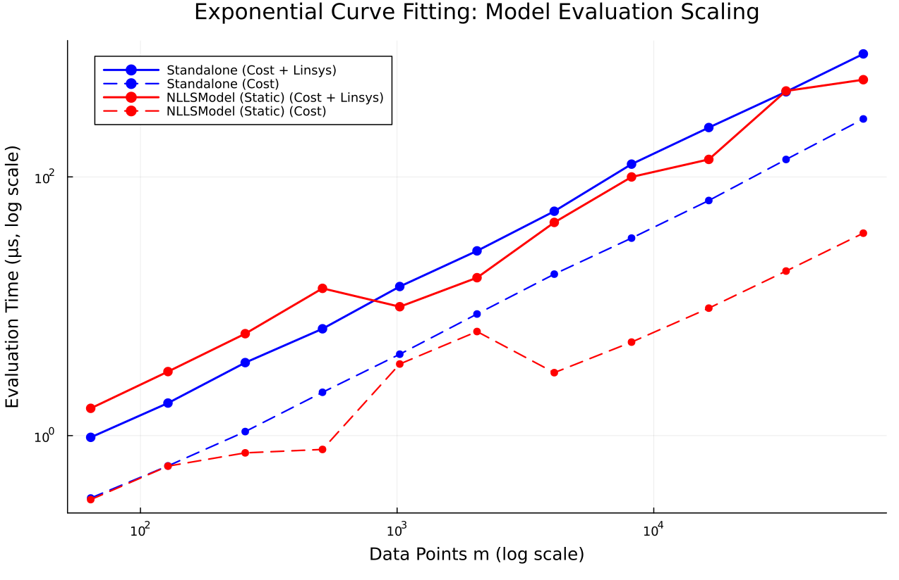
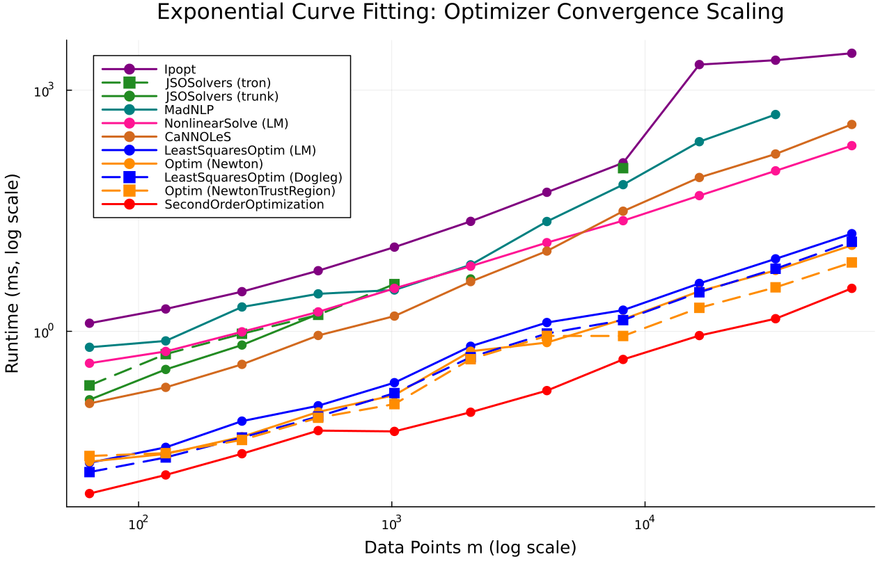
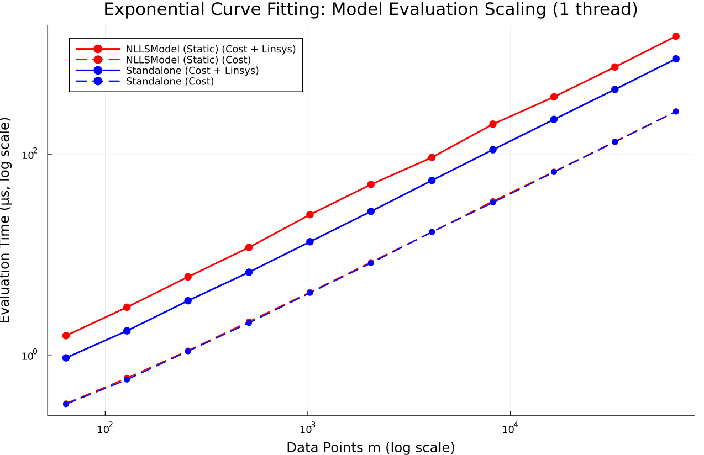

# Exponential Curve Fitting

- **Category**: `medium_dense`
- **Scaling Metric**: Data Points m
- **Problem Sizes Evaluated**: 64, 128, 256, 512, 1024, 2048, 4096, 8192, 16384, 32768, 65536 (11 sizes)
- **Standard Baseline Model for Optimizers**: `Standalone`
- **Derivatives**: autodiff

**Derivatives: automatic.** Every cost of this problem depends on at most 8 scalar inputs, so each cost's Jacobian is computed by forward-mode automatic differentiation, with NLLSModel's `computeresjac`. The `Standalone` model fills its residual vector and Jacobian by calling that same function for each cost in a plain single-threaded loop, so every model evaluates a cost with the same code; what differs between rows is how the linear system is assembled and how the optimizer uses it.

---

## The Problem

Given ``m`` noisy measurements ``y_i`` taken at times ``t_i``, find the exponential decay curve that passes closest to them. The curve has three unknown numbers: its height ``a``, its decay rate ``b`` and the level ``c`` it settles to. The optimizer minimizes the sum of squared gaps between curve and data:

```math
f(a, b, c) = \tfrac12 \sum_{i=1}^{m} \bigl(a\,e^{-b t_i} + c - y_i\bigr)^2 .
```

The data are generated from ``a = 2``, ``b = 1.5``, ``c = 0.5`` at evenly spaced times in ``[0, 2]``, with Gaussian noise of standard deviation 0.02. The optimizers start from ``(1, 1, 1)``.

### Where it is used

Fitting a decay curve is everyday work in the experimental sciences: radioactive decay, the discharge of a capacitor, a cooling object, the concentration of a drug in the blood, fluorescence lifetimes. More widely, it stands for nonlinear regression: a model with a few parameters fitted to many measurements.

### Similar problems

Any fit of a handful of parameters to a large data set: calibrating a sensor against reference readings, dose–response curves, fitting a peak to a spectrum. The linear system is tiny (3 × 3) and solving it costs nothing; nearly all the time goes into evaluating the model and its derivatives at every data point and summing them. It is the opposite regime to the sparse problems of this benchmark, where the linear solve dominates.

### How it scales

The size is the number of data points, ``m``. The number of unknowns is fixed; only the amount of data grows, so the work per iteration is proportional to ``m``.

| | In terms of the size | Smallest | Largest |
|:---|:---|---:|---:|
| Size | ``m`` | 64 | 65536 |
| Variables | 1, of size 3 | 1 | 1 |
| Unknowns in total | 3 | 3 | 3 |
| Costs | ``m``, each one residual depending on the whole variable | 64 | 65536 |
| Residuals in total | ``m`` | 64 | 65536 |
| Jacobian | ``m \times 3``, dense | 64 × 3 | 65536 × 3 |
| Hessian ``\mathbf{J}^T \mathbf{J}`` | ``3 \times 3``, dense | 3 × 3 | 3 × 3 |

---

## The SecondOrderOptimization rows

- **`SecondOrderOptimization (Gauss-Newton)`** is `iterator = :newton` on the normal equations: Gauss–Newton, since the Hessian it is given is ``\mathbf{J}^T \mathbf{J}``. It takes the full step, with no line search or trust region (a diagonal shift only when the system cannot be solved), so a step that raises the cost is caught only by the stall test, and the row then ends `not_converged`. **`CaNNOLeS`** (`method = :Newton_noFHess`) is Gauss–Newton too, globalized: an ``\mathbf{L}\mathbf{D}\mathbf{L}^T`` factorization of the augmented system ``[\mu \mathbf{I}\ \ \mathbf{J}^T;\ \mathbf{J}\ \ {-\mathbf{I}}]``, with ``\mu`` raised from 0 only when the factorization fails or has the wrong inertia, then an Armijo backtracking line search on ``\tfrac12\lVert\boldsymbol{\epsilon}\rVert^2``.
- **`SecondOrderOptimization (LM, tall)`** is Levenberg–Marquardt on the residual-and-Jacobian form (`formulation = :jacobian`): each step solves the damped least-squares problem in ``\mathbf{J}`` by QR, without forming ``\mathbf{J}^T \mathbf{J}``, on the `NLLSModel` model. `storage = :auto` stores ``\mathbf{J}`` dense or sparse from its fill (sparse at the large sizes), and `linsolver = :auto` factorizes it by dense QR or SPQR. The rows without "tall" solve the normal equations in ``\mathbf{J}^T \mathbf{J}``.

---

## 1. Model Evaluation Scaling

The plot below shows the log-log scaling of **Pure Cost Evaluation** (dashed/dotted lines) and **Cost + Linear System Assembly** (solid/dash-dot lines) across problem sizes.



---

## 2. Optimizer Evaluation Scaling

The plot below shows the log-log scaling of **Optimizer Runtime to Convergence** across all tested solvers, where each solver is evaluated on its optimal problem representation (e.g. `NLLSModel` for `SecondOrderOptimization`, `LeastSquaresProblem` for `LeastSquaresOptim`, `NLPModels` for JSO/interior-point solvers, and `Manifolds` for `Manopt`). Non-converged runs are omitted.



---

## 3. Single-Threaded Results

The same benchmark with NLLSModel and BLAS on one thread (`set_benchmark_threads!(numthreads = 1, blas_threads = 1)`),
stored separately from the threaded table. Comparing the two shows what threading gains or costs at each size.




- [View Single-Threaded Raw Benchmark Results Data (Markdown Table)](../data/single_threaded/curve_fitting.md)

---

## 4. Raw Data

The full numeric benchmark measurements (cost, linear system assembly times, outer iterations, memory, and convergence status across all sizes) are persisted in the streaming Markdown data file:

- [View Full Raw Benchmark Results Data (Markdown Table)](../data/curve_fitting.md)

---

## 5. Analysis & Key Takeaways

- **Model Efficiency**: At Data Points m = `65536`, **`NLLSModel (Static)`** achieves the fastest Cost + Linear System evaluation at **586.54 μs** (32 B allocated).
- **Top Converged Optimizer**: At Data Points m = `65536` (12/15 solvers converged), **`SecondOrderOptimization (Dogleg)`** is fastest at **3.06 ms** (5 iterations, final cost `1.32e+01`).
- **Convergence Filtering**: Only runs satisfying universal convergence tolerances (`gtol = 1.0e-8`, `xtol = 1.0e-8`, `ftol = 1.0e-8`) within `500` iterations and `30.0s` are plotted.
