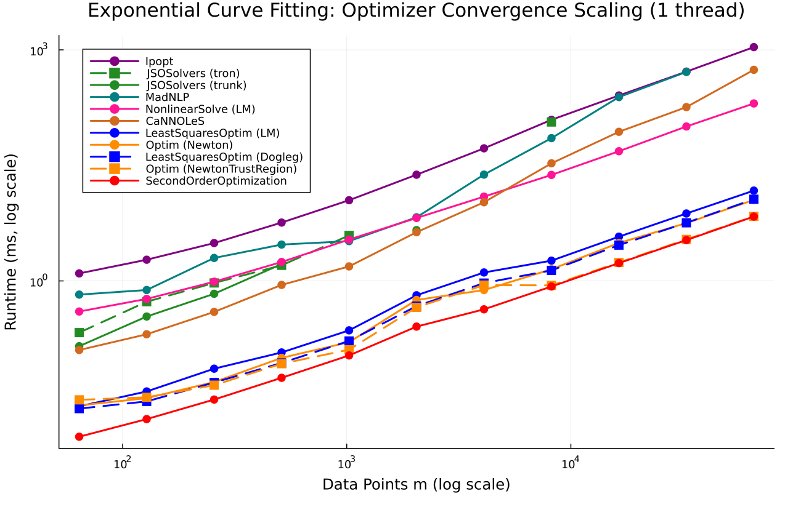

# Exponential Curve Fitting

- **Category**: `medium_dense`
- **Scaling Metric**: Data Points m
- **Problem Sizes Evaluated**: 64, 128, 256, 512, 1024, 2048, 4096, 8192, 16384, 32768, 65536 (11 sizes)
- **Standard Baseline Model for Optimizers**: `Standalone`
- **Derivatives**: autodiff

**Derivatives: automatic.** Every cost of this problem depends on at most 8 scalar inputs, so each cost's Jacobian is computed by forward-mode automatic differentiation, with NLLSModel's `computeresjac`. The `Standalone` model fills its residual vector and Jacobian by calling that same function for each cost in a plain single-threaded loop, so the NLLSModel and Standalone models evaluate a cost with the same code; what differs between their rows is how the linear system is assembled and how the optimizer uses it. The mode applies to the NLLSModel and Standalone models. The `JuMP` model, the native model of JSOSolvers, Ipopt, MadNLP and CaNNOLeS, is differentiated by JuMP's own automatic differentiation, exactly and with exact second derivatives, whatever the problem's mode: a native model's derivatives are part of the package under test.

---

## The Problem

Given ``m`` noisy measurements ``y_i`` taken at times ``t_i``, find the exponential decay curve that passes closest to them. The curve has three unknown numbers: its height ``a``, its decay rate ``b`` and the level ``c`` it settles to. The optimizer minimizes the sum of squared gaps between curve and data:

```math
f(a, b, c) = \tfrac12 \sum_{i=1}^{m} \bigl(a\,e^{-b t_i} + c - y_i\bigr)^2 .
```

The data are generated from ``a = 2``, ``b = 1.5``, ``c = 0.5`` at evenly spaced times in ``[0, 2]``, with Gaussian noise of standard deviation 0.02. The optimizers start from ``(1, 1, 1)``.

### Where it is used

Fitting a decay curve is everyday work in the experimental sciences: radioactive decay, the discharge of a capacitor, a cooling object, the concentration of a drug in the blood, fluorescence lifetimes. More widely, it stands for nonlinear regression: a model with a few parameters fitted to many measurements.

### Similar problems

Any fit of a handful of parameters to a large data set: calibrating a sensor against reference readings, dose–response curves, fitting a peak to a spectrum. The linear system is tiny (3 × 3) and solving it costs nothing; nearly all the time goes into evaluating the model and its derivatives at every data point and summing them. It is the opposite regime to the sparse problems of this benchmark, where the linear solve dominates.

### How it scales

The size is the number of data points, ``m``. The number of unknowns is fixed; only the amount of data grows, so the work per iteration is proportional to ``m``.

| | In terms of the size | Smallest | Largest |
|:---|:---|---:|---:|
| Size | ``m`` | 64 | 65536 |
| Variables | 1, of size 3 | 1 | 1 |
| Unknowns in total | 3 | 3 | 3 |
| Costs | ``m``, each one residual depending on the whole variable | 64 | 65536 |
| Residuals in total | ``m`` | 64 | 65536 |
| Jacobian | ``m \times 3``, dense | 64 × 3 | 65536 × 3 |
| Hessian ``\mathbf{J}^T \mathbf{J}`` | ``3 \times 3``, dense | 3 × 3 | 3 × 3 |

---

## Which model each row runs on, and how it stops

Each row runs on its package's native model, or on the `Standalone` model if its package has none here (see the overview). The criteria are the benchmark's gradient, step and relative cost-change tolerances, as far as the package offers them; the overview's table says what each is called in each package.

| Row | Model | Stopping criteria given |
|:---|:---|:---|
| `CaNNOLeS` | `JuMP` | gradient |
| `Ipopt` | `JuMP` | gradient, step, relative cost change |
| `JSOSolvers (tron)` | `JuMP` | gradient |
| `JSOSolvers (trunk)` | `JuMP` | gradient |
| `LeastSquaresOptim (Dogleg)` | `Standalone` | gradient, step, relative cost change |
| `LeastSquaresOptim (LM)` | `Standalone` | gradient, step, relative cost change |
| `MadNLP` | `JuMP` | gradient |
| `NonlinearSolve (LM)` | `Standalone` | its own defaults |
| `NonlinearSolve (TrustRegion)` | `Standalone` | its own defaults |
| `Optim (Newton)` | `Standalone` | gradient, step, relative cost change |
| `Optim (NewtonTrustRegion)` | `Standalone` | gradient, step, relative cost change |
| `SecondOrderOptimization` | `NLLSModel (Static)` | gradient, step, relative cost change |

The `SecondOrderOptimization` row runs `iterator = :levenbergmarquardt`, `linsolver = :cholesky`, `formulation = :hessian`, `reduction = :none`, `storage = :dense`: the configuration NLLSModel's `recommendoptimizer` chose for this problem at its largest size, Data Points m = 65536, with one thread (then fixed in the problem's code, the same at every size).

---


## 1. Model Evaluation Scaling

The plot below shows the log-log scaling of **Pure Cost Evaluation** (dashed/dotted lines) and **Cost + Linear System Assembly** (solid/dash-dot lines) across problem sizes.


---

## 2. Optimizer Evaluation Scaling

The plot below shows the log-log scaling of **Optimizer Runtime to Convergence** across all tested solvers, each on the model given in the table above (its package's native model, or the `Standalone` model). Only `ok` rows are plotted.


---

## 3. Single-Threaded Results

The same benchmark with NLLSModel and BLAS on one thread (`set_benchmark_threads!(numthreads = 1, blas_threads = 1)`),
stored separately from the multi-threaded table. Comparing the two shows what threading gains or costs at each size.




- [View Single-Threaded Raw Benchmark Results Data (Markdown Table)](../data/single_threaded/curve_fitting.md)

---

## 4. Raw Data

The full numeric benchmark measurements (cost, linear system assembly times, outer iterations, memory, and convergence status across all sizes) are persisted in the streaming Markdown data file:

- [View Full Raw Benchmark Results Data (Markdown Table)](../data/curve_fitting.md)

---

## 5. Analysis & Key Takeaways

- **Model Efficiency**: At Data Points m = `65536`, **`NLLSModel (Static)`** achieves the fastest Cost + Linear System evaluation at **521.75 μs** (32 B allocated).
- **Top Converged Optimizer**: At Data Points m = `65536` (8/12 solvers converged), **`SecondOrderOptimization`** is fastest at **2.90 ms** (5 iterations, final cost `1.32e+01`).
- **Convergence Filtering**: Only runs satisfying universal convergence tolerances (`gtol = 1.0e-8`, `xtol = 1.0e-8`, `ftol = 1.0e-8`) within `500` iterations and `30.0s` are plotted.
