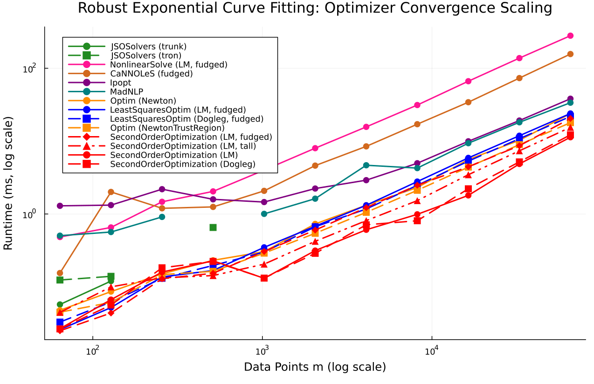

# Robust Exponential Curve Fitting

- **Category**: `medium_dense`
- **Scaling Metric**: Data Points m
- **Problem Sizes Evaluated**: 64, 128, 256, 512, 1024, 2048, 4096, 8192, 16384, 32768, 65536 (11 sizes)
- **Standard Baseline Model for Solvers**: `Standalone (fudged)`

---

## About this problem

Exponential curve fitting, ``a e^{-b t} + c - y`` with one `SVector{3}` variable, on curve fitting's data with **30 % of the points moved up by +1** (one-sided outliers, against noise of σ = 0.02), fitted with a **Huber kernel of width 0.05** (2.5σ, `Huber2oKernel`, with the second-order correction).

- **Native rows.** `SecondOrderOptimization` (Dogleg, LM, LM tall) run the `NLLSModel (Static)` model, which declares the kernel.
- **Every other row runs `Standalone (fudged)`.** That includes the general solvers, whether or not the row's name says "fudged". The residuals are rewritten as ``\tilde r = \operatorname{sign}(r)\sqrt{\rho(r^2)}``, and each row of the Jacobian is scaled by ``\rho'(r^2)\,|r| / \sqrt{\rho(r^2)}``. Then ``\tfrac12\|\tilde r\|^2`` is the robust cost exactly and ``\tilde J^T \tilde r`` its gradient.
  - LeastSquaresOptim, NonlinearSolve and CaNNOLeS have no kernel interface, and their rows are named "fudged".
  - So is the control row, `SecondOrderOptimization (LM, fudged)`: the native LM optimizer on the fudged model.
  - Optim, JSOSolvers, Ipopt and MadNLP keep their standard names. They get the exact robust cost and gradient, but their Hessian is ``\tilde J^T \tilde J``.

The weight each form gives an outlier's ``J_i^T J_i`` (``|r| > w``; inliers have weight 1 in all three), **derived from the code, not measured**:

| Form | Weight | Far from the width |
|---|---|---|
| Reweighting only (IRLS) | ``w / \lvert r\rvert`` | ``w / \lvert r\rvert`` |
| NLLSModel, Triggs with its positive-definiteness guard | ``2w / (3\lvert r\rvert)`` | ``\tfrac23 \cdot w / \lvert r\rvert`` |
| Rewritten residuals, Gauss–Newton | ``w^2 / (2w\lvert r\rvert - w^2)`` | ``\to \tfrac12 \cdot w / \lvert r\rvert`` |

---

## 1. Model Evaluation Scaling

The plot below shows the log-log scaling of **Pure Cost Evaluation** (dashed/dotted lines) and **Cost + Linear System Assembly** (solid/dash-dot lines) across problem sizes.

---

## 2. Optimizer Evaluation Scaling

The plot below shows the log-log scaling of **Optimizer Runtime to Convergence** across all tested solvers, where each solver is evaluated on its optimal problem representation (e.g. `NLLSModel` for `SecondOrderOptimization`, `LeastSquaresProblem` for `LeastSquaresOptim`, `NLPModels` for JSO/interior-point solvers, and `Manifolds` for `Manopt`). Non-converged runs are omitted.

---

## 3. Single-Threaded Results

The same benchmark with NLLSModel and BLAS on one thread (`set_benchmark_threads!(numthreads = 1, blas_threads = 1)`),
stored separately from the threaded table. Comparing the two shows what threading gains or costs at each size.

- [View Single-Threaded Raw Benchmark Results Data (Markdown Table)](../data/single_threaded/curve_fitting_robust.md)

---

## 4. Raw Data

The full numeric benchmark measurements (cost, linear system assembly times, outer iterations, memory, and convergence status across all sizes) are persisted in the streaming Markdown data file:

- [View Full Raw Benchmark Results Data (Markdown Table)](../data/curve_fitting_robust.md)

---

## 5. Analysis & Key Takeaways

- **Model Efficiency**: At Data Points m = `65536`, **`NLLSModel (Static)`** achieves the fastest Cost + Linear System evaluation at **757.12 μs** (32 B allocated).
- **Top Converged Optimizer**: At Data Points m = `65536` (12/15 solvers converged), **`SecondOrderOptimization (LM)`** is fastest at **11.32 ms** (8 iterations, final cost `9.57e+02`).
- **Convergence Filtering**: Only runs satisfying universal convergence tolerances (`gtol = 1.0e-8`, `xtol = 1.0e-8`, `ftol = 1.0e-8`) within `500` iterations and `30.0s` are plotted.
