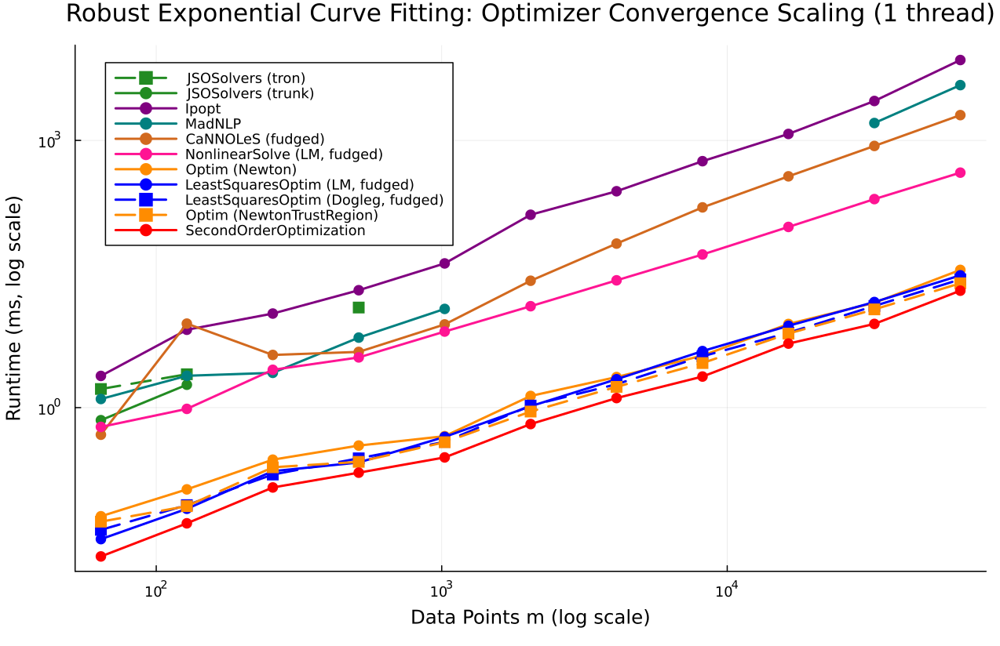

# Robust Exponential Curve Fitting

- **Category**: `medium_dense`
- **Scaling Metric**: Data Points m
- **Problem Sizes Evaluated**: 64, 128, 256, 512, 1024, 2048, 4096, 8192, 16384, 32768, 65536 (11 sizes)
- **Standard Baseline Model for Optimizers**: `Standalone (fudged)`
- **Derivatives**: autodiff

**Derivatives: automatic.** Every cost of this problem depends on at most 8 scalar inputs, so each cost's Jacobian is computed by forward-mode automatic differentiation, with NLLSModel's `computeresjac`. The `Standalone (fudged)` model, which every row but the native SecondOrderOptimization ones runs on, fills its residual vector and Jacobian by calling that same function for each cost in a plain single-threaded loop, then rewrites each residual and scales its row as described below, so every model evaluates a cost with the same code.

---

## The Problem

The same decay curve as [Exponential Curve Fitting](curve_fitting.md), ``a\,e^{-b t} + c``, fitted to the same data, except that **30 % of the measurements are wrong**: each of those has been moved up by 1, fifty times the noise level of 0.02. Ordinary least squares squares every gap, so those points would drag the curve up towards them. A *robust* fit limits their pull: a gap is squared only while it is small, and counted in proportion to its size once it is large. The optimizer minimizes

```math
f(a, b, c) = \tfrac12 \sum_{i=1}^{m} \rho\Bigl(\bigl(a\,e^{-b t_i} + c - y_i\bigr)^2\Bigr), \qquad
\rho(s) = \begin{cases} s & s \le w^2 \\ 2w\sqrt{s} - w^2 & s > w^2 \end{cases}
```

where ``\rho`` is the Huber kernel and ``w = 0.05`` its width (2.5 times the noise level). The optimizers start from ``(1, 1, 1)``; a good fit recovers values close to the true ``(2, 1.5, 0.5)`` in spite of the bad points.

### Where it is used

Wherever some of the data cannot be trusted and it is not known which: wrongly matched image features in computer vision, reflected signals in satellite positioning, glitches in a sensor log, the occasional bad reading in a laboratory series. Robust kernels are standard in 3D reconstruction, robot mapping and robust regression in statistics.

### Similar problems

In size and structure it is the plain curve fit: three unknowns, a 3 × 3 system, and time dominated by the pass over the data. What it adds is the kernel, which is the same ingredient that large problems such as bundle adjustment and pose-graph optimization use, here on a problem small enough to see its effect alone. The kernel changes how each residual is weighted, and packages differ in whether they support one at all (see "How each row gets the robust cost" below).

### How it scales

The size is the number of data points, ``m``, of which ``\operatorname{round}(0.3\,m)`` are outliers. The sizes are those of the plain curve fit, and the work per iteration is proportional to ``m``.

| | In terms of the size | Smallest | Largest |
|:---|:---|---:|---:|
| Size | ``m`` | 64 | 65536 |
| Variables | 1, of size 3 | 1 | 1 |
| Unknowns in total | 3 | 3 | 3 |
| Costs | ``m``, each one residual with a Huber kernel, depending on the whole variable | 64 | 65536 |
| Residuals in total | ``m`` | 64 | 65536 |
| Jacobian | ``m \times 3``, dense | 64 × 3 | 65536 × 3 |
| Hessian ``\mathbf{J}^T \mathbf{J}`` | ``3 \times 3``, dense | 3 × 3 | 3 × 3 |

---

## How each row gets the robust cost

- **Native rows.** `SecondOrderOptimization` (Dogleg, LM, Gauss-Newton, LM tall) run the `NLLSModel (Static)` model, which declares the kernel. The Gauss-Newton row is `iterator = :newton`, the full step with no line search or trust region; `CaNNOLeS (fudged)` is Gauss–Newton globalized by a regularized ``\mathbf{L}\mathbf{D}\mathbf{L}^T`` factorization and an Armijo line search.
- **Every other row runs `Standalone (fudged)`.** That includes the general solvers, whether or not the row's name says "fudged". Each residual ``\epsilon`` is rewritten as ``\tilde\epsilon = \operatorname{sign}(\epsilon)\sqrt{\rho(\epsilon^2)}``, and its row of the Jacobian is scaled by ``\rho'(\epsilon^2)\,|\epsilon| / \sqrt{\rho(\epsilon^2)}``. Then ``\tfrac12\lVert\tilde{\boldsymbol{\epsilon}}\rVert^2`` is the robust cost exactly and ``\tilde{\mathbf{J}}^T \tilde{\boldsymbol{\epsilon}}`` its gradient.
  - LeastSquaresOptim, NonlinearSolve and CaNNOLeS have no kernel interface, and their rows are named "fudged".
  - So is the control row, `SecondOrderOptimization (LM, fudged)`: the native LM optimizer on the fudged model.
  - Optim, JSOSolvers, Ipopt and MadNLP keep their standard names. They get the exact robust cost and gradient, but their Hessian is ``\tilde{\mathbf{J}}^T \tilde{\mathbf{J}}``.

The weight each form gives an outlier's ``\mathbf{j}_i \mathbf{j}_i^T``, with ``\mathbf{j}_i^T`` its row of the Jacobian (``|\epsilon| > w``; inliers have weight 1 in all three), **derived from the code, not measured**:

| Form | Weight | Far from the width |
|---|---|---|
| Reweighting only (IRLS) | ``w / \lvert \epsilon\rvert`` | ``w / \lvert \epsilon\rvert`` |
| NLLSModel, Triggs with its positive-definiteness guard | ``2w / (3\lvert \epsilon\rvert)`` | ``\tfrac23 \cdot w / \lvert \epsilon\rvert`` |
| Rewritten residuals, Gauss–Newton | ``w^2 / (2w\lvert \epsilon\rvert - w^2)`` | ``\to \tfrac12 \cdot w / \lvert \epsilon\rvert`` |

---

## 1. Model Evaluation Scaling

The plot below shows the log-log scaling of **Pure Cost Evaluation** (dashed/dotted lines) and **Cost + Linear System Assembly** (solid/dash-dot lines) across problem sizes.


---

## 2. Optimizer Evaluation Scaling

The plot below shows the log-log scaling of **Optimizer Runtime to Convergence** across all tested solvers, where each solver is evaluated on its optimal problem representation (e.g. `NLLSModel` for `SecondOrderOptimization`, `LeastSquaresProblem` for `LeastSquaresOptim`, `NLPModels` for JSO/interior-point solvers, and `Manifolds` for `Manopt`). Non-converged runs are omitted.


---

## 3. Single-Threaded Results

The same benchmark with NLLSModel and BLAS on one thread (`set_benchmark_threads!(numthreads = 1, blas_threads = 1)`),
stored separately from the threaded table. Comparing the two shows what threading gains or costs at each size.




- [View Single-Threaded Raw Benchmark Results Data (Markdown Table)](../data/single_threaded/curve_fitting_robust.md)

---

## 4. Raw Data

The full numeric benchmark measurements (cost, linear system assembly times, outer iterations, memory, and convergence status across all sizes) are persisted in the streaming Markdown data file:

- [View Full Raw Benchmark Results Data (Markdown Table)](../data/curve_fitting_robust.md)

---

## 5. Analysis & Key Takeaways

- **Model Efficiency**: At Data Points m = `65536`, **`NLLSModel (Static)`** achieves the fastest Cost + Linear System evaluation at **1.10 ms** (32 B allocated).
- **Top Converged Optimizer**: At Data Points m = `65536` (13/16 solvers converged), **`SecondOrderOptimization (Gauss-Newton)`** is fastest at **9.90 ms** (8 iterations, final cost `9.57e+02`).
- **Convergence Filtering**: Only runs satisfying universal convergence tolerances (`gtol = 1.0e-8`, `xtol = 1.0e-8`, `ftol = 1.0e-8`) within `500` iterations and `30.0s` are plotted.
