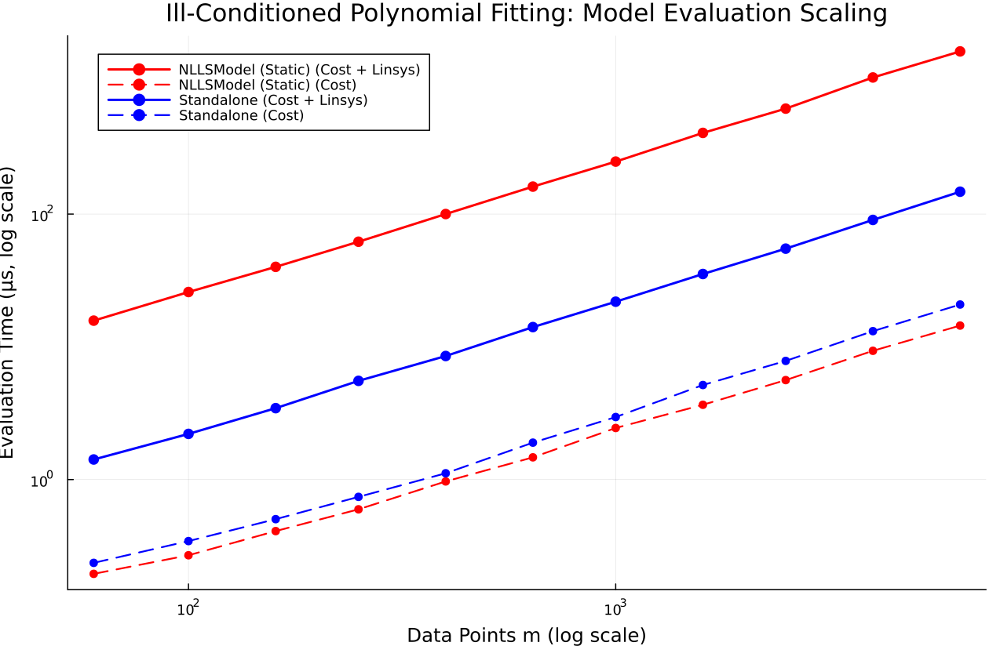
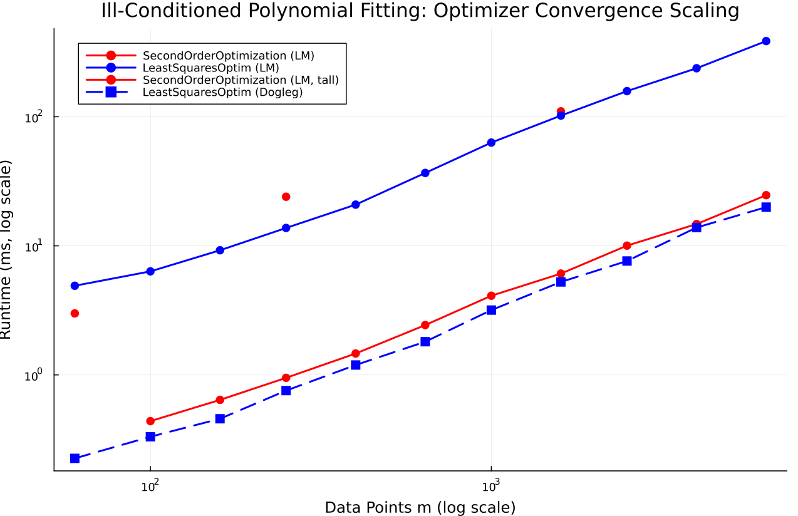

# Ill-Conditioned Polynomial Fitting

- **Category**: `medium_dense`
- **Scaling Metric**: Data Points m
- **Problem Sizes Evaluated**: 60, 100, 160, 250, 400, 640, 1000, 1600, 2500, 4000, 6400 (11 sizes)
- **Standard Baseline Model for Solvers**: `Standalone`

---

## 1. Model Evaluation Scaling

The plot below shows the log-log scaling of **Pure Cost Evaluation** (dashed/dotted lines) and **Cost + Linear System Assembly** (solid/dash-dot lines) across problem sizes.

---

## 2. Optimizer Evaluation Scaling

The plot below shows the log-log scaling of **Optimizer Runtime to Convergence** across all tested solvers, where each solver is evaluated on its optimal problem representation (e.g. `NLLSModel` for `SecondOrderOptimization`, `LeastSquaresProblem` for `LeastSquaresOptim`, `NLPModels` for JSO/interior-point solvers, and `Manifolds` for `Manopt`). Non-converged runs are omitted.

---

## 3. Raw Data

The full numeric benchmark measurements (cost, linear system assembly times, outer iterations, memory, and convergence status across all sizes) are persisted in the streaming Markdown data file:

- [View Full Raw Benchmark Results Data (Markdown Table)](../data/ill-conditioned_polynomial_fitting.md)

---

## 4. Analysis & Key Takeaways

- **Model Efficiency**: At Data Points m = `6400`, **`Standalone`** achieves the fastest Cost + Linear System evaluation at **147.42 μs** (32 B allocated).
- **Top Converged Optimizer**: At Data Points m = `6400` (3/4 solvers converged), **`LeastSquaresOptim (Dogleg)`** is fastest at **19.96 ms** (24 iterations, final cost `9.70e+01`).
- **Convergence Filtering**: Only runs satisfying universal convergence tolerances (`gtol = 1.0e-8`, `xtol = 1.0e-8`, `ftol = 1.0e-8`) within `500` iterations and `30.0s` are plotted.
