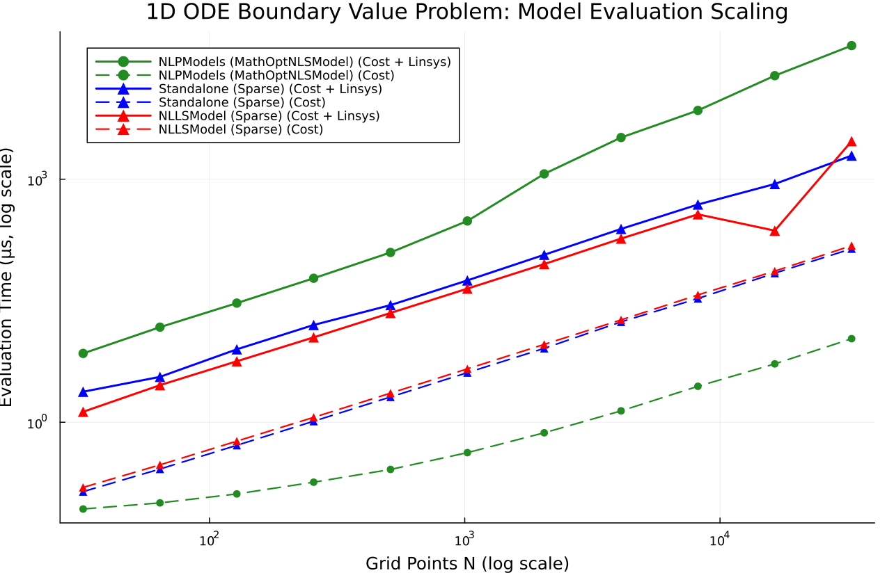
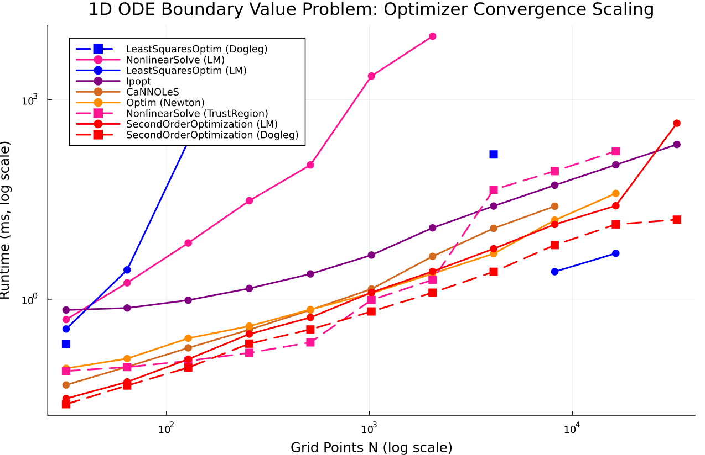

# 1D ODE Boundary Value Problem

- **Category**: `large_sparse`
- **Scaling Metric**: Grid Points N
- **Problem Sizes Evaluated**: 32, 64, 128, 256, 512, 1024, 2048, 4096, 8192, 16384, 32768 (11 sizes)
- **Standard Baseline Model for Solvers**: `Standalone (Sparse)`

---

## 1. Model Evaluation Scaling

The plot below shows the log-log scaling of **Pure Cost Evaluation** (dashed/dotted lines) and **Cost + Linear System Assembly** (solid/dash-dot lines) across problem sizes.

---

## 2. Optimizer Evaluation Scaling

The plot below shows the log-log scaling of **Optimizer Runtime to Convergence** across all tested solvers, where each solver is evaluated on its optimal problem representation (e.g. `NLLSModel` for `SecondOrderOptimization`, `LeastSquaresProblem` for `LeastSquaresOptim`, `NLPModels` for JSO/interior-point solvers, and `Manifolds` for `Manopt`). Non-converged runs are omitted.

---

## 3. Raw Data

The full numeric benchmark measurements (cost, linear system assembly times, outer iterations, memory, and convergence status across all sizes) are persisted in the streaming Markdown data file:

- [View Full Raw Benchmark Results Data (Markdown Table)](../data/ode_bvp.md)

---

## 4. Analysis & Key Takeaways

- **Model Efficiency**: At Grid Points N = `32768`, **`Standalone (Sparse)`** achieves the fastest Cost + Linear System evaluation at **1.96 ms** (7.5 MiB allocated).
- **Top Converged Optimizer**: At Grid Points N = `32768` (3/13 solvers converged), **`SecondOrderOptimization (Dogleg)`** is fastest at **15.71 ms** (2 iterations, final cost `4.70e+00`).
- **Convergence Filtering**: Only runs satisfying universal convergence tolerances (`gtol = 1.0e-8`, `xtol = 1.0e-8`, `ftol = 1.0e-8`) within `500` iterations and `30.0s` are plotted.
