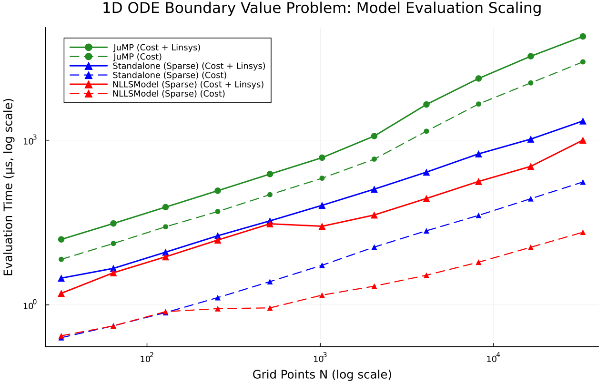

# 1D ODE Boundary Value Problem

- **Category**: `large_sparse`
- **Scaling Metric**: Grid Points N
- **Problem Sizes Evaluated**: 32, 64, 128, 256, 512, 1024, 2048, 4096, 8192, 16384, 32768 (11 sizes)
- **Standard Baseline Model for Optimizers**: `Standalone (Sparse)`
- **Derivatives**: autodiff

**Derivatives: automatic.** Every cost of this problem depends on at most 8 scalar inputs, so each cost's Jacobian is computed by forward-mode automatic differentiation, with NLLSModel's `computeresjac`. The `Standalone` model fills its residual vector and Jacobian by calling that same function for each cost in a plain single-threaded loop, so every model evaluates a cost with the same code; what differs between rows is how the linear system is assembled and how the optimizer uses it. The `NLPModels (MathOptNLSModel)` model is differentiated by JuMP's own automatic differentiation.

---

## The Problem

A differential equation describes how a quantity varies along a line; a *boundary value problem* fixes its value at both ends and asks for everything in between. This one is the Bratu equation, a simple model of a material that generates heat by a reaction that speeds up as it warms, while losing heat by conduction to its two cooled ends:

```math
-u''(x) = \lambda\, e^{u(x)}, \qquad 0 < x < 1, \qquad u(0) = u(1) = 0, \qquad \lambda = 1 .
```

To solve it on a computer, the line is divided by ``N`` evenly spaced grid points, a distance ``h = 1/(N+1)`` apart, and the unknowns are the values ``u_1, \dots, u_N`` at those points. The equation becomes one algebraic equation per grid point, each involving a point and its two neighbours:

```math
r_i(u) = \frac{-u_{i-1} + 2u_i - u_{i+1}}{h^2} - \lambda\, e^{u_i}, \qquad u_0 = u_{N+1} = 0 .
```

The optimizer minimizes ``\tfrac12 \sum_i r_i^2``, starting from ``u = 0``. There are as many equations as unknowns, so at the solution every residual is zero: this is a system of nonlinear equations, solved as a least-squares problem.

### Where it is used

Discretized differential equations are the daily work of scientific computing: heat conduction, reaction and diffusion in chemical engineering, the bending of beams, electrostatics. More generally the problem stands for solving a large sparse system of nonlinear equations.

### Similar problems

Its structure is that of the [sparse Rosenbrock problem](rosenbrock_sparse.md), a chain in which each unknown is tied to its neighbours, with a tridiagonal Jacobian. Two things set it apart. It is square (as many residuals as unknowns). And it becomes badly conditioned as the grid is refined: the division by ``h^2`` makes the Jacobian's condition number grow as about ``0.4\,N^2``, and that of ``J^T J`` as its square. At the largest size that is about ``4 \times 10^8`` for ``J`` and ``10^{17}`` for ``J^T J``, beyond what double precision can represent, so, as in the [ill-conditioned polynomial fit](polynomial_fitting.md), optimizers that form ``J^T J`` are at a disadvantage against those that work with ``J``.

### How it scales

The size is the number of grid points, ``N``. Variables, residuals and non-zeros grow in proportion to it, and so does the work per iteration for a sparse direct solver; the conditioning worsens as ``N^2``.

| | In terms of the size | Smallest | Largest |
|:---|:---|---:|---:|
| Size | ``N`` | 32 | 32768 |
| Variables | ``N``, each a scalar | 32 | 32768 |
| Unknowns in total | ``N`` | 32 | 32768 |
| Costs | ``N``, each one residual: ``N - 2`` depend on three variables, the 2 at the ends on two | 32 | 32768 |
| Residuals in total | ``N`` | 32 | 32768 |
| Jacobian | ``N \times N``, tridiagonal, ``3N - 2`` non-zeros | 94 non-zeros | 98302 non-zeros |
| Hessian ``J^T J`` | ``N \times N``, pentadiagonal, ``5N - 6`` non-zeros | 154 non-zeros | 163834 non-zeros |

---

## The SecondOrderOptimization rows

- **`SecondOrderOptimization (Gauss-Newton)`** is `iterator = :newton` on the normal equations: Gauss–Newton, since the Hessian it is given is ``J^T J``. It takes the full step, with no line search or trust region (a diagonal shift only when the system cannot be solved), so a step that raises the cost is caught only by the stall test, and the row then ends `not_converged`. **`CaNNOLeS`** (`method = :Newton_noFHess`) is Gauss–Newton too, globalized: an ``LDL^T`` factorization of the augmented system ``[\rho I\ \ J^T;\ J\ \ {-I}]``, with ``\rho`` raised from 0 only when the factorization fails or has the wrong inertia, then an Armijo backtracking line search on ``\tfrac12\|F\|^2``.
- **`SecondOrderOptimization (LM, tall)`** is Levenberg–Marquardt on the residual-and-Jacobian form (`formulation = :jacobian`): each step solves the damped least-squares problem in ``J`` by QR, without forming ``J^T J``, on the `NLLSModel` model. `storage = :auto` stores ``J`` dense or sparse from its fill (sparse at the large sizes), and `linsolver = :auto` factorizes it by dense QR or SPQR. The rows without "tall" solve the normal equations in ``J^T J``.

---

## 1. Model Evaluation Scaling

The plot below shows the log-log scaling of **Pure Cost Evaluation** (dashed/dotted lines) and **Cost + Linear System Assembly** (solid/dash-dot lines) across problem sizes.



---

## 2. Optimizer Evaluation Scaling

The plot below shows the log-log scaling of **Optimizer Runtime to Convergence** across all tested solvers, where each solver is evaluated on its optimal problem representation (e.g. `NLLSModel` for `SecondOrderOptimization`, `LeastSquaresProblem` for `LeastSquaresOptim`, `NLPModels` for JSO/interior-point solvers, and `Manifolds` for `Manopt`). Non-converged runs are omitted.


---

## 3. Single-Threaded Results

The same benchmark with NLLSModel and BLAS on one thread (`set_benchmark_threads!(numthreads = 1, blas_threads = 1)`),
stored separately from the threaded table. Comparing the two shows what threading gains or costs at each size.


- [View Single-Threaded Raw Benchmark Results Data (Markdown Table)](../data/single_threaded/ode_bvp.md)

---

## 4. Raw Data

The full numeric benchmark measurements (cost, linear system assembly times, outer iterations, memory, and convergence status across all sizes) are persisted in the streaming Markdown data file:

- [View Full Raw Benchmark Results Data (Markdown Table)](../data/ode_bvp.md)

---

## 5. Analysis & Key Takeaways

- **Model Efficiency**: At Grid Points N = `32768`, **`NLLSModel (Sparse)`** achieves the fastest Cost + Linear System evaluation at **547.46 μs** (64 B allocated).
- **Top Converged Optimizer**: At Grid Points N = `32768` (4/15 solvers converged), **`Ipopt`** is fastest at **207.93 ms** (2 iterations, final cost `2.29e-09`).
- **Convergence Filtering**: Only runs satisfying universal convergence tolerances (`gtol = 1.0e-8`, `xtol = 1.0e-8`, `ftol = 1.0e-8`) within `500` iterations and `30.0s` are plotted.
