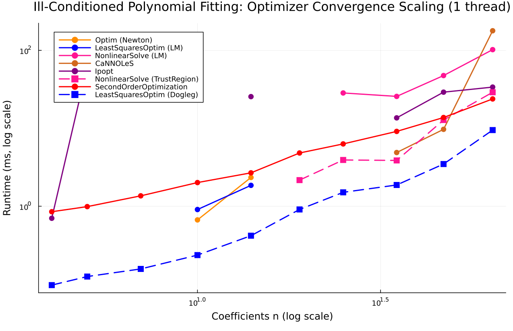

# Ill-Conditioned Polynomial Fitting

- **Category**: `medium_dense`
- **Scaling Metric**: Coefficients n
- **Problem Sizes Evaluated**: 4, 5, 7, 10, 14, 19, 25, 35, 47, 64 (10 sizes)
- **Standard Baseline Model for Optimizers**: `Standalone`
- **Derivatives**: analytic

**Derivatives: analytic.** A cost of this problem depends on more than 8 scalar inputs, so each cost has a hand-written Jacobian. NLLSModel calls it through `computeresjac`, and the `Standalone` model fills its residual vector and Jacobian by calling the same function for each cost in a plain single-threaded loop, so the NLLSModel and Standalone models evaluate a cost with the same code. The mode applies to the NLLSModel and Standalone models. The `JuMP` model, the native model of JSOSolvers, Ipopt, MadNLP and CaNNOLeS, is differentiated by JuMP's own automatic differentiation, exactly and with exact second derivatives, whatever the problem's mode: a native model's derivatives are part of the package under test.

---

## The Problem

Fit a polynomial with ``n`` coefficients to ``m = 8n`` samples of a smooth curve, ``y_i = \sin(3t_i) + 0.01\cos(17t_i)``, at evenly spaced points ``t_i`` in ``[-1, 1]``. The polynomial is written in a Chebyshev basis stretched by a factor ``s \ge 1``, ``T_0(t/s), \dots, T_{n-1}(t/s)``, so that the data cover only the middle of the interval on which the basis is well behaved:

```math
f(\mathbf{c}) = \tfrac12 \sum_{i=1}^{m} \Bigl(\sigma \bigl(\textstyle\sum_{k=0}^{n-1} c_k\, T_k(t_i / s) - y_i\bigr)\Bigr)^2, \qquad \sigma = 10^4 .
```

The residuals are linear in the unknowns, so this is ordinary linear least squares, and in exact arithmetic one step from the starting point (all coefficients zero) would land on the answer. The difficulty is numerical. The stretch is chosen at each ``n`` so that the Jacobian's condition number is ``4 \times 10^9`` at every size (``s`` is about 840 at 4 coefficients, 2.9 at 14 and 1.07 at 64): this is the benchmark's one size sweep that is ill-conditioned at every size, and the construction that keeps the condition number fixed is contrived. Below about 14 coefficients much of that ill-conditioning is in the columns' norms, so a scaling of the coefficients would remove part of it there (at 4 coefficients the condition number after scaling the columns to unit norm is about ``4 \times 10^6``). Forming ``\mathbf{J}^T \mathbf{J}`` squares the condition number, to about ``1.6 \times 10^{19}``, which is more than double precision can represent (about ``10^{16}``). An optimizer that forms ``\mathbf{J}^T \mathbf{J}`` therefore loses the answer's accuracy before it starts; one that factorizes ``\mathbf{J}`` itself does not. Because the cost of a computed answer is itself rounded, each row is scored by its excess cost over the true minimum, both computed in extended precision.

### Where it is used

Polynomial regression and trend fitting, calibration curves, and any linear fit whose basis functions are nearly dependent. It is in the benchmark as a test of numerical accuracy, not of nonlinearity.

### Similar problems

Problems that are poorly conditioned because some combination of unknowns barely changes the residuals: a camera's focal length and its distance to the scene when the scene is nearly flat, parameters that the data only weakly determine, inverse problems in general. In shape it is like the curve fit, fewer unknowns than residuals and a dense system. The [dense conditioning sweep](conditioning_dense.md) holds the size fixed instead, and sweeps the condition number.

### How it scales

The size is the number of coefficients, ``n``, with 8 data points per coefficient. The conditioning is the same at every size. The work per iteration is that of a dense ``8n \times n`` least-squares problem, proportional to ``n^3``, whether the optimizer forms ``\mathbf{J}^T \mathbf{J}`` (``8n^3``) or factorizes ``\mathbf{J}`` (about ``16n^3``).

| | In terms of the size | Smallest | Largest |
|:---|:---|---:|---:|
| Size | ``n`` | 4 | 64 |
| Variables | 1, of size ``n`` | 1 | 1 |
| Unknowns in total | ``n`` | 4 | 64 |
| Costs | ``8n``, each one residual depending on the whole variable | 32 | 512 |
| Residuals in total | ``8n`` | 32 | 512 |
| Jacobian | ``8n \times n``, dense | 32 × 4 | 512 × 64 |
| Hessian ``\mathbf{J}^T \mathbf{J}`` | ``n \times n``, dense | 4 × 4 | 64 × 64 |

---

## Which model each row runs on, and how it stops

Each row runs on its package's native model, or on the `Standalone` model if its package has none here (see the overview). The criteria are the benchmark's gradient, step and relative cost-change tolerances, as far as the package offers them; the overview's table says what each is called in each package.

| Row | Model | Stopping criteria given |
|:---|:---|:---|
| `CaNNOLeS` | `JuMP` | gradient |
| `Ipopt` | `JuMP` | gradient, step, relative cost change |
| `JSOSolvers (tron)` | `JuMP` | gradient |
| `JSOSolvers (trunk)` | `JuMP` | gradient |
| `LeastSquaresOptim (Dogleg)` | `Standalone` | gradient, step, relative cost change |
| `LeastSquaresOptim (LM)` | `Standalone` | gradient, step, relative cost change |
| `MadNLP` | `JuMP` | gradient |
| `NonlinearSolve (LM)` | `Standalone` | its own defaults |
| `NonlinearSolve (TrustRegion)` | `Standalone` | its own defaults |
| `Optim (Newton)` | `Standalone` | gradient, step, relative cost change |
| `Optim (NewtonTrustRegion)` | `Standalone` | gradient, step, relative cost change |
| `SecondOrderOptimization` | `NLLSModel` | gradient, step, relative cost change |

The `SecondOrderOptimization` row runs `iterator = :levenbergmarquardt`, `linsolver = :qr`, `formulation = :jacobian`, `reduction = :none`, `storage = :dense`: the configuration NLLSModel's `recommendoptimizer` chose for this problem at its largest size, Coefficients n = 64, with one thread (then fixed in the problem's code, the same at every size).

---


## 1. Model Evaluation Scaling

The plot below shows the log-log scaling of **Pure Cost Evaluation** (dashed/dotted lines) and **Cost + Linear System Assembly** (solid/dash-dot lines) across problem sizes.


---

## 2. Optimizer Evaluation Scaling

The plot below shows the log-log scaling of **Optimizer Runtime to Convergence** across all tested solvers, each on the model given in the table above (its package's native model, or the `Standalone` model). Only `ok` rows are plotted.


---

## 3. Single-Threaded Results

The same benchmark with NLLSModel and BLAS on one thread (`set_benchmark_threads!(numthreads = 1, blas_threads = 1)`),
stored separately from the multi-threaded table. Comparing the two shows what threading gains or costs at each size.




- [View Single-Threaded Raw Benchmark Results Data (Markdown Table)](../data/single_threaded/polynomial_fitting.md)

---

## 4. Raw Data

The full numeric benchmark measurements (cost, linear system assembly times, outer iterations, memory, and convergence status across all sizes) are persisted in the streaming Markdown data file:

- [View Full Raw Benchmark Results Data (Markdown Table)](../data/polynomial_fitting.md)

---

## 5. Analysis & Key Takeaways

- **Model Efficiency**: At Coefficients n = `64`, **`JuMP`** achieves the fastest Cost + Linear System evaluation at **13.25 μs** (128 B allocated).
- **Top Converged Optimizer**: At Coefficients n = `64` (6/12 solvers converged), **`LeastSquaresOptim (Dogleg)`** is fastest at **12.59 ms** (13 iterations, final cost `4.36e-22`).
- **Convergence Filtering**: Only runs satisfying universal convergence tolerances (`gtol = 1.0e-8`, `xtol = 1.0e-8`, `ftol = 1.0e-8`) within `500` iterations and `30.0s` are plotted.
