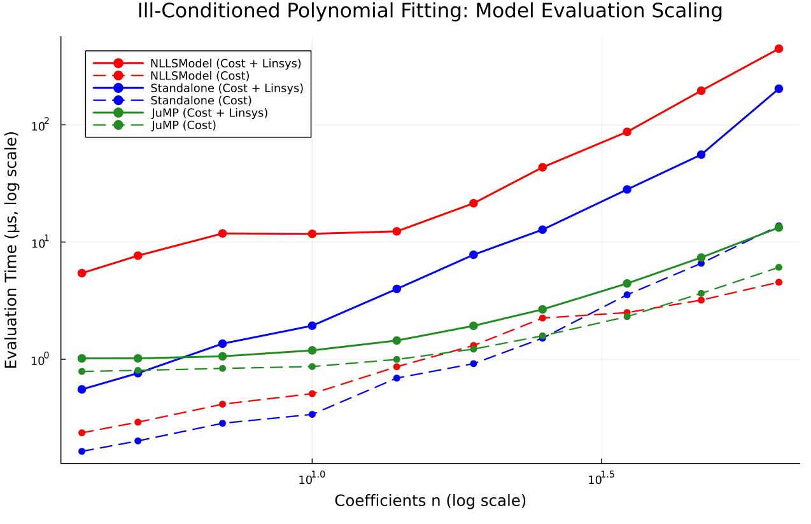
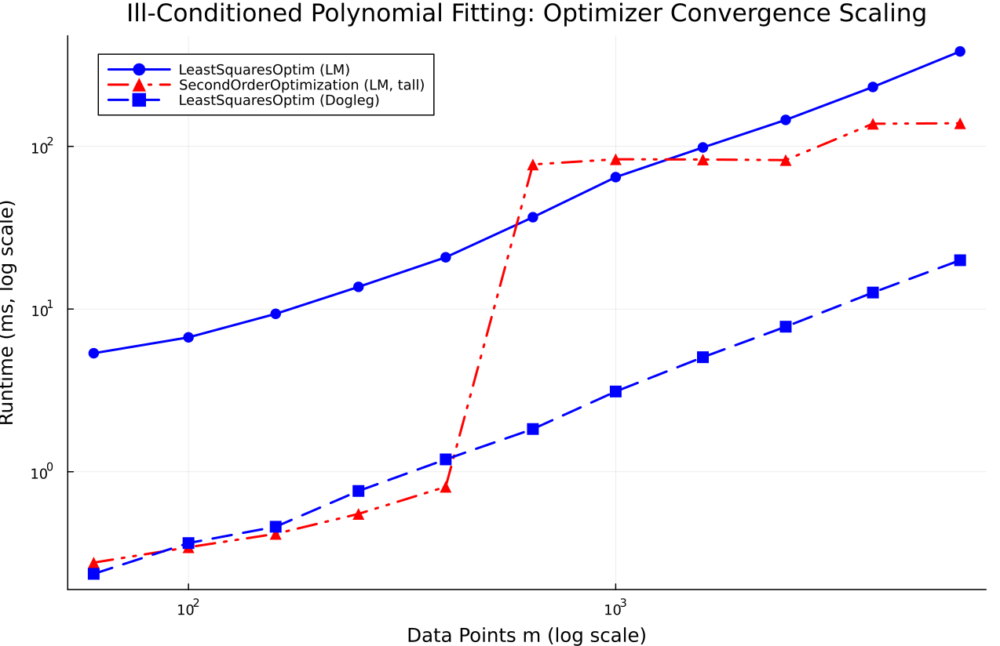

# Ill-Conditioned Polynomial Fitting

- **Category**: `medium_dense`
- **Scaling Metric**: Data Points m
- **Problem Sizes Evaluated**: 60, 100, 160, 250, 400, 640, 1000, 1600, 2500, 4000, 6400 (11 sizes)
- **Standard Baseline Model for Optimizers**: `Standalone`
- **Derivatives**: analytic

**Derivatives: analytic.** A cost of this problem depends on more than 8 scalar inputs, so each cost has a hand-written Jacobian. NLLSModel calls it through `computeresjac`, and the `Standalone` model fills its residual vector and Jacobian by calling the same function for each cost in a plain single-threaded loop, so every model evaluates a cost with the same code.

---

## The Problem

Fit a polynomial of degree 13 to ``m`` samples of a smooth curve, ``y(t) = \sin(3t) + 0.01\cos(17t)``, at evenly spaced points in ``[0, 1]``. The unknowns are the polynomial's 14 coefficients ``c_0, \dots, c_{13}``:

```math
f(c) = \tfrac12 \sum_{i=1}^{m} \Bigl(\sigma \bigl(\textstyle\sum_{k=0}^{13} c_k\, t_i^k - y(t_i)\bigr)\Bigr)^2, \qquad \sigma = 10^4 .
```

The residuals are linear in the unknowns, so this is ordinary linear least squares, and in exact arithmetic one step from the starting point (all coefficients zero) would land on the answer. The difficulty is numerical. On ``[0, 1]`` the powers ``t^8, t^9, t^{10}, \dots`` look almost alike, so very different sets of coefficients give almost the same curve. The Jacobian's condition number is about ``4 \times 10^9``. Forming ``J^T J`` squares it, to about ``10^{19}``, which is more than double precision can represent (about ``10^{16}``). An optimizer that forms ``J^T J`` therefore loses the answer's accuracy before it starts; one that factorizes ``J`` itself does not. Because the cost of a computed answer is itself rounded, each row is scored by its excess cost over the true minimum, both computed in extended precision.

### Where it is used

Polynomial regression and trend fitting, calibration curves, and any linear fit whose basis functions are nearly dependent. It is in the benchmark as a test of numerical accuracy, not of nonlinearity.

### Similar problems

Problems that are poorly conditioned because some combination of unknowns barely changes the residuals: a camera's focal length and its distance to the scene when the scene is nearly flat, parameters that the data only weakly determine, inverse problems in general. In size it is like the curve fit, a few unknowns and many residuals, with a small dense system.

### How it scales

The size is the number of data points, ``m``. The number of unknowns is fixed at 14, and the conditioning is set by the degree, which is fixed too; ``m`` changes only the amount of data, and the work per iteration is proportional to it.

| | In terms of the size | Smallest | Largest |
|:---|:---|---:|---:|
| Size | ``m`` | 60 | 6400 |
| Variables | 1, of size 14 | 1 | 1 |
| Unknowns in total | 14 | 14 | 14 |
| Costs | ``m``, each one residual depending on the whole variable | 60 | 6400 |
| Residuals in total | ``m`` | 60 | 6400 |
| Jacobian | ``m \times 14``, dense | 60 × 14 | 6400 × 14 |
| Hessian ``J^T J`` | ``14 \times 14``, dense | 14 × 14 | 14 × 14 |

---


## 1. Model Evaluation Scaling

The plot below shows the log-log scaling of **Pure Cost Evaluation** (dashed/dotted lines) and **Cost + Linear System Assembly** (solid/dash-dot lines) across problem sizes.



---

## 2. Optimizer Evaluation Scaling

The plot below shows the log-log scaling of **Optimizer Runtime to Convergence** across all tested solvers, where each solver is evaluated on its optimal problem representation (e.g. `NLLSModel` for `SecondOrderOptimization`, `LeastSquaresProblem` for `LeastSquaresOptim`, `NLPModels` for JSO/interior-point solvers, and `Manifolds` for `Manopt`). Non-converged runs are omitted.



---

## 3. Single-Threaded Results

The same benchmark with NLLSModel and BLAS on one thread (`set_benchmark_threads!(numthreads = 1, blas_threads = 1)`),
stored separately from the threaded table. Comparing the two shows what threading gains or costs at each size.


- [View Single-Threaded Raw Benchmark Results Data (Markdown Table)](../data/single_threaded/polynomial_fitting.md)

---

## 4. Raw Data

The full numeric benchmark measurements (cost, linear system assembly times, outer iterations, memory, and convergence status across all sizes) are persisted in the streaming Markdown data file:

- [View Full Raw Benchmark Results Data (Markdown Table)](../data/polynomial_fitting.md)

---

## 5. Analysis & Key Takeaways

- **Model Efficiency**: At Data Points m = `6400`, **`Standalone`** achieves the fastest Cost + Linear System evaluation at **170.92 μs** (32 B allocated).
- **Top Converged Optimizer**: At Data Points m = `6400` (3/4 solvers converged), **`SecondOrderOptimization (LM, tall)`** is fastest at **11.47 ms** (18 iterations, final cost `9.70e+01`).
- **Convergence Filtering**: Only runs satisfying universal convergence tolerances (`gtol = 1.0e-8`, `xtol = 1.0e-8`, `ftol = 1.0e-8`) within `500` iterations and `30.0s` are plotted.
