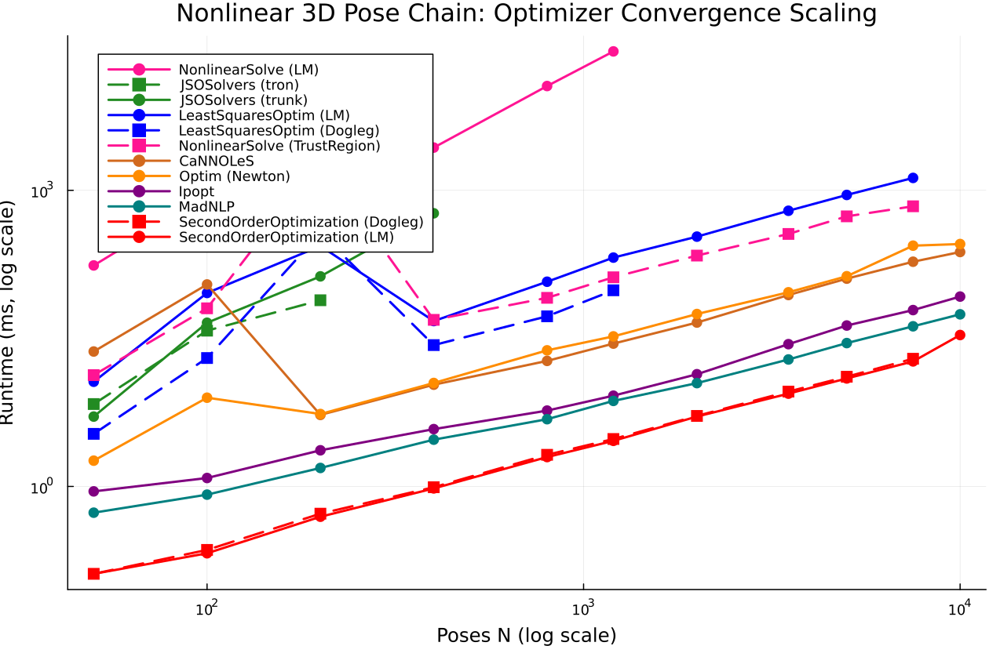

# Nonlinear 3D Pose Chain

- **Category**: `large_sparse`
- **Scaling Metric**: Poses N
- **Problem Sizes Evaluated**: 50, 100, 200, 400, 800, 1200, 2000, 3500, 5000, 7500, 10000 (11 sizes)
- **Standard Baseline Model for Solvers**: `NLLSModel (Sparse)`

---

## 1. Model Evaluation Scaling

This problem uses `NLLSModel (Sparse)` universally across all solvers via its built-in adapters; Phase 1 comparative model evaluation is omitted.

---

## 2. Optimizer Evaluation Scaling

The plot below shows the log-log scaling of **Optimizer Runtime to Convergence** across all tested solvers, where each solver is evaluated on its optimal problem representation (e.g. `NLLSModel` for `SecondOrderOptimization`, `LeastSquaresProblem` for `LeastSquaresOptim`, `NLPModels` for JSO/interior-point solvers, and `Manifolds` for `Manopt`). Non-converged runs are omitted.

---

## 3. Raw Data

The full numeric benchmark measurements (cost, linear system assembly times, outer iterations, memory, and convergence status across all sizes) are persisted in the streaming Markdown data file:

- [View Full Raw Benchmark Results Data (Markdown Table)](../data/pose_chain.md)

---

## 4. Analysis & Key Takeaways

- **Model Architecture**: Handled universally via `NLLSModel (Sparse)` with built-in zero-allocation adapters.
- **Top Converged Optimizer**: At Poses N = `10000` (5/12 solvers converged), **`SecondOrderOptimization (LM)`** is fastest at **34.20 ms** (5 iterations, final cost `5.44e-02`).
- **Convergence Filtering**: Only runs satisfying universal convergence tolerances (`gtol = 1.0e-8`, `xtol = 1.0e-8`, `ftol = 1.0e-8`) within `500` iterations and `30.0s` are plotted.
