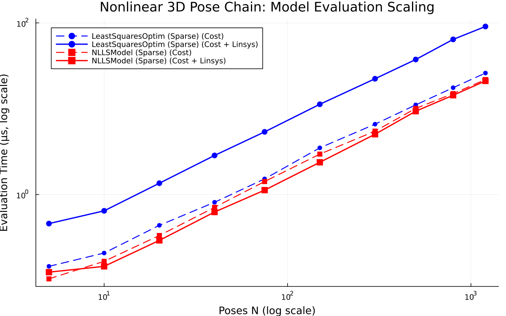

# Nonlinear 3D Pose Chain

- **Category**: `large_sparse`
- **Scaling Metric**: Poses N
- **Problem Sizes Evaluated**: 5, 10, 20, 40, 75, 150, 300, 500, 800, 1200 (10 sizes)

---

## 1. Model Evaluation Scaling

The plot below shows the log-log scaling of **Pure Cost Evaluation** (dashed lines) and **Cost + Linear System Assembly** (solid lines) across problem sizes.

### Model Evaluation Timings

| Poses N | Model | Cost Time | Cost Allocs | Linsys Time | Linsys Allocs | Linsys Memory |
|:---|:---|:---|:---|:---|:---|:---|
| 5 | LeastSquaresOptim (Sparse) | 145.5 ns | 0 | 458.5 ns | 0 | 0 B |
| 5 | NLLSModel (Sparse) ★ | 104.0 ns | 0 | 124.5 ns | 0 | 0 B |
| 10 | LeastSquaresOptim (Sparse) | 208.0 ns | 0 | 645.5 ns | 0 | 0 B |
| 10 | NLLSModel (Sparse) ★ | 166.5 ns | 0 | 145.5 ns | 0 | 0 B |
| 20 | LeastSquaresOptim (Sparse) | 437.5 ns | 0 | 1.35 μs | 0 | 0 B |
| 20 | NLLSModel (Sparse) ★ | 333.0 ns | 0 | 292.0 ns | 0 | 0 B |
| 40 | LeastSquaresOptim (Sparse) | 812.0 ns | 0 | 2.85 μs | 0 | 0 B |
| 40 | NLLSModel (Sparse) ★ | 708.5 ns | 0 | 625.0 ns | 0 | 0 B |
| 75 | LeastSquaresOptim (Sparse) | 1.52 μs | 0 | 5.38 μs | 0 | 0 B |
| 75 | NLLSModel (Sparse) ★ | 1.42 μs | 0 | 1.12 μs | 0 | 0 B |
| 150 | LeastSquaresOptim (Sparse) | 3.50 μs | 0 | 11.27 μs | 0 | 0 B |
| 150 | NLLSModel (Sparse) ★ | 2.96 μs | 0 | 2.38 μs | 0 | 0 B |
| 300 | LeastSquaresOptim (Sparse) | 6.60 μs | 0 | 22.35 μs | 0 | 0 B |
| 300 | NLLSModel (Sparse) ★ | 5.48 μs | 0 | 5.04 μs | 0 | 0 B |
| 500 | LeastSquaresOptim (Sparse) | 11.08 μs | 0 | 37.48 μs | 0 | 0 B |
| 500 | NLLSModel (Sparse) ★ | 10.08 μs | 0 | 9.35 μs | 0 | 0 B |
| 800 | LeastSquaresOptim (Sparse) | 17.58 μs | 0 | 64.27 μs | 0 | 0 B |
| 800 | NLLSModel (Sparse) ★ | 15.00 μs | 0 | 14.35 μs | 0 | 0 B |
| 1200 | LeastSquaresOptim (Sparse) | 26.04 μs | 0 | 90.90 μs | 0 | 0 B |
| 1200 | NLLSModel (Sparse) ★ | 21.88 μs | 0 | 21.08 μs | 0 | 0 B |

---

## 2. Optimizer Evaluation Scaling

The plot below shows the log-log scaling of **Optimizer Runtime to Convergence** across all compatible optimizer families.

### Optimizer Results Summary

| Poses N | Optimizer | Runtime | Allocs | Memory | Iterations | Final Cost | Converged |
|:---|:---|:---|:---|:---|:---|:---|:---|
| 5 | LeastSquaresOptim (LM) | 63.02 μs | 15840 | 15.5 KiB | 21 | 2.9356e-17 | ✓ Yes |
| 5 | SecondOrderOptimization (Dogleg) | 90.94 ms | 23056 | 22.5 KiB | 5 | 1.6497e-32 | ✓ Yes |
| 5 | LeastSquaresOptim (Dogleg) | 36.73 μs | 11920 | 11.6 KiB | 5 | 1.0340e-30 | ✓ Yes |
| 5 | Ipopt | 20.37 ms | 29680 | 29.0 KiB | 3 | 3.6777e-22 | ✓ Yes |
| 5 | Optim (NewtonTrustRegion) | 15.53 ms | 150880 | 147.3 KiB | 5 | 2.3470e-25 | ✓ Yes |
| 5 | JSOSolvers (tron) | 245.13 ms | 17792 | 17.4 KiB | 8 | 8.8060e-15 | ✓ Yes |
| 5 | Optim (Newton) | 29.48 μs | 37008 | 36.1 KiB | 3 | 3.6777e-22 | ✓ Yes |
| 5 | SecondOrderOptimization (LM) | 50.14 ms | 22272 | 21.8 KiB | 4 | 1.6497e-32 | ✓ Yes |
| 5 | JSOSolvers (trunk) | 162.22 ms | 13184 | 12.9 KiB | 7 | 1.2845e-15 | ✓ Yes |
| 10 | LeastSquaresOptim (LM) | 112.56 μs | 20720 | 20.2 KiB | 18 | 2.3325e-17 | ✓ Yes |
| 10 | SecondOrderOptimization (Dogleg) | 41.69 μs | 49552 | 48.4 KiB | 7 | 3.2090e-31 | ✓ Yes |
| 10 | LeastSquaresOptim (Dogleg) | 61.58 μs | 15984 | 15.6 KiB | 6 | 5.2450e-29 | ✓ Yes |
| 10 | Ipopt | 653.54 μs | 55472 | 54.2 KiB | 4 | 2.4551e-18 | ✓ Yes |
| 10 | Optim (NewtonTrustRegion) | 688.75 μs | 729184 | 712.1 KiB | 7 | 8.1329e-18 | ✓ Yes |
| 10 | JSOSolvers (tron) | 91.92 μs | 26560 | 25.9 KiB | 10 | 1.0191e-16 | ✓ Yes |
| 10 | Optim (Newton) | 41.67 μs | 111728 | 109.1 KiB | 4 | 2.4551e-18 | ✓ Yes |
| 10 | SecondOrderOptimization (LM) | 25.40 μs | 43088 | 42.1 KiB | 5 | 3.2382e-31 | ✓ Yes |
| 10 | JSOSolvers (trunk) | 57.90 μs | 20544 | 20.1 KiB | 11 | 4.3556e-16 | ✓ Yes |
| 20 | LeastSquaresOptim (LM) | 563.52 μs | 59728 | 58.3 KiB | 26 | 3.6243e-15 | ✓ Yes |
| 20 | SecondOrderOptimization (Dogleg) | 71.65 μs | 105328 | 102.9 KiB | 8 | 2.7603e-30 | ✓ Yes |
| 20 | LeastSquaresOptim (Dogleg) | 329.15 μs | 53344 | 52.1 KiB | 8 | 2.7549e-30 | ✓ Yes |
| 20 | Ipopt | 809.35 μs | 115408 | 112.7 KiB | 5 | 2.1253e-21 | ✓ Yes |
| 20 | Optim (NewtonTrustRegion) | 3.78 ms | 3285664 | 3.1 MiB | 10 | 2.7620e-30 | ✓ Yes |
| 20 | JSOSolvers (tron) | 252.33 μs | 45072 | 44.0 KiB | 16 | 6.0050e-18 | ✓ Yes |
| 20 | Optim (Newton) | 121.98 μs | 405984 | 396.5 KiB | 5 | 2.1253e-21 | ✓ Yes |
| 20 | SecondOrderOptimization (LM) | 48.69 μs | 92448 | 90.3 KiB | 6 | 2.7560e-30 | ✓ Yes |
| 20 | JSOSolvers (trunk) | 167.62 μs | 36064 | 35.2 KiB | 15 | 3.0951e-16 | ✓ Yes |
| 40 | LeastSquaresOptim (LM) | 2.44 ms | 160624 | 156.9 KiB | 29 | 2.8850e-13 | ✓ Yes |
| 40 | SecondOrderOptimization (Dogleg) | 161.25 μs | 270896 | 264.5 KiB | 12 | 5.8212e-29 | ✓ Yes |
| 40 | LeastSquaresOptim (Dogleg) | 1.06 ms | 68432 | 66.8 KiB | 9 | 3.2680e-28 | ✓ Yes |
| 40 | Ipopt | 1.67 ms | 275296 | 268.8 KiB | 7 | 4.8618e-28 | ✓ Yes |
| 40 | Optim (NewtonTrustRegion) | 39.84 ms | 27310672 | 26.0 MiB | 17 | 6.3040e-21 | ✓ Yes |
| 40 | JSOSolvers (tron) | 1.72 ms | 79040 | 77.2 KiB | 77 | 2.1510e-14 | ✓ Yes |
| 40 | Optim (Newton) | 569.50 μs | 1899376 | 1.8 MiB | 8 | 5.8411e-29 | ✓ Yes |
| 40 | SecondOrderOptimization (LM) | 151.00 μs | 276416 | 269.9 KiB | 11 | 5.8609e-29 | ✓ Yes |
| 40 | JSOSolvers (trunk) | 772.90 μs | 64912 | 63.4 KiB | 37 | 7.4607e-13 | ✓ Yes |
| 75 | LeastSquaresOptim (LM) | 20.37 ms | 642592 | 627.5 KiB | 95 | 3.1972e-13 | ✓ Yes |
| 75 | SecondOrderOptimization (Dogleg) | 580.65 μs | 898560 | 877.5 KiB | 23 | 2.5203e-28 | ✓ Yes |
| 75 | LeastSquaresOptim (Dogleg) | 5.07 ms | 272880 | 266.5 KiB | 17 | 2.3339e-27 | ✓ Yes |
| 75 | Ipopt | 2.53 ms | 745264 | 727.8 KiB | 11 | 2.4283e-19 | ✓ Yes |
| 75 | Optim (NewtonTrustRegion) | 594.20 ms | 456875808 | 435.7 MiB | 82 | 3.0477e-26 | ✓ Yes |
| 75 | JSOSolvers (tron) | 2.23 ms | 51632 | 50.4 KiB | 101 | 1.1837e+01 | ✗ No |
| 75 | Optim (Newton) | 2.51 ms | 7020656 | 6.7 MiB | 11 | 2.5099e-28 | ✓ Yes |
| 75 | SecondOrderOptimization (LM) | 409.40 μs | 723520 | 706.6 KiB | 15 | 1.8545e-24 | ✓ Yes |
| 75 | JSOSolvers (trunk) | 2.37 ms | 26224 | 25.6 KiB | 101 | 2.3998e+00 | ✗ No |
| 150 | LeastSquaresOptim (LM) | 23.48 ms | 416416 | 406.7 KiB | 100 | 3.0186e+01 | ✗ No |
| 150 | SecondOrderOptimization (Dogleg) | 3.16 ms | 3891024 | 3.7 MiB | 52 | 2.7265e-27 | ✓ Yes |
| 150 | LeastSquaresOptim (Dogleg) | 63.06 ms | 1026944 | 1002.9 KiB | 75 | 3.2268e-25 | ✓ Yes |
| 150 | Ipopt | 9.27 ms | 2702752 | 2.6 MiB | 21 | 2.8096e-27 | ✓ Yes |
| 150 | Optim (NewtonTrustRegion) | 2.01 s | 1604268528 | 1529.9 MiB | 70 | 3.4072e+01 | ✗ No |
| 150 | JSOSolvers (tron) | 4.35 ms | 99872 | 97.5 KiB | 101 | 3.7910e+01 | ✗ No |
| 150 | Optim (Newton) | 33.43 ms | 53938688 | 51.4 MiB | 27 | 2.7240e-27 | ✓ Yes |
| 150 | SecondOrderOptimization (LM) | 3.99 ms | 6540896 | 6.2 MiB | 91 | 2.4922e-25 | ✓ Yes |
| 150 | JSOSolvers (trunk) | 4.43 ms | 51376 | 50.2 KiB | 101 | 3.3477e+01 | ✗ No |
| 300 | LeastSquaresOptim (LM) | 45.40 ms | 448672 | 438.2 KiB | 100 | 8.2524e+01 | ✗ No |
| 300 | SecondOrderOptimization (Dogleg) | 43.02 ms | 16165264 | 15.4 MiB | 100 | 1.4541e+01 | ✓ Yes |
| 300 | LeastSquaresOptim (Dogleg) | 335.20 ms | 3679488 | 3.5 MiB | 100 | 4.9718e+01 | ✗ No |
| 300 | Ipopt | 64.08 ms | 24542496 | 23.4 MiB | 96 | 1.9148e-17 | ✓ Yes |
| 300 | Optim (NewtonTrustRegion) | 2.08 s | 1424450112 | 1358.5 MiB | 16 | 9.6572e+01 | ✗ No |
| 300 | JSOSolvers (tron) | 9.13 ms | 194128 | 189.6 KiB | 101 | 9.0732e+01 | ✗ No |
| 300 | Optim (Newton) | 494.81 ms | 696626976 | 664.4 MiB | 100 | 1.4149e+02 | ✗ No |
| 300 | SecondOrderOptimization (LM) | 8.15 ms | 16539808 | 15.8 MiB | 100 | 6.2529e+01 | ✓ Yes |
| 300 | JSOSolvers (trunk) | 9.54 ms | 100592 | 98.2 KiB | 101 | 8.6215e+01 | ✗ No |
| 500 | LeastSquaresOptim (LM) | 82.30 ms | 494976 | 483.4 KiB | 100 | 1.5094e+02 | ✗ No |
| 500 | SecondOrderOptimization (Dogleg) | 15.62 ms | 22585280 | 21.5 MiB | 100 | 1.0364e+02 | ✓ Yes |
| 500 | LeastSquaresOptim (Dogleg) | 660.41 ms | 5462176 | 5.2 MiB | 100 | 1.5189e+02 | ✗ No |
| 500 | Ipopt | 36.94 ms | 10462256 | 10.0 MiB | 26 | 5.5133e+02 | ✗ No |
| 500 | Optim (NewtonTrustRegion) | 2.25 s | 1153243760 | 1099.8 MiB | 4 | 2.9410e+02 | ✗ No |
| 500 | JSOSolvers (tron) | 14.80 ms | 288416 | 281.7 KiB | 101 | 1.6075e+02 | ✗ No |
| 500 | Optim (Newton) | 1.45 s | 1927552976 | 1838.3 MiB | 100 | 5.3046e+02 | ✗ No |
| 500 | SecondOrderOptimization (LM) | 14.79 ms | 24686032 | 23.5 MiB | 100 | 1.2789e+02 | ✓ Yes |
| 500 | JSOSolvers (trunk) | 19.67 ms | 149744 | 146.2 KiB | 101 | 1.5536e+02 | ✗ No |
| 800 | LeastSquaresOptim (LM) | 143.05 ms | 622560 | 608.0 KiB | 100 | 2.5546e+02 | ✗ No |
| 800 | SecondOrderOptimization (Dogleg) | 25.01 ms | 40360576 | 38.5 MiB | 100 | 1.8375e+02 | ✓ Yes |
| 800 | LeastSquaresOptim (Dogleg) | 1.43 s | 4963984 | 4.7 MiB | 100 | 3.0546e+02 | ✗ No |
| 800 | Ipopt | 71.25 ms | 26005056 | 24.8 MiB | 39 | 7.7979e+02 | ✗ No |
| 800 | Optim (NewtonTrustRegion) | 2.77 s | 1109807696 | 1058.4 MiB | 2 | 8.2043e+02 | ✗ No |
| 800 | JSOSolvers (tron) | 24.26 ms | 476944 | 465.8 KiB | 101 | 2.6487e+02 | ✗ No |
| 800 | Optim (Newton) | 2.15 s | 2600810448 | 2480.3 MiB | 51 | 8.7460e+02 | ✗ No |
| 800 | SecondOrderOptimization (LM) | 24.78 ms | 43163648 | 41.2 MiB | 100 | 2.3118e+02 | ✓ Yes |
| 800 | JSOSolvers (trunk) | 28.60 ms | 248048 | 242.2 KiB | 101 | 2.5987e+02 | ✗ No |
| 1200 | LeastSquaresOptim (LM) | 193.22 ms | 692000 | 675.8 KiB | 100 | 3.9795e+02 | ✗ No |
| 1200 | SecondOrderOptimization (Dogleg) | 36.64 ms | 57858176 | 55.2 MiB | 100 | 3.4507e+02 | ✓ Yes |
| 1200 | LeastSquaresOptim (Dogleg) | 3.46 s | 6902944 | 6.6 MiB | 100 | 5.4045e+02 | ✗ No |
| 1200 | Ipopt | 231.84 ms | 87344000 | 83.3 MiB | 93 | 1.1022e+03 | ✗ No |
| 1200 | Optim (NewtonTrustRegion) | 4.10 s | 1455028976 | 1387.6 MiB | 1 | 1.3301e+03 | ✗ No |
| 1200 | JSOSolvers (tron) | 36.54 ms | 759728 | 741.9 KiB | 101 | 4.0466e+02 | ✗ No |
| 1200 | Optim (Newton) | 2.31 s | 2604161968 | 2483.5 MiB | 20 | 1.1516e+03 | ✗ No |
| 1200 | SecondOrderOptimization (LM) | 66.46 ms | 65186640 | 62.2 MiB | 100 | 3.8060e+02 | ✓ Yes |
| 1200 | JSOSolvers (trunk) | 51.01 ms | 395504 | 386.2 KiB | 101 | 3.9996e+02 | ✗ No |

---

## 3. Analysis & Key Takeaways

- **Asymptotic Complexity**: Log-log scaling indicates the empirical runtime growth rate as Poses N expands.
- **Fastest Model**: The fastest linear system assembly was consistently achieved by `NLLSModel (Sparse)`.
- **Top Optimizer**: Solvers leveraging specialized structure (e.g. sparse block factorization in SecondOrderOptimization) demonstrate superior scaling exponents on large problem regimes.
