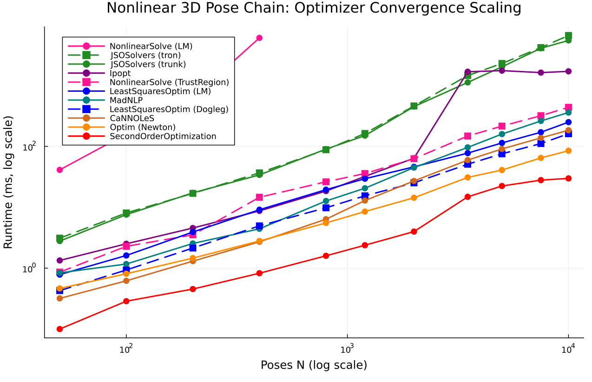

# Nonlinear 3D Pose Chain

- **Category**: `large_sparse`
- **Scaling Metric**: Poses N
- **Problem Sizes Evaluated**: 50, 100, 200, 400, 800, 1200, 2000, 3500, 5000, 7500, 10000 (11 sizes)
- **Standard Baseline Model for Optimizers**: `NLLSModel (Sparse)`
- **Derivatives**: autodiff

**Derivatives: automatic.** Every cost of this problem depends on at most 8 scalar inputs, so each cost's Jacobian is computed by forward-mode automatic differentiation, with NLLSModel's `computeresjac`.

---

## The Problem

A robot moves along a path and records, at each step, how far it has moved since the last one. From those step measurements alone its position could be found by adding them up, but errors would accumulate. Now and then it also recognizes a place it has been before, which ties two distant points of the path together (a *loop closure*). The problem is to find the ``N`` positions, each a point in 3D, that agree best with all the measurements at once.

Each measurement between two positions ``\mathbf{x}_a`` and ``\mathbf{x}_b`` contributes three residuals,

```math
\boldsymbol{\epsilon}(\mathbf{x}_a, \mathbf{x}_b) = \mathbf{x}_b - \mathbf{x}_a - \mathbf{o}_{ab} + 0.1 \sin(\mathbf{x}_a),
```

where ``\mathbf{o}_{ab}`` is the measured offset and the sine term (applied to each coordinate) makes the problem nonlinear. There is one such measurement between every consecutive pair, one loop closure from position ``i - 10`` to position ``i`` for every tenth ``i``, and one extra term that pins the first position, since otherwise the whole path could slide freely. The optimizers start from the path obtained by adding up slightly wrong steps.

### Where it is used

Robot and vehicle navigation (SLAM, pose-graph optimization), visual and inertial odometry, and surveying networks. The same structure appears in any chain of states linked by relative measurements: estimating a trajectory over time, or the joints of a mechanism.

### Similar problems

Pose-graph optimization is the direct analogue; real pose graphs have orientations as well as positions (6 unknowns per pose, on a manifold), where this problem has 3 ordinary coordinates. In structure it is a chain with a few longer links, like a smoothing problem in time or the camera system left after the points of a video sequence's bundle adjustment have been eliminated. The Hessian is block-banded: 3 × 3 blocks on the diagonal, beside it, and ten blocks away. A sparse direct solver factorizes it in time proportional to ``N``.

### How it scales

The size is the number of positions, ``N``. Variables, residuals and non-zeros all grow in proportion to it, and so does the work per iteration for a solver that exploits the band.

| | In terms of the size | Smallest | Largest |
|:---|:---|---:|---:|
| Size | ``N`` | 50 | 10000 |
| Variables | ``N``, each of size 3 | 50 | 10000 |
| Unknowns in total | ``3N`` | 150 | 30000 |
| Costs | ``N + \lfloor (N-1)/10 \rfloor``, each of 3 residuals: 1 on one variable, the others on two (``N - 1`` steps and ``\lfloor (N-1)/10 \rfloor`` loop closures) | 54 | 10999 |
| Residuals in total | ``3\,(N + \lfloor (N-1)/10 \rfloor)`` | 162 | 32997 |
| Jacobian | ``3\,(N + \lfloor (N-1)/10 \rfloor) \times 3N``, sparse: two 3 × 3 blocks per row block at most | 162 × 150 | 32997 × 30000 |
| Hessian ``\mathbf{J}^T \mathbf{J}`` | ``3N \times 3N``, block-banded with 3 × 3 blocks and a half-bandwidth of 10 blocks | 150 × 150 | 30000 × 30000 |

---

## The SecondOrderOptimization rows

- **`SecondOrderOptimization (Gauss-Newton)`** is `iterator = :newton` on the normal equations: Gauss–Newton, since the Hessian it is given is ``\mathbf{J}^T \mathbf{J}``. It takes the full step, with no line search or trust region (a diagonal shift only when the system cannot be solved), so a step that raises the cost is caught only by the stall test, and the row then ends `not_converged`. **`CaNNOLeS`** (`method = :Newton_noFHess`) is Gauss–Newton too, globalized: an ``\mathbf{L}\mathbf{D}\mathbf{L}^T`` factorization of the augmented system ``[\mu \mathbf{I}\ \ \mathbf{J}^T;\ \mathbf{J}\ \ {-\mathbf{I}}]``, with ``\mu`` raised from 0 only when the factorization fails or has the wrong inertia, then an Armijo backtracking line search on ``\tfrac12\lVert\boldsymbol{\epsilon}\rVert^2``.
- **`SecondOrderOptimization (LM, tall)`** is Levenberg–Marquardt on the residual-and-Jacobian form (`formulation = :jacobian`): each step solves the damped least-squares problem in ``\mathbf{J}`` by QR, without forming ``\mathbf{J}^T \mathbf{J}``, on the `NLLSModel` model. `storage = :auto` stores ``\mathbf{J}`` dense or sparse from its fill (sparse at the large sizes), and `linsolver = :auto` factorizes it by dense QR or SPQR. The rows without "tall" solve the normal equations in ``\mathbf{J}^T \mathbf{J}``.
- **`SecondOrderOptimization (LM, tall, LSMR)`** is the tall row with `linsolver = :lsmr`: each step's least-squares problem is solved iteratively by LSMR (Krylov.jl) instead of by QR.

---

## 1. Model Evaluation Scaling

This problem uses `NLLSModel (Sparse)` universally across all solvers via its built-in adapters; Phase 1 comparative model evaluation is omitted.

---

## 2. Optimizer Evaluation Scaling

The plot below shows the log-log scaling of **Optimizer Runtime to Convergence** across all tested solvers, where each solver is evaluated on its optimal problem representation (e.g. `NLLSModel` for `SecondOrderOptimization`, `LeastSquaresProblem` for `LeastSquaresOptim`, `NLPModels` for JSO/interior-point solvers, and `Manifolds` for `Manopt`). Non-converged runs are omitted.



---

## 3. Single-Threaded Results

The same benchmark with NLLSModel and BLAS on one thread (`set_benchmark_threads!(numthreads = 1, blas_threads = 1)`),
stored separately from the threaded table. Comparing the two shows what threading gains or costs at each size.


- [View Single-Threaded Raw Benchmark Results Data (Markdown Table)](../data/single_threaded/pose_chain.md)

---

## 4. Raw Data

The full numeric benchmark measurements (cost, linear system assembly times, outer iterations, memory, and convergence status across all sizes) are persisted in the streaming Markdown data file:

- [View Full Raw Benchmark Results Data (Markdown Table)](../data/pose_chain.md)

---

## 5. Analysis & Key Takeaways

- **Model Architecture**: Handled universally via `NLLSModel (Sparse)` with built-in zero-allocation adapters.
- **Top Converged Optimizer**: At Poses N = `10000` (9/15 solvers converged), **`SecondOrderOptimization (Gauss-Newton)`** is fastest at **27.63 ms** (5 iterations, final cost `5.44e-02`).
- **Convergence Filtering**: Only runs satisfying universal convergence tolerances (`gtol = 1.0e-8`, `xtol = 1.0e-8`, `ftol = 1.0e-8`) within `500` iterations and `30.0s` are plotted.
