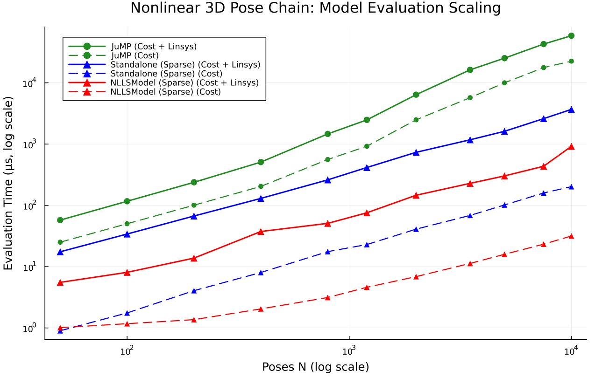
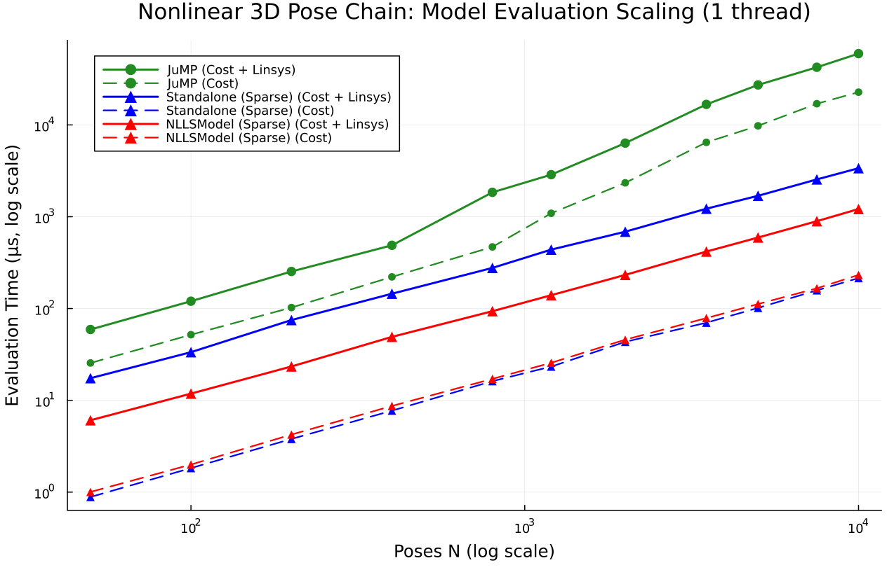

# Nonlinear 3D Pose Chain

- **Category**: `large_sparse`
- **Scaling Metric**: Poses N
- **Problem Sizes Evaluated**: 50, 100, 200, 400, 800, 1200, 2000, 3500, 5000, 7500, 10000 (11 sizes)
- **Standard Baseline Model for Optimizers**: `Standalone (Sparse)`
- **Derivatives**: autodiff

**Derivatives: automatic.** Every cost of this problem depends on at most 8 scalar inputs, so each cost's Jacobian is computed by forward-mode automatic differentiation, with NLLSModel's `computeresjac`. The `Standalone` model fills its residual vector and Jacobian by calling that same function for each cost in a plain single-threaded loop, so the NLLSModel and Standalone models evaluate a cost with the same code; what differs between their rows is how the linear system is assembled and how the optimizer uses it. The mode applies to the NLLSModel and Standalone models. The `JuMP` model, the native model of JSOSolvers, Ipopt, MadNLP and CaNNOLeS, is differentiated by JuMP's own automatic differentiation, exactly and with exact second derivatives, whatever the problem's mode: a native model's derivatives are part of the package under test.

---

## The Problem

A robot moves along a path and records, at each step, how far it has moved since the last one. From those step measurements alone its position could be found by adding them up, but errors would accumulate. Now and then it also recognizes a place it has been before, which ties two distant points of the path together (a *loop closure*). The problem is to find the ``N`` positions, each a point in 3D, that agree best with all the measurements at once.

Each measurement between two positions ``\mathbf{x}_a`` and ``\mathbf{x}_b`` contributes three residuals,

```math
\boldsymbol{\epsilon}(\mathbf{x}_a, \mathbf{x}_b) = \mathbf{x}_b - \mathbf{x}_a - \mathbf{o}_{ab} + 0.1\,\bigl(\mathbf{x}_a + \sin(\mathbf{x}_a)\bigr),
```

where ``\mathbf{o}_{ab}`` is the measured offset and the last term (the sine applied to each coordinate) makes the problem nonlinear. Its derivative, ``0.1\,(1 + \cos x)``, is never negative, so its effect does not cancel along the chain, and the problem's conditioning is the same at every length: the Jacobian's condition number is about 20 at every size. There is one such measurement between every consecutive pair, one loop closure from position ``i - 10`` to position ``i`` for every tenth ``i``, and one extra term that pins the first position, since otherwise the whole path could slide freely. The optimizers start from the path obtained by adding up slightly wrong steps.

### Where it is used

Robot and vehicle navigation (SLAM, pose-graph optimization), visual and inertial odometry, and surveying networks. The same structure appears in any chain of states linked by relative measurements: estimating a trajectory over time, or the joints of a mechanism.

### Similar problems

Pose-graph optimization is the direct analogue; real pose graphs have orientations as well as positions (6 unknowns per pose, on a manifold), where this problem has 3 ordinary coordinates. In structure it is a chain with a few longer links, like a smoothing problem in time or the camera system left after the points of a video sequence's bundle adjustment have been eliminated. The Hessian is block-banded: 3 × 3 blocks on the diagonal, beside it, and ten blocks away. A sparse direct solver factorizes it in time proportional to ``N``.

### How it scales

The size is the number of positions, ``N``. Variables, residuals and non-zeros all grow in proportion to it, and so does the work per iteration for a solver that exploits the band.

| | In terms of the size | Smallest | Largest |
|:---|:---|---:|---:|
| Size | ``N`` | 50 | 10000 |
| Variables | ``N``, each of size 3 | 50 | 10000 |
| Unknowns in total | ``3N`` | 150 | 30000 |
| Costs | ``N + \lfloor (N-1)/10 \rfloor``, each of 3 residuals: 1 on one variable, the others on two (``N - 1`` steps and ``\lfloor (N-1)/10 \rfloor`` loop closures) | 54 | 10999 |
| Residuals in total | ``3\,(N + \lfloor (N-1)/10 \rfloor)`` | 162 | 32997 |
| Jacobian | ``3\,(N + \lfloor (N-1)/10 \rfloor) \times 3N``, sparse: two 3 × 3 blocks per row block at most | 162 × 150 | 32997 × 30000 |
| Hessian ``\mathbf{J}^T \mathbf{J}`` | ``3N \times 3N``, block-banded with 3 × 3 blocks and a half-bandwidth of 10 blocks | 150 × 150 | 30000 × 30000 |

---

## Which model each row runs on, and how it stops

Each row runs on its package's native model, or on the `Standalone` model if its package has none here (see the overview). The criteria are the benchmark's gradient, step and relative cost-change tolerances, as far as the package offers them; the overview's table says what each is called in each package.

| Row | Model | Stopping criteria given |
|:---|:---|:---|
| `CaNNOLeS` | `JuMP` | gradient |
| `Ipopt` | `JuMP` | gradient, step, relative cost change |
| `JSOSolvers (tron)` | `JuMP` | gradient |
| `JSOSolvers (trunk)` | `JuMP` | gradient |
| `LeastSquaresOptim (Dogleg)` | `Standalone (Sparse)` | gradient, step, relative cost change |
| `LeastSquaresOptim (LM)` | `Standalone (Sparse)` | gradient, step, relative cost change |
| `MadNLP` | `JuMP` | gradient |
| `NonlinearSolve (LM)` | `Standalone (Sparse)` | its own defaults |
| `NonlinearSolve (TrustRegion)` | `Standalone (Sparse)` | its own defaults |
| `Optim (Newton)` | `Standalone (Sparse)` | gradient, step, relative cost change |
| `SecondOrderOptimization` | `NLLSModel (Sparse)` | gradient, step, relative cost change |

The `SecondOrderOptimization` row runs `iterator = :dogleg`, `linsolver = :ldl`, `formulation = :hessian`, `reduction = :none`, `storage = :sparse`: the configuration NLLSModel's `recommendoptimizer` chose for this problem at its largest size, Poses N = 10000, with one thread (then fixed in the problem's code, the same at every size).

---


## 1. Model Evaluation Scaling

The plot below shows the log-log scaling of **Pure Cost Evaluation** (dashed/dotted lines) and **Cost + Linear System Assembly** (solid/dash-dot lines) across problem sizes.



---

## 2. Optimizer Evaluation Scaling

The plot below shows the log-log scaling of **Optimizer Runtime to Convergence** across all tested solvers, each on the model given in the table above (its package's native model, or the `Standalone` model). Only `ok` rows are plotted.


---

## 3. Single-Threaded Results

The same benchmark with NLLSModel and BLAS on one thread (`set_benchmark_threads!(numthreads = 1, blas_threads = 1)`),
stored separately from the multi-threaded table. Comparing the two shows what threading gains or costs at each size.




- [View Single-Threaded Raw Benchmark Results Data (Markdown Table)](../data/single_threaded/pose_chain.md)

---

## 4. Raw Data

The full numeric benchmark measurements (cost, linear system assembly times, outer iterations, memory, and convergence status across all sizes) are persisted in the streaming Markdown data file:

- [View Full Raw Benchmark Results Data (Markdown Table)](../data/pose_chain.md)

---

## 5. Analysis & Key Takeaways

- **Model Efficiency**: At Poses N = `10000`, **`NLLSModel (Sparse)`** achieves the fastest Cost + Linear System evaluation at **919.58 μs** (64 B allocated).
- **Top Converged Optimizer**: At Poses N = `10000` (10/11 solvers converged), **`SecondOrderOptimization`** is fastest at **29.77 ms** (4 iterations, final cost `1.07e-01`).
- **Convergence Filtering**: Only runs satisfying universal convergence tolerances (`gtol = 1.0e-8`, `xtol = 1.0e-8`, `ftol = 1.0e-8`) within `500` iterations and `30.0s` are plotted.
