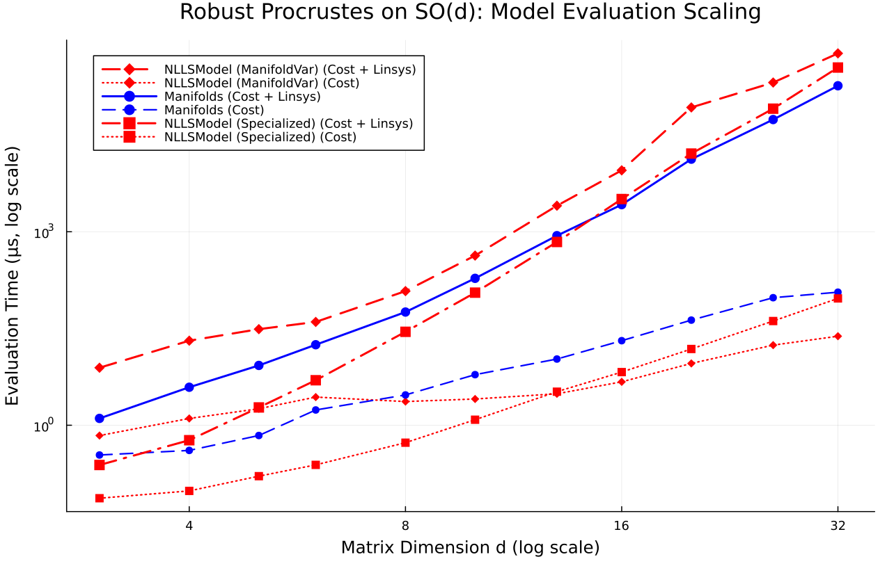

# Robust Procrustes on SO(d)

- **Category**: `manifold`
- **Scaling Metric**: Matrix Dimension d
- **Problem Sizes Evaluated**: 3, 4, 5, 6, 8, 10, 13, 16, 20, 26, 32 (11 sizes)
- **Standard Baseline Model for Solvers**: `Manifolds`

---

## 1. Model Evaluation Scaling

The plot below shows the log-log scaling of **Pure Cost Evaluation** (dashed/dotted lines) and **Cost + Linear System Assembly** (solid/dash-dot lines) across problem sizes.

---

## 2. Optimizer Evaluation Scaling

The plot below shows the log-log scaling of **Optimizer Runtime to Convergence** across all tested solvers, where each solver is evaluated on its optimal problem representation (e.g. `NLLSModel` for `SecondOrderOptimization`, `LeastSquaresProblem` for `LeastSquaresOptim`, `NLPModels` for JSO/interior-point solvers, and `Manifolds` for `Manopt`). Non-converged runs are omitted.

---

## 3. Single-Threaded Results

The same benchmark with NLLSModel and BLAS on one thread (`set_benchmark_threads!(numthreads = 1, blas_threads = 1)`),
stored separately from the threaded table. Comparing the two shows what threading gains or costs at each size.

- [View Single-Threaded Raw Benchmark Results Data (Markdown Table)](../data/single_threaded/robust_procrustes.md)

---

## 4. Raw Data

The full numeric benchmark measurements (cost, linear system assembly times, outer iterations, memory, and convergence status across all sizes) are persisted in the streaming Markdown data file:

- [View Full Raw Benchmark Results Data (Markdown Table)](../data/robust_procrustes.md)

---

## 5. Analysis & Key Takeaways

- **Model Efficiency**: At Matrix Dimension d = `32`, **`Manifolds`** achieves the fastest Cost + Linear System evaluation at **276.58 ms** (32 B allocated).
- **Top Converged Optimizer**: At Matrix Dimension d = `32` (4/4 solvers converged), **`Manopt (LevenbergMarquardt)`** is fastest at **2.04 s** (11 iterations, final cost `3.92e-06`).
- **Convergence Filtering**: Only runs satisfying universal convergence tolerances (`gtol = 1.0e-8`, `xtol = 1.0e-8`, `ftol = 1.0e-8`) within `500` iterations and `30.0s` are plotted.
