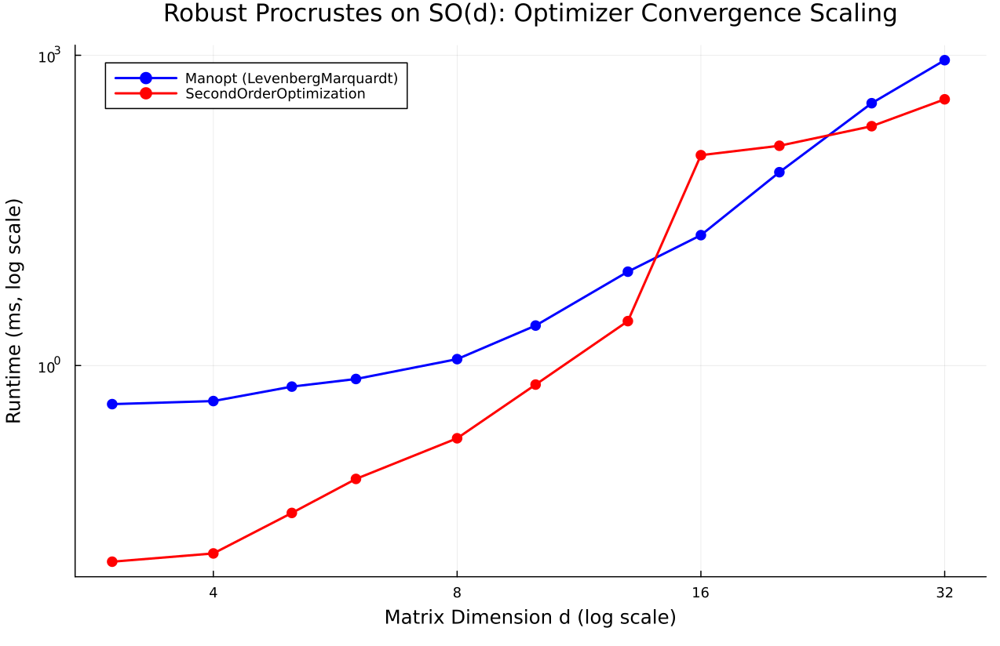
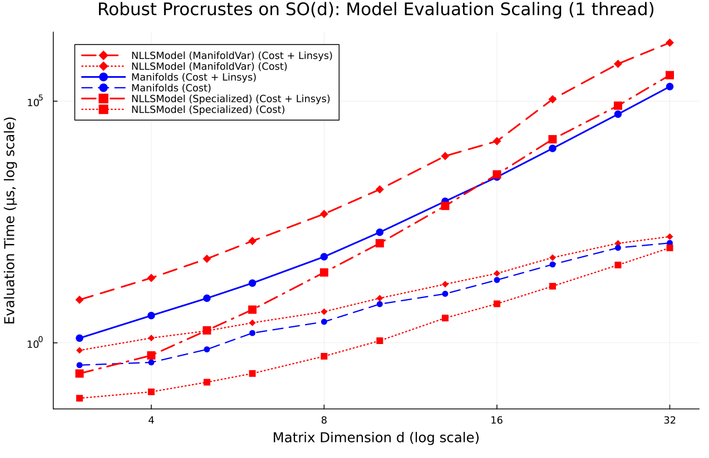
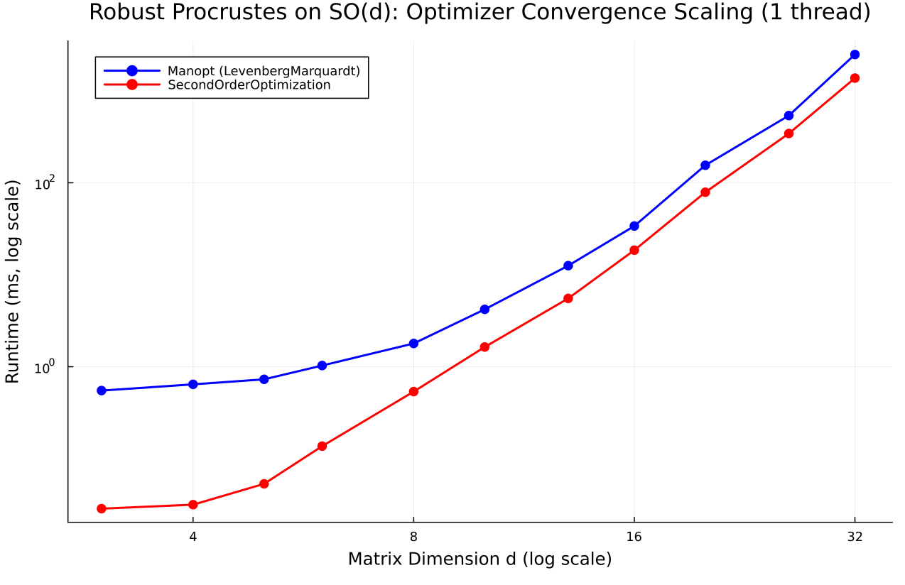

# Robust Procrustes on SO(d)

- **Category**: `manifold`
- **Scaling Metric**: Matrix Dimension d
- **Problem Sizes Evaluated**: 3, 4, 5, 6, 8, 10, 13, 16, 20, 26, 32 (11 sizes)
- **Standard Baseline Model for Optimizers**: `Manifolds`
- **Derivatives**: analytic

**Derivatives: analytic.** Each correspondence's residual depends on the rotation, ``d(d-1)/2`` scalar inputs (more than 8 from ``d = 5``), and every model has a hand-written Jacobian. `NLLSModel (ManifoldVar)` computes each correspondence's Jacobian in the orthonormal tangent basis of `Manifolds.jl`, through `computeresjac`; `NLLSModel (Specialized)` does the same for its own rotation type, with a specialized kernel; and the `Manifolds` model's per-correspondence Jacobian blocks, ``-\mathbf{R}\,\mathbf{E}_l \mathbf{b}_i`` with the products ``\mathbf{E}_l \mathbf{b}_i`` precomputed, are hand-written as well (the Manopt row builds the same blocks).

---

## The Problem

Two sets of matching points are given, and one is to be turned so that it lies on top of the other. The unknown is a rotation ``\mathbf{R}``; the points ``\mathbf{a}_i`` and ``\mathbf{b}_i`` come in pairs, and the optimizer looks for the rotation that brings each ``\mathbf{R}\,\mathbf{b}_i`` closest to its ``\mathbf{a}_i``. A few of the pairs are wrong (outliers), so the fit is made robust with a Huber kernel, which counts a small mismatch by its square and a large one only in proportion to its size:

```math
f(\mathbf{R}) = \tfrac12 \sum_{i=1}^{n} \rho\bigl(\lVert \mathbf{a}_i - \mathbf{R}\,\mathbf{b}_i \rVert^2\bigr), \qquad
\rho(s) = \begin{cases} s & s \le w^2 \\ 2w\sqrt{s} - w^2 & s > w^2 \end{cases}
```

The points are in ``d`` dimensions, and there are ``n = d(d+1)/2`` pairs. They are generated from a known rotation with no noise, apart from four pairs displaced by 0.1; the kernel's width is ``w = 10^{-5}``, so that away from the answer nearly every pair is on the kernel's linear part. The optimizers start from the identity.

A rotation is not a list of freely adjustable numbers: a ``d \times d`` matrix has ``d^2`` entries, but only those matrices with ``\mathbf{R}^T \mathbf{R} = \mathbf{I}`` and determinant 1 are rotations. They form a curved space, the manifold ``SO(d)``, of dimension ``d(d-1)/2``. The optimizers work on that space directly, taking each step in the flat space of small rotations about the current estimate and mapping the result back onto the manifold.

### Where it is used

Aligning one shape or point cloud with another: registering 3D scans, superimposing molecules, finding a spacecraft's attitude from star directions (Wahba's problem), all in 3 dimensions. In high dimensions the same problem aligns two sets of word embeddings (between languages, say) and rotates factors in statistics. Without outliers it has a closed-form solution (orthogonal Procrustes, by a singular value decomposition); with a robust kernel it needs an iterative optimizer.

### Similar problems

Like [multilateration](multilateration.md) and [affine alignment](affine_alignment.md) it has a single block of unknowns on which every residual depends, and a dense linear system. It differs in two ways: the unknown lives on a manifold, as camera and robot orientations do in bundle adjustment and pose-graph optimization, and the cost has a robust kernel, as in [robust curve fitting](curve_fitting_robust.md). It is the benchmark's test of both features together, and the one problem on which a manifold optimization package (Manopt) is compared.

### How it scales

The size is the dimension, ``d``. The rotation's degrees of freedom grow as ``d^2 / 2`` and the residuals as ``d^3 / 2``; the linear system is dense, so factorizing it costs in proportion to ``d^6``.

| | In terms of the size | Smallest | Largest |
|:---|:---|---:|---:|
| Size | ``d`` | 3 | 32 |
| Variables | 1: a ``d \times d`` rotation with ``d(d-1)/2`` degrees of freedom | 1 | 1 |
| Unknowns in total | ``d(d-1)/2`` | 3 | 496 |
| Costs | ``d(d+1)/2`` pairs, each of ``d`` residuals with a Huber kernel, depending on the whole variable | 6 | 528 |
| Residuals in total | ``d^2(d+1)/2`` | 18 | 16896 |
| Jacobian | ``d^2(d+1)/2 \times d(d-1)/2``, dense | 18 × 3 | 16896 × 496 |
| Hessian ``\mathbf{J}^T \mathbf{J}`` | ``d(d-1)/2 \times d(d-1)/2``, dense | 3 × 3 | 496 × 496 |

---


## 1. Model Evaluation Scaling

The plot below shows the log-log scaling of **Pure Cost Evaluation** (dashed/dotted lines) and **Cost + Linear System Assembly** (solid/dash-dot lines) across problem sizes.


---

## 2. Optimizer Evaluation Scaling

The plot below shows the log-log scaling of **Optimizer Runtime to Convergence** across all tested solvers, where each solver is evaluated on its optimal problem representation (e.g. `NLLSModel` for `SecondOrderOptimization`, `LeastSquaresProblem` for `LeastSquaresOptim`, `NLPModels` for JSO/interior-point solvers, and `Manifolds` for `Manopt`). Non-converged runs are omitted.



---

## 3. Single-Threaded Results

The same benchmark with NLLSModel and BLAS on one thread (`set_benchmark_threads!(numthreads = 1, blas_threads = 1)`),
stored separately from the threaded table. Comparing the two shows what threading gains or costs at each size.





- [View Single-Threaded Raw Benchmark Results Data (Markdown Table)](../data/single_threaded/robust_procrustes.md)

---

## 4. Raw Data

The full numeric benchmark measurements (cost, linear system assembly times, outer iterations, memory, and convergence status across all sizes) are persisted in the streaming Markdown data file:

- [View Full Raw Benchmark Results Data (Markdown Table)](../data/robust_procrustes.md)

---

## 5. Analysis & Key Takeaways

- **Model Efficiency**: At Matrix Dimension d = `32`, **`Manifolds`** achieves the fastest Cost + Linear System evaluation at **193.59 ms** (32 B allocated).
- **Top Converged Optimizer**: At Matrix Dimension d = `32` (4/4 solvers converged), **`SecondOrderOptimization (Dogleg)`** is fastest at **1.26 s** (11 iterations, final cost `3.92e-06`).
- **Convergence Filtering**: Only runs satisfying universal convergence tolerances (`gtol = 1.0e-8`, `xtol = 1.0e-8`, `ftol = 1.0e-8`) within `500` iterations and `30.0s` are plotted.
