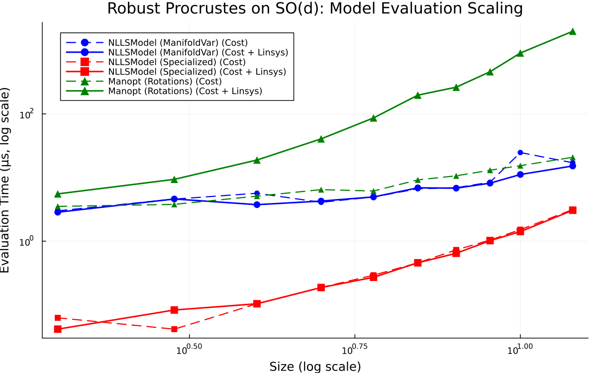
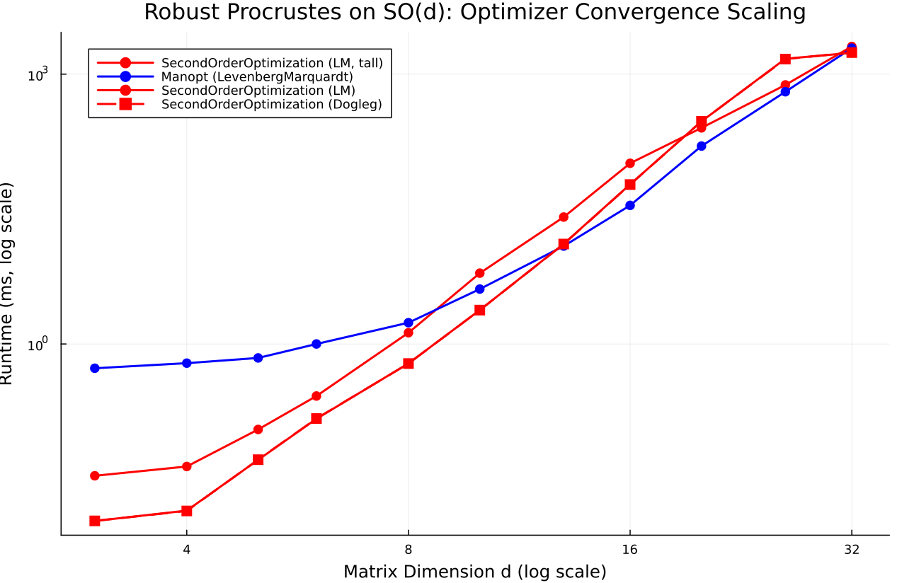

# Robust Procrustes on SO(d)

- **Category**: `manifold`
- **Scaling Metric**: Size
- **Problem Sizes Evaluated**: 2, 3, 4, 6, 8, 10, 14, 18, 22, 26, 32 (11 sizes)

---

## 1. Model Evaluation Scaling

The plot below shows the log-log scaling of **Pure Cost Evaluation** (dashed lines) and **Cost + Linear System Assembly** (solid lines) across problem sizes.

### Model Evaluation Timings

| Size | Model | Cost Time | Cost Allocs | Linsys Time | Linsys Allocs | Linsys Memory |
|:---|:---|:---|:---|:---|:---|:---|
| 2 | NLLSModel (ManifoldVar) | 250.0 ns | 12 | 291.0 ns | 12 | 480 B |
| 2 | NLLSModel (Specialized) ★ | 42.0 ns | 0 | 41.0 ns | 0 | 0 B |
| 2 | Manifolds | 500.0 ns | 30 | 1.38 μs | 62 | 2.6 KiB |
| 3 | NLLSModel (ManifoldVar) | 583.0 ns | 24 | 583.0 ns | 24 | 960 B |
| 3 | NLLSModel (Specialized) ★ | 42.0 ns | 0 | 42.0 ns | 0 | 0 B |
| 3 | Manifolds | 916.0 ns | 54 | 4.92 μs | 218 | 10.7 KiB |
| 4 | NLLSModel (ManifoldVar) | 917.0 ns | 40 | 875.0 ns | 40 | 1.9 KiB |
| 4 | NLLSModel (Specialized) ★ | 84.0 ns | 0 | 84.0 ns | 0 | 0 B |
| 4 | Manifolds | 1.33 μs | 86 | 16.54 μs | 604 | 38.6 KiB |
| 6 | NLLSModel (ManifoldVar) | 2.38 μs | 84 | 2.50 μs | 84 | 4.6 KiB |
| 6 | NLLSModel (Specialized) ★ | 292.0 ns | 0 | 250.0 ns | 0 | 0 B |
| 6 | Manifolds | 3.00 μs | 174 | 88.33 μs | 2787 | 262.1 KiB |
| 8 | NLLSModel (ManifoldVar) | 4.04 μs | 144 | 4.00 μs | 144 | 9.0 KiB |
| 8 | NLLSModel (Specialized) ★ | 625.0 ns | 0 | 625.0 ns | 0 | 0 B |
| 8 | Manifolds | 5.25 μs | 295 | 259.29 μs | 8530 | 1.1 MiB |
| 10 | NLLSModel (ManifoldVar) | 8.17 μs | 220 | 8.08 μs | 220 | 15.5 KiB |
| 10 | NLLSModel (Specialized) ★ | 1.46 μs | 0 | 1.42 μs | 0 | 0 B |
| 10 | Manifolds | 9.79 μs | 447 | 849.04 μs | 20520 | 3.6 MiB |
| 14 | NLLSModel (ManifoldVar) | 19.04 μs | 420 | 18.96 μs | 420 | 36.1 KiB |
| 14 | NLLSModel (Specialized) ★ | 5.08 μs | 0 | 5.00 μs | 0 | 0 B |
| 14 | Manifolds | 25.08 μs | 847 | 4.67 ms | 77836 | 21.6 MiB |
| 18 | NLLSModel (ManifoldVar) | 37.25 μs | 684 | 37.00 μs | 684 | 69.5 KiB |
| 18 | NLLSModel (Specialized) ★ | 11.92 μs | 0 | 11.79 μs | 0 | 0 B |
| 18 | Manifolds | 43.46 μs | 1375 | 19.93 ms | 238069 | 99.1 MiB |
| 22 | NLLSModel (ManifoldVar) | 67.21 μs | 1012 | 66.88 μs | 1012 | 118.6 KiB |
| 22 | NLLSModel (Specialized) ★ | 23.62 μs | 0 | 23.46 μs | 0 | 0 B |
| 22 | Manifolds | 78.04 μs | 2033 | 64.43 ms | 529871 | 285.3 MiB |
| 26 | NLLSModel (ManifoldVar) | 106.25 μs | 1404 | 105.96 μs | 1404 | 186.5 KiB |
| 26 | NLLSModel (Specialized) ★ | 44.33 μs | 0 | 44.17 μs | 0 | 0 B |
| 26 | Manifolds | 121.25 μs | 2817 | 173.25 ms | 1032420 | 793.8 MiB |
| 32 | NLLSModel (ManifoldVar) | 142.71 μs | 2112 | 143.29 μs | 2112 | 330.0 KiB |
| 32 | NLLSModel (Specialized) ★ | 104.21 μs | 0 | 103.79 μs | 0 | 0 B |
| 32 | Manifolds | 163.17 μs | 4233 | 434.05 ms | 2365692 | 2380.3 MiB |

---

## 2. Optimizer Evaluation Scaling

The plot below shows the log-log scaling of **Optimizer Runtime to Convergence** across all compatible optimizer families.

### Optimizer Results Summary

| Size | Optimizer | Runtime | Allocs | Memory | Iterations | Final Cost | Converged |
|:---|:---|:---|:---|:---|:---|:---|:---|
| 2 | SecondOrderOptimization (Dogleg) | 284.04 μs | 140624 | 137.3 KiB | 15 | 7.5728e-32 | ✓ Yes |
| 2 | SecondOrderOptimization (LM) | 295.08 μs | 147952 | 144.5 KiB | 15 | 3.0494e-31 | ✓ Yes |
| 2 | Manopt (LevenbergMarquardt) | 26.19 μs | 33712 | 32.9 KiB | 4 | 2.1387e-33 | ✓ Yes |
| 3 | SecondOrderOptimization (Dogleg) | 1.07 ms | 921776 | 900.2 KiB | 30 | 3.7711e-06 | ✓ Yes |
| 3 | SecondOrderOptimization (LM) | 392.30 ms | 950752 | 928.5 KiB | 30 | 3.7711e-06 | ✓ Yes |
| 3 | Manopt (LevenbergMarquardt) | 135.94 μs | 224752 | 219.5 KiB | 17 | 1.7353e-02 | ✓ Yes |
| 4 | SecondOrderOptimization (Dogleg) | 1.04 ms | 1552896 | 1.5 MiB | 14 | 3.9226e-06 | ✓ Yes |
| 4 | SecondOrderOptimization (LM) | 2.20 s | 457489456 | 436.3 MiB | 15 | 3.9226e-06 | ✓ Yes |
| 4 | Manopt (LevenbergMarquardt) | 290.71 μs | 602368 | 588.2 KiB | 16 | 1.7466e-02 | ✓ Yes |
| 6 | SecondOrderOptimization (Dogleg) | 3.62 ms | 12794016 | 12.2 MiB | 14 | 3.9226e-06 | ✓ Yes |
| 6 | SecondOrderOptimization (LM) | 2.92 s | 624177904 | 595.3 MiB | 15 | 3.9226e-06 | ✓ Yes |
| 6 | Manopt (LevenbergMarquardt) | 17.98 ms | 2939488 | 2.8 MiB | 15 | 1.7510e-02 | ✓ Yes |
| 8 | SecondOrderOptimization (Dogleg) | 25.72 ms | 75240096 | 71.8 MiB | 16 | 3.9226e-06 | ✓ Yes |
| 8 | SecondOrderOptimization (LM) | 4.18 s | 623056768 | 594.2 MiB | 16 | 3.9226e-06 | ✓ Yes |
| 8 | Manopt (LevenbergMarquardt) | 3.35 ms | 12460208 | 11.9 MiB | 17 | 1.7515e-02 | ✓ Yes |
| 10 | SecondOrderOptimization (Dogleg) | 60.63 ms | 275828336 | 263.1 MiB | 16 | 3.9226e-06 | ✓ Yes |
| 10 | SecondOrderOptimization (LM) | 14.17 s | 1174707168 | 1120.3 MiB | 16 | 3.9226e-06 | ✓ Yes |
| 10 | Manopt (LevenbergMarquardt) | 34.83 ms | 43817360 | 41.8 MiB | 16 | 1.7516e-02 | ✓ Yes |
| 14 | SecondOrderOptimization (Dogleg) | 781.24 ms | 1923521920 | 1834.4 MiB | 16 | 3.9226e-06 | ✓ Yes |
| 14 | SecondOrderOptimization (LM) | 4.71 s | 2768500512 | 2640.2 MiB | 15 | 3.9226e-06 | ✓ Yes |
| 14 | Manopt (LevenbergMarquardt) | 87.17 ms | 212324048 | 202.5 MiB | 16 | 1.7516e-02 | ✓ Yes |
| 18 | SecondOrderOptimization (Dogleg) | 3.11 s | 8261768912 | 7879.0 MiB | 16 | 3.9226e-06 | ✓ Yes |
| 18 | SecondOrderOptimization (LM) | 6.32 s | 8986654912 | 8570.3 MiB | 16 | 3.9226e-06 | ✓ Yes |
| 18 | Manopt (LevenbergMarquardt) | 531.38 ms | 1172619952 | 1118.3 MiB | 15 | 1.7516e-02 | ✓ Yes |
| 22 | SecondOrderOptimization (Dogleg) | 8.34 s | 25910507312 | 24710.2 MiB | 15 | 3.9226e-06 | ✓ Yes |
| 22 | SecondOrderOptimization (LM) | 15.12 s | 27893992240 | 26601.8 MiB | 15 | 3.9226e-06 | ✓ Yes |
| 22 | Manopt (LevenbergMarquardt) | 1.29 s | 3108989088 | 2965.0 MiB | 16 | 1.7516e-02 | ✓ Yes |
| 26 | SecondOrderOptimization (Dogleg) | 22.83 s | 74052796448 | 70622.3 MiB | 16 | 3.9226e-06 | ✓ Yes |
| 26 | SecondOrderOptimization (LM) | 34.96 s | 78515566912 | 74878.3 MiB | 16 | 3.9226e-06 | ✓ Yes |
| 26 | Manopt (LevenbergMarquardt) | 2.82 s | 10133614400 | 9664.2 MiB | 13 | 1.7516e-02 | ✓ Yes |
| 32 | SecondOrderOptimization (Dogleg) | 86.18 s | 252401267840 | 240708.6 MiB | 16 | 3.9226e-06 | ✓ Yes |
| 32 | SecondOrderOptimization (LM) | 90.95 s | 266176132256 | 253845.3 MiB | 16 | 3.9226e-06 | ✓ Yes |
| 32 | Manopt (LevenbergMarquardt) | 6.08 s | 25183061920 | 24016.4 MiB | 17 | 1.7516e-02 | ✓ Yes |

---

## 3. Analysis & Key Takeaways

- **Asymptotic Complexity**: Log-log scaling indicates the empirical runtime growth rate as Size expands.
- **Fastest Model**: The fastest linear system assembly was consistently achieved by `NLLSModel (Specialized)`.
- **Top Optimizer**: Solvers leveraging specialized structure (e.g. sparse block factorization in SecondOrderOptimization) demonstrate superior scaling exponents on large problem regimes.
