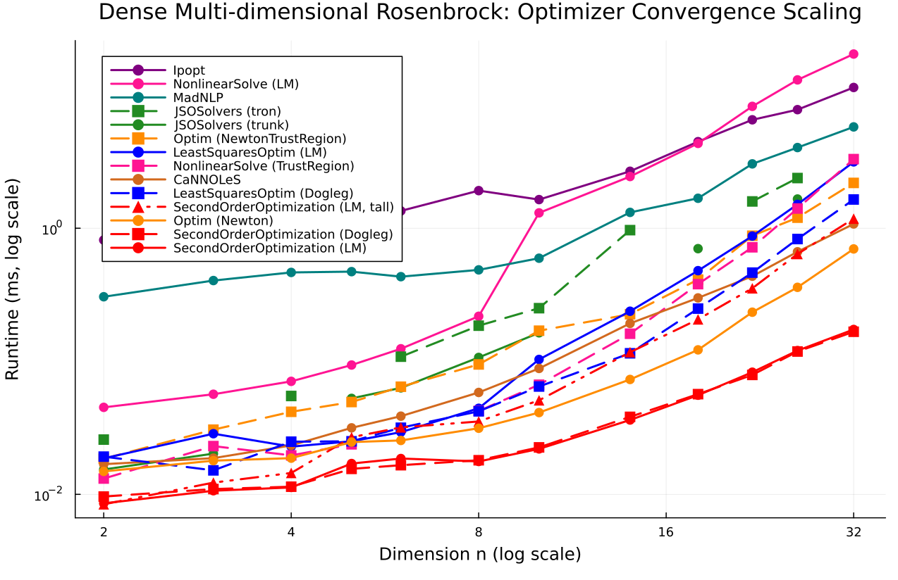

# Dense Multi-dimensional Rosenbrock

- **Category**: `small_dense`
- **Scaling Metric**: Dimension n
- **Problem Sizes Evaluated**: 2, 3, 4, 5, 6, 8, 10, 14, 18, 22, 26, 32 (12 sizes)
- **Standard Baseline Model for Optimizers**: `Standalone`
- **Derivatives**: autodiff

**Derivatives: automatic.** Every cost of this problem depends on at most 8 scalar inputs, so each cost's Jacobian is computed by forward-mode automatic differentiation, with NLLSModel's `computeresjac`. The `Standalone` model fills its residual vector and Jacobian by calling that same function for each cost in a plain single-threaded loop, so the NLLSModel and Standalone models evaluate a cost with the same code; what differs between their rows is how the linear system is assembled and how the optimizer uses it. The mode applies to the NLLSModel and Standalone models. The `JuMP` model, the native model of JSOSolvers, Ipopt, MadNLP and CaNNOLeS, is differentiated by JuMP's own automatic differentiation, exactly and with exact second derivatives, whatever the problem's mode: a native model's derivatives are part of the package under test.

---

## The Problem

A Rosenbrock-style test function (a minimum at the bottom of a curved valley) in which **every pair** of unknowns is coupled, not only neighbours. Each of the ``n`` unknowns is pulled towards 1, and for every pair ``j < k`` the later one is pulled onto the parabola ``x_k = x_j^2``:

```math
f(\mathbf{x}) = \tfrac12 \sum_{k=1}^{n} \bigl(1.2\,(x_k - 1)\bigr)^2 + \tfrac12 \sum_{j < k} \bigl(x_k - x_j^2\bigr)^2 .
```

Every term is zero at ``\mathbf{x} = (1, \dots, 1)``, which is the minimum. The optimizers start from ``x_k = 0.5`` in every coordinate, as on the [sparse Rosenbrock problem](rosenbrock_sparse.md).

### Where it is used

Nowhere directly: it is a synthetic test function. It is the dense counterpart of the [sparse Rosenbrock problem](rosenbrock_sparse.md): the same kind of nonlinearity, but with no sparsity to exploit.

### Similar problems

Small problems in which everything interacts with everything else: calibrating a set of coupled parameters, or estimating ``n`` quantities from a measurement between every pair of them (clock offsets in a network, ratings from all-play-all results). Each residual touches only one or two unknowns, so the Jacobian is mostly zeros, but the matrix ``\mathbf{J}^T \mathbf{J}`` is completely full. A dense factorization is the right tool at these sizes.

### How it scales

The size is the number of unknowns, ``n``. The number of residuals grows with the number of pairs, as ``n^2 / 2``; assembling the dense system costs in proportion to ``n^2`` and factorizing it to ``n^3``.

| | In terms of the size | Smallest | Largest |
|:---|:---|---:|---:|
| Size | ``n`` | 2 | 32 |
| Variables | ``n``, each a scalar | 2 | 32 |
| Unknowns in total | ``n`` | 2 | 32 |
| Costs | ``n(n+1)/2``, each one residual: ``n`` depend on one variable, ``n(n-1)/2`` on two | 3 | 528 |
| Residuals in total | ``n(n+1)/2`` | 3 | 528 |
| Jacobian | ``n(n+1)/2 \times n``, with ``n^2`` non-zeros | 3 × 2 | 528 × 32 |
| Hessian ``\mathbf{J}^T \mathbf{J}`` | ``n \times n``, dense | 2 × 2 | 32 × 32 |

---

## Which model each row runs on, and how it stops

Each row runs on its package's native model, or on the `Standalone` model if its package has none here (see the overview). The criteria are the benchmark's gradient, step and relative cost-change tolerances, as far as the package offers them; the overview's table says what each is called in each package.

| Row | Model | Stopping criteria given |
|:---|:---|:---|
| `CaNNOLeS` | `JuMP` | gradient |
| `Ipopt` | `JuMP` | gradient, step |
| `JSOSolvers (tron)` | `JuMP` | gradient |
| `JSOSolvers (trunk)` | `JuMP` | gradient |
| `LeastSquaresOptim (Dogleg)` | `Standalone` | gradient, step, relative cost change |
| `LeastSquaresOptim (LM)` | `Standalone` | gradient, step, relative cost change |
| `MadNLP` | `JuMP` | gradient |
| `NonlinearSolve (LM)` | `Standalone` | its own defaults |
| `NonlinearSolve (TrustRegion)` | `Standalone` | its own defaults |
| `Optim (Newton)` | `Standalone` | gradient, step, relative cost change |
| `Optim (NewtonTrustRegion)` | `Standalone` | gradient, step, relative cost change |
| `SecondOrderOptimization` | `NLLSModel` | gradient, step, relative cost change |

The `SecondOrderOptimization` row runs `iterator = :dogleg`, `linsolver = :cholesky`, `formulation = :hessian`, `reduction = :none`, `storage = :dense`: the configuration NLLSModel's `recommendoptimizer` chose for this problem at its largest size, Dimension n = 32, with one thread (then fixed in the problem's code, the same at every size).

---


## 1. Model Evaluation Scaling

The plot below shows the log-log scaling of **Pure Cost Evaluation** (dashed/dotted lines) and **Cost + Linear System Assembly** (solid/dash-dot lines) across problem sizes.


---

## 2. Optimizer Evaluation Scaling

The plot below shows the log-log scaling of **Optimizer Runtime to Convergence** across all tested solvers, each on the model given in the table above (its package's native model, or the `Standalone` model). Only `ok` rows are plotted.



---

## 3. Single-Threaded Results

The same benchmark with NLLSModel and BLAS on one thread (`set_benchmark_threads!(numthreads = 1, blas_threads = 1)`),
stored separately from the multi-threaded table. Comparing the two shows what threading gains or costs at each size.


- [View Single-Threaded Raw Benchmark Results Data (Markdown Table)](../data/single_threaded/rosenbrock_dense.md)

---

## 4. Raw Data

The full numeric benchmark measurements (cost, linear system assembly times, outer iterations, memory, and convergence status across all sizes) are persisted in the streaming Markdown data file:

- [View Full Raw Benchmark Results Data (Markdown Table)](../data/rosenbrock_dense.md)

---

## 5. Analysis & Key Takeaways

- **Model Efficiency**: At Dimension n = `32`, **`NLLSModel`** achieves the fastest Cost + Linear System evaluation at **7.19 μs** (32 B allocated).
- **Top Converged Optimizer**: At Dimension n = `32` (10/12 solvers converged), **`SecondOrderOptimization`** is fastest at **131.69 μs** (6 iterations, final cost `1.84e-21`).
- **Convergence Filtering**: Only runs satisfying universal convergence tolerances (`gtol = 1.0e-8`, `xtol = 1.0e-8`, `ftol = 1.0e-8`) within `500` iterations and `30.0s` are plotted.
