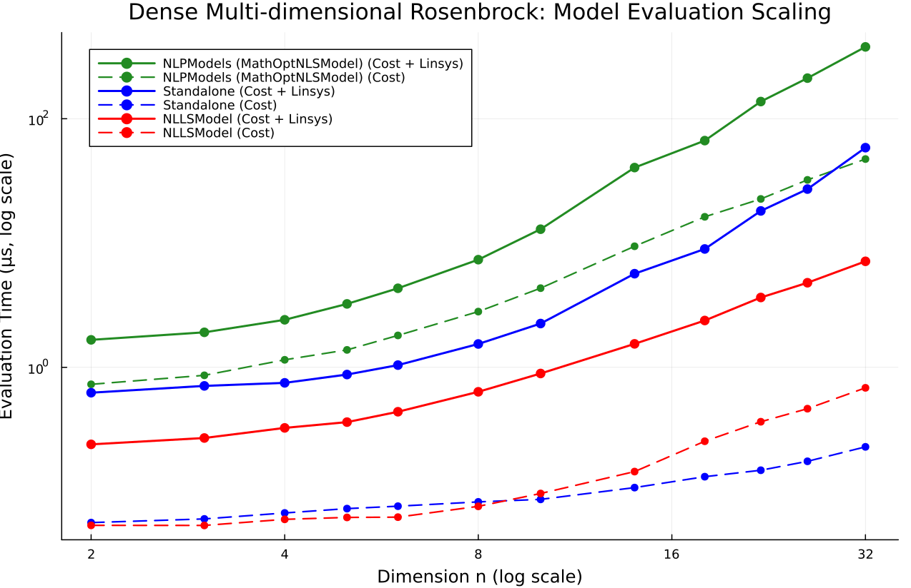
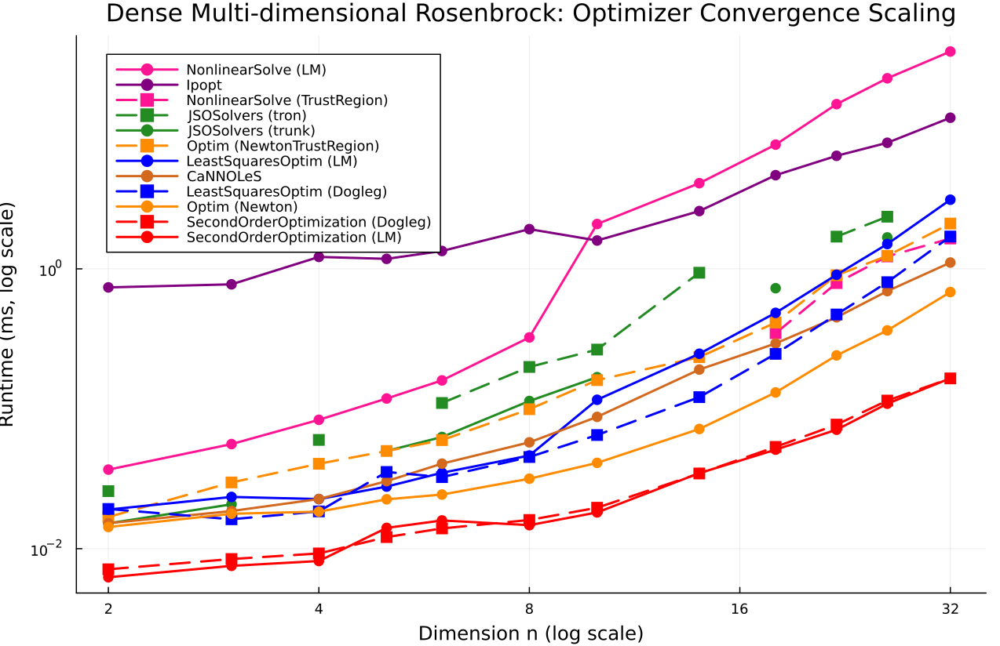

# Dense Multi-dimensional Rosenbrock

- **Category**: `small_dense`
- **Scaling Metric**: Dimension n
- **Problem Sizes Evaluated**: 1, 2, 3, 4, 6, 8, 10, 14, 18, 22, 26, 32 (12 sizes)

---

## 1. Model Evaluation Scaling

The plot below shows the log-log scaling of **Pure Cost Evaluation** (dashed lines) and **Cost + Linear System Assembly** (solid lines) across problem sizes.

### Model Evaluation Timings

| Dimension n | Model | Cost Time | Cost Allocs | Linsys Time | Linsys Allocs | Linsys Memory |
|:---|:---|:---|:---|:---|:---|:---|
| 1 | NLPModels (MathOptNLSModel) | 83.0 ns | 3 | 208.0 ns | 5 | 128 B |
| 1 | Standalone | 0.0 ns | 0 | 42.0 ns | 0 | 0 B |
| 1 | NLLSModel ★ | 42.0 ns | 0 | 41.0 ns | 0 | 0 B |
| 2 | NLPModels (MathOptNLSModel) | 125.0 ns | 5 | 417.0 ns | 7 | 160 B |
| 2 | Standalone ★ | 42.0 ns | 0 | 42.0 ns | 0 | 0 B |
| 2 | NLLSModel | 41.0 ns | 0 | 42.0 ns | 0 | 0 B |
| 3 | NLPModels (MathOptNLSModel) | 167.0 ns | 5 | 500.0 ns | 7 | 160 B |
| 3 | Standalone ★ | 0.0 ns | 0 | 42.0 ns | 0 | 0 B |
| 3 | NLLSModel | 0.0 ns | 0 | 42.0 ns | 0 | 0 B |
| 4 | NLPModels (MathOptNLSModel) | 167.0 ns | 5 | 584.0 ns | 7 | 160 B |
| 4 | Standalone | 42.0 ns | 0 | 42.0 ns | 0 | 0 B |
| 4 | NLLSModel ★ | 42.0 ns | 0 | 41.0 ns | 0 | 0 B |
| 6 | NLPModels (MathOptNLSModel) | 166.0 ns | 5 | 708.0 ns | 7 | 160 B |
| 6 | Standalone ★ | 42.0 ns | 0 | 42.0 ns | 0 | 0 B |
| 6 | NLLSModel | 41.0 ns | 0 | 42.0 ns | 0 | 0 B |
| 8 | NLPModels (MathOptNLSModel) | 167.0 ns | 5 | 875.0 ns | 7 | 160 B |
| 8 | Standalone ★ | 42.0 ns | 0 | 42.0 ns | 0 | 0 B |
| 8 | NLLSModel | 83.0 ns | 0 | 42.0 ns | 0 | 0 B |
| 10 | NLPModels (MathOptNLSModel) | 167.0 ns | 5 | 1.08 μs | 7 | 160 B |
| 10 | Standalone | 83.0 ns | 0 | 83.0 ns | 0 | 0 B |
| 10 | NLLSModel ★ | 84.0 ns | 0 | 42.0 ns | 0 | 0 B |
| 14 | NLPModels (MathOptNLSModel) | 167.0 ns | 5 | 1.88 μs | 7 | 160 B |
| 14 | Standalone ★ | 83.0 ns | 0 | 83.0 ns | 0 | 0 B |
| 14 | NLLSModel | 125.0 ns | 0 | 125.0 ns | 0 | 0 B |
| 18 | NLPModels (MathOptNLSModel) | 167.0 ns | 5 | 3.08 μs | 7 | 160 B |
| 18 | Standalone ★ | 125.0 ns | 0 | 125.0 ns | 0 | 0 B |
| 18 | NLLSModel | 208.0 ns | 0 | 209.0 ns | 0 | 0 B |
| 22 | NLPModels (MathOptNLSModel) | 209.0 ns | 5 | 4.38 μs | 7 | 160 B |
| 22 | Standalone ★ | 167.0 ns | 0 | 125.0 ns | 0 | 0 B |
| 22 | NLLSModel | 333.0 ns | 0 | 333.0 ns | 0 | 0 B |
| 26 | NLPModels (MathOptNLSModel) | 209.0 ns | 5 | 5.96 μs | 7 | 160 B |
| 26 | Standalone ★ | 167.0 ns | 0 | 208.0 ns | 0 | 0 B |
| 26 | NLLSModel | 458.0 ns | 0 | 458.0 ns | 0 | 0 B |
| 32 | NLPModels (MathOptNLSModel) | 292.0 ns | 5 | 9.00 μs | 7 | 160 B |
| 32 | Standalone ★ | 250.0 ns | 0 | 250.0 ns | 0 | 0 B |
| 32 | NLLSModel | 667.0 ns | 0 | 667.0 ns | 0 | 0 B |

---

## 2. Optimizer Evaluation Scaling

The plot below shows the log-log scaling of **Optimizer Runtime to Convergence** across all compatible optimizer families.

### Optimizer Results Summary

| Dimension n | Optimizer | Runtime | Allocs | Memory | Iterations | Final Cost | Converged |
|:---|:---|:---|:---|:---|:---|:---|:---|
| 1 | SecondOrderOptimization (Dogleg) | 5.50 μs | 4176 | 4.1 KiB | 2 | 0.0000e+00 | ✓ Yes |
| 1 | LeastSquaresOptim (Dogleg) | 6.25 μs | 154576 | 151.0 KiB | 3 | 0.0000e+00 | ✓ Yes |
| 1 | NonlinearSolve (TrustRegion) | 24.25 μs | 16880 | 16.5 KiB | 4 | 0.0000e+00 | ✓ Yes |
| 1 | Optim (NewtonTrustRegion) | 9.54 μs | 11072 | 10.8 KiB | 2 | 0.0000e+00 | ✓ Yes |
| 1 | MadNLP | 192.29 μs | 46784 | 45.7 KiB | 1 | 3.5499e-32 | ✓ Yes |
| 1 | NonlinearSolve (LM) | 33.58 μs | 22400 | 21.9 KiB | 8 | 6.7115e-28 | ✓ Yes |
| 1 | Optim (Newton) | 7.17 μs | 8304 | 8.1 KiB | 1 | 3.5499e-32 | ✓ Yes |
| 1 | LeastSquaresOptim (LM) | 9.52 μs | 306624 | 299.4 KiB | 6 | 1.2673e-26 | ✓ Yes |
| 1 | Ipopt | 312.40 μs | 9392 | 9.2 KiB | 1 | 3.5499e-32 | ✓ Yes |
| 1 | JSOSolvers (tron) | 9.50 μs | 10240 | 10.0 KiB | 2 | 0.0000e+00 | ✓ Yes |
| 1 | JSOSolvers (trunk) | 5.62 μs | 6864 | 6.7 KiB | 2 | 3.5499e-32 | ✓ Yes |
| 1 | SecondOrderOptimization (LM) | 6.83 μs | 5088 | 5.0 KiB | 3 | 0.0000e+00 | ✓ Yes |
| 2 | SecondOrderOptimization (Dogleg) | 10.52 μs | 8352 | 8.2 KiB | 7 | 0.0000e+00 | ✓ Yes |
| 2 | LeastSquaresOptim (Dogleg) | 17.12 μs | 360960 | 352.5 KiB | 7 | 0.0000e+00 | ✓ Yes |
| 2 | NonlinearSolve (TrustRegion) | 48.71 μs | 23312 | 22.8 KiB | 8 | 0.0000e+00 | ✓ Yes |
| 2 | Optim (NewtonTrustRegion) | 19.71 μs | 23488 | 22.9 KiB | 6 | 7.7016e-25 | ✓ Yes |
| 2 | MadNLP | 278.96 μs | 50320 | 49.1 KiB | 6 | 7.7016e-25 | ✓ Yes |
| 2 | NonlinearSolve (LM) | 297.07 ms | 31712 | 31.0 KiB | 14 | 8.1539e-29 | ✓ Yes |
| 2 | Optim (Newton) | 16.15 μs | 15216 | 14.9 KiB | 6 | 7.7016e-25 | ✓ Yes |
| 2 | LeastSquaresOptim (LM) | 13.06 μs | 360832 | 352.4 KiB | 7 | 1.5248e-24 | ✓ Yes |
| 2 | Ipopt | 573.69 μs | 18544 | 18.1 KiB | 6 | 7.7016e-25 | ✓ Yes |
| 2 | JSOSolvers (tron) | 20.35 μs | 12992 | 12.7 KiB | 6 | 6.0087e-20 | ✓ Yes |
| 2 | JSOSolvers (trunk) | 12.27 μs | 9936 | 9.7 KiB | 7 | 4.9612e-28 | ✓ Yes |
| 2 | SecondOrderOptimization (LM) | 10.79 μs | 8384 | 8.2 KiB | 7 | 0.0000e+00 | ✓ Yes |
| 3 | SecondOrderOptimization (Dogleg) | 12.52 μs | 9744 | 9.5 KiB | 7 | 0.0000e+00 | ✓ Yes |
| 3 | LeastSquaresOptim (Dogleg) | 20.79 μs | 415760 | 406.0 KiB | 8 | 0.0000e+00 | ✓ Yes |
| 3 | NonlinearSolve (TrustRegion) | 47.25 μs | 27232 | 26.6 KiB | 8 | 0.0000e+00 | ✓ Yes |
| 3 | Optim (NewtonTrustRegion) | 33.04 μs | 34080 | 33.3 KiB | 7 | 9.2456e-22 | ✓ Yes |
| 3 | MadNLP | 302.77 μs | 52064 | 50.8 KiB | 7 | 7.5249e-20 | ✓ Yes |
| 3 | NonlinearSolve (LM) | 292.30 ms | 40192 | 39.2 KiB | 16 | 3.0231e-28 | ✓ Yes |
| 3 | Optim (Newton) | 20.65 μs | 18720 | 18.3 KiB | 7 | 7.5249e-20 | ✓ Yes |
| 3 | LeastSquaresOptim (LM) | 24.71 μs | 467152 | 456.2 KiB | 9 | 5.6818e-30 | ✓ Yes |
| 3 | Ipopt | 636.81 μs | 21136 | 20.6 KiB | 7 | 7.5249e-20 | ✓ Yes |
| 3 | JSOSolvers (tron) | 24.98 μs | 14336 | 14.0 KiB | 7 | 3.1374e-17 | ✓ Yes |
| 3 | JSOSolvers (trunk) | 14.81 μs | 10784 | 10.5 KiB | 7 | 5.6186e-18 | ✓ Yes |
| 3 | SecondOrderOptimization (LM) | 14.33 μs | 10608 | 10.4 KiB | 8 | 0.0000e+00 | ✓ Yes |
| 4 | SecondOrderOptimization (Dogleg) | 45.67 μs | 13264 | 13.0 KiB | 8 | 0.0000e+00 | ✓ Yes |
| 4 | LeastSquaresOptim (Dogleg) | 23.12 μs | 420928 | 411.1 KiB | 8 | 0.0000e+00 | ✓ Yes |
| 4 | NonlinearSolve (TrustRegion) | 50.17 μs | 33776 | 33.0 KiB | 8 | 3.3132e-31 | ✓ Yes |
| 4 | Optim (NewtonTrustRegion) | 41.56 μs | 47120 | 46.0 KiB | 8 | 0.0000e+00 | ✓ Yes |
| 4 | MadNLP | 2.92 s | 312441680 | 298.0 MiB | 7 | 1.3440e-21 | ✓ Yes |
| 4 | NonlinearSolve (LM) | 299.33 ms | 56720 | 55.4 KiB | 19 | 1.1844e-26 | ✓ Yes |
| 4 | Optim (Newton) | 19.46 μs | 22816 | 22.3 KiB | 7 | 1.3440e-21 | ✓ Yes |
| 4 | LeastSquaresOptim (LM) | 21.92 μs | 472832 | 461.8 KiB | 9 | 4.8047e-28 | ✓ Yes |
| 4 | Ipopt | 646.60 μs | 22560 | 22.0 KiB | 7 | 1.3440e-21 | ✓ Yes |
| 4 | JSOSolvers (tron) | 80.29 μs | 17360 | 17.0 KiB | 9 | 1.2086e-16 | ✓ Yes |
| 4 | JSOSolvers (trunk) | 265.08 ms | 12320 | 12.0 KiB | 7 | 5.5528e-17 | ✓ Yes |
| 4 | SecondOrderOptimization (LM) | 13.67 μs | 13408 | 13.1 KiB | 8 | 0.0000e+00 | ✓ Yes |
| 6 | SecondOrderOptimization (Dogleg) | 18.92 μs | 20928 | 20.4 KiB | 8 | 0.0000e+00 | ✓ Yes |
| 6 | LeastSquaresOptim (Dogleg) | 49.96 μs | 485776 | 474.4 KiB | 14 | 0.0000e+00 | ✓ Yes |
| 6 | NonlinearSolve (TrustRegion) | 67.46 μs | 54608 | 53.3 KiB | 9 | 0.0000e+00 | ✓ Yes |
| 6 | Optim (NewtonTrustRegion) | 68.88 μs | 71216 | 69.5 KiB | 8 | 3.2466e-25 | ✓ Yes |
| 6 | MadNLP | 349.73 μs | 60784 | 59.4 KiB | 8 | 1.3644e-26 | ✓ Yes |
| 6 | NonlinearSolve (LM) | 302.97 ms | 102624 | 100.2 KiB | 23 | 2.7767e-28 | ✓ Yes |
| 6 | Optim (Newton) | 32.12 μs | 36080 | 35.2 KiB | 8 | 4.1099e-19 | ✓ Yes |
| 6 | LeastSquaresOptim (LM) | 37.75 μs | 485184 | 473.8 KiB | 9 | 6.5103e-28 | ✓ Yes |
| 6 | Ipopt | 753.92 μs | 29632 | 28.9 KiB | 8 | 1.3644e-26 | ✓ Yes |
| 6 | JSOSolvers (tron) | 42.77 μs | 21952 | 21.4 KiB | 10 | 3.8580e-15 | ✓ Yes |
| 6 | JSOSolvers (trunk) | 27.58 μs | 18048 | 17.6 KiB | 9 | 3.0650e-18 | ✓ Yes |
| 6 | SecondOrderOptimization (LM) | 25.69 μs | 27712 | 27.1 KiB | 10 | 5.3805e-30 | ✓ Yes |
| 8 | SecondOrderOptimization (Dogleg) | 21.62 μs | 32768 | 32.0 KiB | 8 | 0.0000e+00 | ✓ Yes |
| 8 | LeastSquaresOptim (Dogleg) | 51.08 μs | 501776 | 490.0 KiB | 9 | 0.0000e+00 | ✓ Yes |
| 8 | NonlinearSolve (TrustRegion) | 86.79 μs | 83664 | 81.7 KiB | 9 | 0.0000e+00 | ✓ Yes |
| 8 | Optim (NewtonTrustRegion) | 106.69 μs | 113264 | 110.6 KiB | 9 | 0.0000e+00 | ✓ Yes |
| 8 | MadNLP | 354.79 μs | 69392 | 67.8 KiB | 8 | 2.0175e-24 | ✓ Yes |
| 8 | NonlinearSolve (LM) | 317.02 ms | 197216 | 192.6 KiB | 33 | 8.7970e-28 | ✓ Yes |
| 8 | Optim (Newton) | 43.54 μs | 53584 | 52.3 KiB | 8 | 2.0175e-24 | ✓ Yes |
| 8 | LeastSquaresOptim (LM) | 52.62 μs | 502048 | 490.3 KiB | 9 | 1.0826e-24 | ✓ Yes |
| 8 | Ipopt | 719.79 μs | 34624 | 33.8 KiB | 8 | 2.0175e-24 | ✓ Yes |
| 8 | JSOSolvers (tron) | 57.92 μs | 29968 | 29.3 KiB | 10 | 1.1583e-14 | ✓ Yes |
| 8 | JSOSolvers (trunk) | 33.52 μs | 24624 | 24.0 KiB | 9 | 3.2796e-16 | ✓ Yes |
| 8 | SecondOrderOptimization (LM) | 24.71 μs | 35824 | 35.0 KiB | 9 | 0.0000e+00 | ✓ Yes |
| 10 | SecondOrderOptimization (Dogleg) | 74.12 μs | 56112 | 54.8 KiB | 10 | 0.0000e+00 | ✓ Yes |
| 10 | LeastSquaresOptim (Dogleg) | 75.83 μs | 522928 | 510.7 KiB | 9 | 0.0000e+00 | ✓ Yes |
| 10 | NonlinearSolve (TrustRegion) | 120.38 μs | 127504 | 124.5 KiB | 9 | 0.0000e+00 | ✓ Yes |
| 10 | Optim (NewtonTrustRegion) | 191.08 μs | 198864 | 194.2 KiB | 11 | 9.9092e-29 | ✓ Yes |
| 10 | MadNLP | 2.84 s | 312517040 | 298.0 MiB | 8 | 1.1201e-22 | ✓ Yes |
| 10 | NonlinearSolve (LM) | 639.63 ms | 98422048 | 93.9 MiB | 100 | 2.7100e+00 | ✗ No |
| 10 | Optim (Newton) | 59.12 μs | 79200 | 77.3 KiB | 8 | 1.1201e-22 | ✓ Yes |
| 10 | LeastSquaresOptim (LM) | 113.94 μs | 847664 | 827.8 KiB | 15 | 3.8422e-25 | ✓ Yes |
| 10 | Ipopt | 755.48 μs | 43456 | 42.4 KiB | 8 | 1.1201e-22 | ✓ Yes |
| 10 | JSOSolvers (tron) | 257.08 ms | 41888 | 40.9 KiB | 11 | 5.9759e-16 | ✓ Yes |
| 10 | JSOSolvers (trunk) | 280.90 ms | 35856 | 35.0 KiB | 10 | 1.3972e-17 | ✓ Yes |
| 10 | SecondOrderOptimization (LM) | 36.10 μs | 55360 | 54.1 KiB | 9 | 0.0000e+00 | ✓ Yes |
| 14 | SecondOrderOptimization (Dogleg) | 65.46 μs | 77872 | 76.0 KiB | 10 | 0.0000e+00 | ✓ Yes |
| 14 | LeastSquaresOptim (Dogleg) | 135.96 μs | 547872 | 535.0 KiB | 9 | 0.0000e+00 | ✓ Yes |
| 14 | NonlinearSolve (TrustRegion) | 235.29 μs | 182576 | 178.3 KiB | 12 | 0.0000e+00 | ✓ Yes |
| 14 | Optim (NewtonTrustRegion) | 288.71 μs | 232208 | 226.8 KiB | 9 | 5.0883e-19 | ✓ Yes |
| 14 | MadNLP | 420.58 μs | 99136 | 96.8 KiB | 9 | 0.0000e+00 | ✓ Yes |
| 14 | NonlinearSolve (LM) | 632.13 ms | 98710928 | 94.1 MiB | 100 | 2.7717e+00 | ✗ No |
| 14 | Optim (Newton) | 106.96 μs | 95984 | 93.7 KiB | 9 | 0.0000e+00 | ✓ Yes |
| 14 | LeastSquaresOptim (LM) | 267.52 μs | 1046816 | 1022.3 KiB | 18 | 7.5856e-27 | ✓ Yes |
| 14 | Ipopt | 849.83 μs | 55472 | 54.2 KiB | 9 | 0.0000e+00 | ✓ Yes |
| 14 | JSOSolvers (tron) | 151.33 μs | 51456 | 50.2 KiB | 11 | 2.7717e+00 | ✓ Yes |
| 14 | JSOSolvers (trunk) | 96.33 μs | 45072 | 44.0 KiB | 10 | 2.7717e+00 | ✓ Yes |
| 14 | SecondOrderOptimization (LM) | 68.83 μs | 80752 | 78.9 KiB | 10 | 0.0000e+00 | ✓ Yes |
| 18 | SecondOrderOptimization (Dogleg) | 120.75 μs | 144832 | 141.4 KiB | 10 | 0.0000e+00 | ✓ Yes |
| 18 | LeastSquaresOptim (Dogleg) | 275.83 μs | 679904 | 664.0 KiB | 10 | 0.0000e+00 | ✓ Yes |
| 18 | NonlinearSolve (TrustRegion) | 499.96 μs | 341520 | 333.5 KiB | 12 | 0.0000e+00 | ✓ Yes |
| 18 | Optim (NewtonTrustRegion) | 492.50 μs | 407264 | 397.7 KiB | 10 | 5.6406e-24 | ✓ Yes |
| 18 | MadNLP | 457.04 μs | 138272 | 135.0 KiB | 9 | 2.4556e-23 | ✓ Yes |
| 18 | NonlinearSolve (LM) | 657.24 ms | 99574864 | 95.0 MiB | 100 | 2.8014e+00 | ✗ No |
| 18 | Optim (Newton) | 193.94 μs | 166768 | 162.9 KiB | 9 | 2.4556e-23 | ✓ Yes |
| 18 | LeastSquaresOptim (LM) | 494.65 μs | 1141584 | 1.1 MiB | 18 | 5.6493e-26 | ✓ Yes |
| 18 | Ipopt | 883.58 μs | 84688 | 82.7 KiB | 9 | 2.4556e-23 | ✓ Yes |
| 18 | JSOSolvers (tron) | 247.54 μs | 82880 | 80.9 KiB | 12 | 1.8665e-14 | ✓ Yes |
| 18 | JSOSolvers (trunk) | 189.85 μs | 77920 | 76.1 KiB | 11 | 2.8014e+00 | ✓ Yes |
| 18 | SecondOrderOptimization (LM) | 132.38 μs | 151264 | 147.7 KiB | 10 | 0.0000e+00 | ✓ Yes |
| 22 | SecondOrderOptimization (Dogleg) | 222.38 μs | 220992 | 215.8 KiB | 10 | 0.0000e+00 | ✓ Yes |
| 22 | LeastSquaresOptim (Dogleg) | 466.54 μs | 759008 | 741.2 KiB | 10 | 0.0000e+00 | ✓ Yes |
| 22 | NonlinearSolve (TrustRegion) | 930.94 μs | 543056 | 530.3 KiB | 14 | 0.0000e+00 | ✓ Yes |
| 22 | Optim (NewtonTrustRegion) | 1.04 ms | 732704 | 715.5 KiB | 13 | 0.0000e+00 | ✓ Yes |
| 22 | MadNLP | 617.50 μs | 184192 | 179.9 KiB | 9 | 4.1424e-22 | ✓ Yes |
| 22 | NonlinearSolve (LM) | 40.87 ms | 4655824 | 4.4 MiB | 100 | 2.8186e+00 | ✗ No |
| 22 | Optim (Newton) | 368.83 μs | 251312 | 245.4 KiB | 9 | 4.1424e-22 | ✓ Yes |
| 22 | LeastSquaresOptim (LM) | 920.67 μs | 1233920 | 1.2 MiB | 18 | 2.3716e-25 | ✓ Yes |
| 22 | Ipopt | 1.02 ms | 118912 | 116.1 KiB | 9 | 4.1424e-22 | ✓ Yes |
| 22 | JSOSolvers (tron) | 471.56 μs | 123056 | 120.2 KiB | 13 | 1.0314e-13 | ✓ Yes |
| 22 | JSOSolvers (trunk) | 362.02 μs | 114224 | 111.5 KiB | 11 | 2.8186e+00 | ✓ Yes |
| 22 | SecondOrderOptimization (LM) | 256.31 μs | 230016 | 224.6 KiB | 10 | 0.0000e+00 | ✓ Yes |
| 26 | SecondOrderOptimization (Dogleg) | 361.15 μs | 328672 | 321.0 KiB | 11 | 0.0000e+00 | ✓ Yes |
| 26 | LeastSquaresOptim (Dogleg) | 830.15 μs | 912224 | 890.8 KiB | 11 | 0.0000e+00 | ✓ Yes |
| 26 | NonlinearSolve (TrustRegion) | 1.39 ms | 786128 | 767.7 KiB | 14 | 0.0000e+00 | ✓ Yes |
| 26 | Optim (NewtonTrustRegion) | 1.51 ms | 1013792 | 990.0 KiB | 13 | 1.0484e-22 | ✓ Yes |
| 26 | MadNLP | 753.54 μs | 248240 | 242.4 KiB | 10 | 1.2434e-30 | ✓ Yes |
| 26 | NonlinearSolve (LM) | 18.50 ms | 3915920 | 3.7 MiB | 100 | 2.8298e+00 | ✗ No |
| 26 | Optim (Newton) | 566.44 μs | 349696 | 341.5 KiB | 10 | 1.2434e-30 | ✓ Yes |
| 26 | LeastSquaresOptim (LM) | 1.49 ms | 1335456 | 1.3 MiB | 18 | 7.4077e-25 | ✓ Yes |
| 26 | Ipopt | 1.24 ms | 169728 | 165.8 KiB | 10 | 1.2434e-30 | ✓ Yes |
| 26 | JSOSolvers (tron) | 711.25 μs | 171056 | 167.0 KiB | 13 | 2.8080e-14 | ✓ Yes |
| 26 | JSOSolvers (trunk) | 590.62 μs | 165392 | 161.5 KiB | 12 | 2.8298e+00 | ✓ Yes |
| 26 | SecondOrderOptimization (LM) | 375.31 μs | 341824 | 333.8 KiB | 11 | 0.0000e+00 | ✓ Yes |
| 32 | SecondOrderOptimization (Dogleg) | 666.90 μs | 553440 | 540.5 KiB | 11 | 0.0000e+00 | ✓ Yes |
| 32 | LeastSquaresOptim (Dogleg) | 1.69 ms | 1144896 | 1.1 MiB | 11 | 0.0000e+00 | ✓ Yes |
| 32 | NonlinearSolve (TrustRegion) | 1.75 ms | 1234672 | 1.2 MiB | 11 | 0.0000e+00 | ✓ Yes |
| 32 | Optim (NewtonTrustRegion) | 2.70 ms | 1562784 | 1.5 MiB | 14 | 1.3363e-29 | ✓ Yes |
| 32 | MadNLP | 1.08 ms | 385680 | 376.6 KiB | 10 | 4.5840e-19 | ✓ Yes |
| 32 | NonlinearSolve (LM) | 27.28 ms | 5711552 | 5.4 MiB | 100 | 2.8407e+00 | ✗ No |
| 32 | Optim (Newton) | 1.14 ms | 594496 | 580.6 KiB | 10 | 4.5840e-19 | ✓ Yes |
| 32 | LeastSquaresOptim (LM) | 3.11 ms | 1590864 | 1.5 MiB | 18 | 3.9810e-22 | ✓ Yes |
| 32 | Ipopt | 1.59 ms | 272960 | 266.6 KiB | 10 | 4.5840e-19 | ✓ Yes |
| 32 | JSOSolvers (tron) | 1.60 ms | 286512 | 279.8 KiB | 14 | 1.5035e-15 | ✓ Yes |
| 32 | JSOSolvers (trunk) | 1.17 ms | 273728 | 267.3 KiB | 12 | 2.8407e+00 | ✓ Yes |
| 32 | SecondOrderOptimization (LM) | 767.90 μs | 572448 | 559.0 KiB | 11 | 0.0000e+00 | ✓ Yes |

---

## 3. Analysis & Key Takeaways

- **Asymptotic Complexity**: Log-log scaling indicates the empirical runtime growth rate as Dimension n expands.
- **Fastest Model**: The fastest linear system assembly was consistently achieved by `NLLSModel`.
- **Top Optimizer**: Solvers leveraging specialized structure (e.g. sparse block factorization in SecondOrderOptimization) demonstrate superior scaling exponents on large problem regimes.
