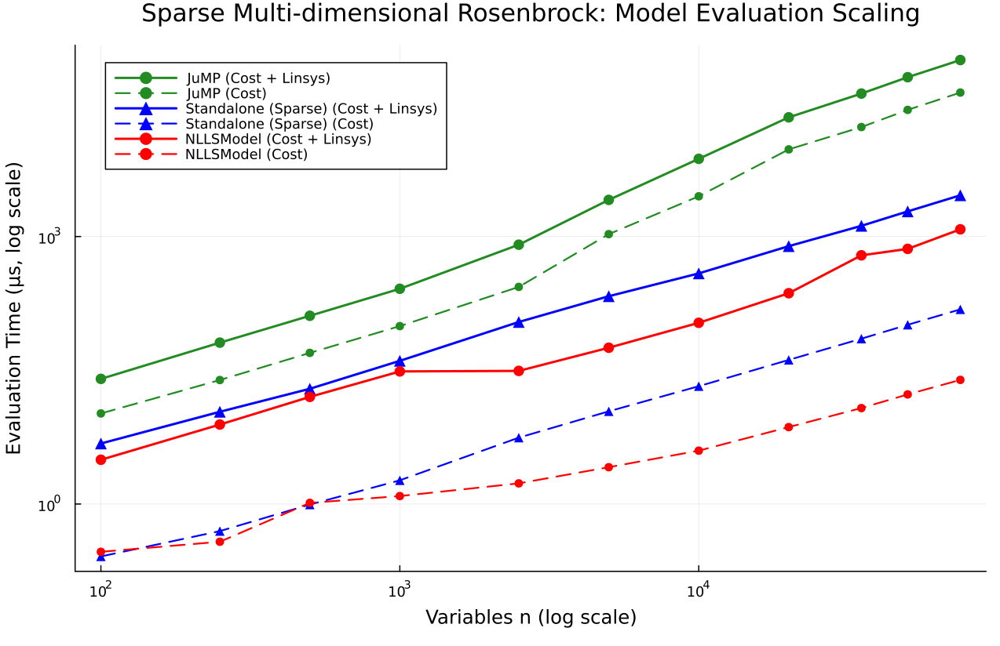
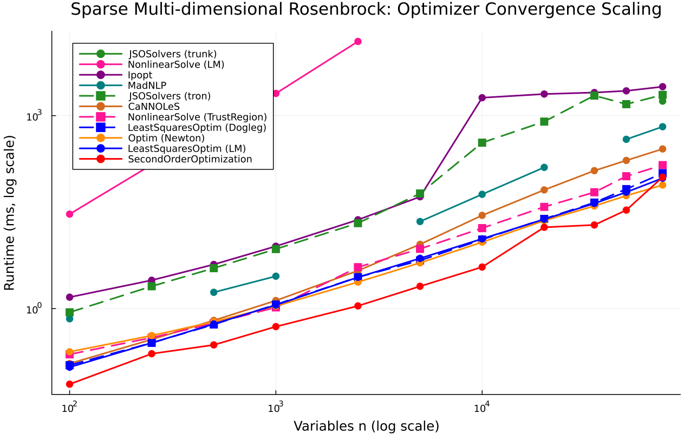

# Sparse Multi-dimensional Rosenbrock

- **Category**: `large_sparse`
- **Scaling Metric**: Variables n
- **Problem Sizes Evaluated**: 100, 250, 500, 1000, 2500, 5000, 10000, 20000, 35000, 50000, 75000 (11 sizes)
- **Standard Baseline Model for Optimizers**: `Standalone (Sparse)`
- **Derivatives**: autodiff

**Derivatives: automatic.** Every cost of this problem depends on at most 8 scalar inputs, so each cost's Jacobian is computed by forward-mode automatic differentiation, with NLLSModel's `computeresjac`. The `Standalone` model fills its residual vector and Jacobian by calling that same function for each cost in a plain single-threaded loop, so every model evaluates a cost with the same code; what differs between rows is how the linear system is assembled and how the optimizer uses it. The `NLPModels (MathOptNLSModel)` model is differentiated by JuMP's own automatic differentiation.

---

## The Problem

The Rosenbrock function is the classic test of an optimizer: its minimum lies at the bottom of a long, curved valley that is easy to reach and slow to follow. This problem chains ``n`` unknowns together. Each unknown is pulled towards 1, and each neighbouring pair is pulled onto the parabola ``x_{k+1} = x_k^2``:

```math
f(\mathbf{x}) = \tfrac12 \sum_{k=1}^{n} \bigl(10\,(x_k - 1)\bigr)^2 + \tfrac12 \sum_{k=1}^{n-1} \bigl(10\,(x_{k+1} - x_k^2)\bigr)^2 .
```

Every term is zero at ``\mathbf{x} = (1, \dots, 1)``, which is the minimum. The optimizers start from ``x_k = 0.5``.

### Where it is used

Nowhere directly: it is a synthetic test function. It is in the benchmark because it is nonlinear, has a known answer, and can be made as large as wanted with no data to load, so it shows how a package's cost grows with the number of unknowns when the structure is as simple as a sparse problem gets.

### Similar problems

Any problem in which the unknowns form a chain and each is tied only to its neighbours: smoothing or denoising a sampled signal, estimating a scalar state over time (a Kalman smoother), and differential equations discretized on a line, such as this benchmark's [ODE boundary value problem](ode_bvp.md). In all of these the matrix the optimizer factorizes is tridiagonal, and a sparse direct solver handles it in time proportional to ``n``.

### How it scales

The size is the number of unknowns, ``n``. Everything grows in proportion to it.

| | In terms of the size | Smallest | Largest |
|:---|:---|---:|---:|
| Size | ``n`` | 100 | 75000 |
| Variables | ``n``, each a scalar | 100 | 75000 |
| Unknowns in total | ``n`` | 100 | 75000 |
| Costs | ``2n - 1``, each one residual: ``n`` depend on one variable, ``n - 1`` on two | 199 | 149999 |
| Residuals in total | ``2n - 1`` | 199 | 149999 |
| Jacobian | ``(2n - 1) \times n``, with ``3n - 2`` non-zeros (two per row at most) | 298 non-zeros | 224998 non-zeros |
| Hessian ``\mathbf{J}^T \mathbf{J}`` | ``n \times n``, tridiagonal | 298 non-zeros | 224998 non-zeros |

---

## The SecondOrderOptimization rows

- **`SecondOrderOptimization (Gauss-Newton)`** is `iterator = :newton` on the normal equations: Gauss–Newton, since the Hessian it is given is ``\mathbf{J}^T \mathbf{J}``. It takes the full step, with no line search or trust region (a diagonal shift only when the system cannot be solved), so a step that raises the cost is caught only by the stall test, and the row then ends `not_converged`. **`CaNNOLeS`** (`method = :Newton_noFHess`) is Gauss–Newton too, globalized: an ``\mathbf{L}\mathbf{D}\mathbf{L}^T`` factorization of the augmented system ``[\mu \mathbf{I}\ \ \mathbf{J}^T;\ \mathbf{J}\ \ {-\mathbf{I}}]``, with ``\mu`` raised from 0 only when the factorization fails or has the wrong inertia, then an Armijo backtracking line search on ``\tfrac12\lVert\boldsymbol{\epsilon}\rVert^2``.
- **`SecondOrderOptimization (LM, tall)`** is Levenberg–Marquardt on the residual-and-Jacobian form (`formulation = :jacobian`): each step solves the damped least-squares problem in ``\mathbf{J}`` by QR, without forming ``\mathbf{J}^T \mathbf{J}``, on the `NLLSModel` model. `storage = :auto` stores ``\mathbf{J}`` dense or sparse from its fill (sparse at the large sizes), and `linsolver = :auto` factorizes it by dense QR or SPQR. The rows without "tall" solve the normal equations in ``\mathbf{J}^T \mathbf{J}``.
- **`SecondOrderOptimization (LM, tall, LSMR)`** is the tall row with `linsolver = :lsmr`: each step's least-squares problem is solved iteratively by LSMR (Krylov.jl) instead of by QR.

---

## 1. Model Evaluation Scaling

The plot below shows the log-log scaling of **Pure Cost Evaluation** (dashed/dotted lines) and **Cost + Linear System Assembly** (solid/dash-dot lines) across problem sizes.



---

## 2. Optimizer Evaluation Scaling

The plot below shows the log-log scaling of **Optimizer Runtime to Convergence** across all tested solvers, where each solver is evaluated on its optimal problem representation (e.g. `NLLSModel` for `SecondOrderOptimization`, `LeastSquaresProblem` for `LeastSquaresOptim`, `NLPModels` for JSO/interior-point solvers, and `Manifolds` for `Manopt`). Non-converged runs are omitted.



---

## 3. Single-Threaded Results

The same benchmark with NLLSModel and BLAS on one thread (`set_benchmark_threads!(numthreads = 1, blas_threads = 1)`),
stored separately from the threaded table. Comparing the two shows what threading gains or costs at each size.


- [View Single-Threaded Raw Benchmark Results Data (Markdown Table)](../data/single_threaded/rosenbrock_sparse.md)

---

## 4. Raw Data

The full numeric benchmark measurements (cost, linear system assembly times, outer iterations, memory, and convergence status across all sizes) are persisted in the streaming Markdown data file:

- [View Full Raw Benchmark Results Data (Markdown Table)](../data/rosenbrock_sparse.md)

---

## 5. Analysis & Key Takeaways

- **Model Efficiency**: At Variables n = `75000`, **`NLLSModel`** achieves the fastest Cost + Linear System evaluation at **957.12 μs** (64 B allocated).
- **Top Converged Optimizer**: At Variables n = `75000` (10/16 solvers converged), **`SecondOrderOptimization (Gauss-Newton)`** is fastest at **31.59 ms** (5 iterations, final cost `0.00e+00`).
- **Convergence Filtering**: Only runs satisfying universal convergence tolerances (`gtol = 1.0e-8`, `xtol = 1.0e-8`, `ftol = 1.0e-8`) within `500` iterations and `30.0s` are plotted.
