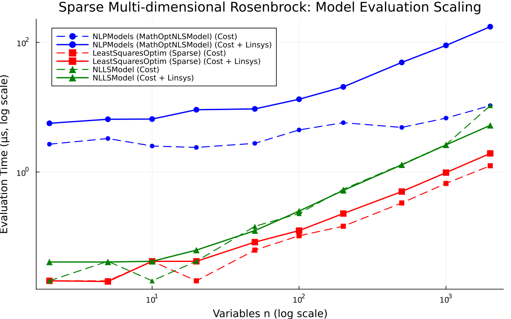
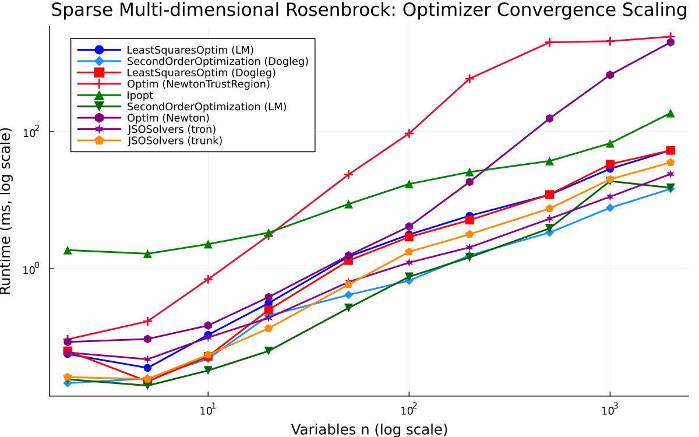

# Sparse Multi-dimensional Rosenbrock

- **Category**: `large_sparse`
- **Scaling Metric**: Variables n
- **Problem Sizes Evaluated**: 2, 5, 10, 20, 50, 100, 200, 500, 1000, 2000 (10 sizes)

---

## 1. Model Evaluation Scaling

The plot below shows the log-log scaling of **Pure Cost Evaluation** (dashed lines) and **Cost + Linear System Assembly** (solid lines) across problem sizes.

### Model Evaluation Timings

| Variables n | Model | Cost Time | Cost Allocs | Linsys Time | Linsys Allocs | Linsys Memory |
|:---|:---|:---|:---|:---|:---|:---|
| 2 | NLPModels (MathOptNLSModel) | 2.69 μs | 5 | 5.65 μs | 7 | 160 B |
| 2 | LeastSquaresOptim (Sparse) ★ | 21.0 ns | 0 | 21.0 ns | 0 | 0 B |
| 2 | NLLSModel | 21.0 ns | 0 | 41.0 ns | 0 | 0 B |
| 5 | NLPModels (MathOptNLSModel) | 3.29 μs | 5 | 6.52 μs | 7 | 160 B |
| 5 | LeastSquaresOptim (Sparse) ★ | 21.0 ns | 0 | 20.5 ns | 0 | 0 B |
| 5 | NLLSModel | 42.0 ns | 0 | 41.0 ns | 0 | 0 B |
| 10 | NLPModels (MathOptNLSModel) | 2.52 μs | 5 | 6.56 μs | 7 | 160 B |
| 10 | LeastSquaresOptim (Sparse) ★ | 42.0 ns | 0 | 42.0 ns | 0 | 0 B |
| 10 | NLLSModel | 21.0 ns | 0 | 42.0 ns | 0 | 0 B |
| 20 | NLPModels (MathOptNLSModel) | 2.40 μs | 5 | 9.15 μs | 7 | 160 B |
| 20 | LeastSquaresOptim (Sparse) ★ | 21.0 ns | 0 | 42.0 ns | 0 | 0 B |
| 20 | NLLSModel | 42.0 ns | 0 | 62.5 ns | 0 | 0 B |
| 50 | NLPModels (MathOptNLSModel) | 2.77 μs | 5 | 9.42 μs | 7 | 160 B |
| 50 | LeastSquaresOptim (Sparse) ★ | 62.5 ns | 0 | 83.0 ns | 0 | 0 B |
| 50 | NLLSModel | 145.5 ns | 0 | 125.0 ns | 0 | 0 B |
| 100 | NLPModels (MathOptNLSModel) | 4.46 μs | 5 | 13.27 μs | 7 | 160 B |
| 100 | LeastSquaresOptim (Sparse) ★ | 104.0 ns | 0 | 125.0 ns | 0 | 0 B |
| 100 | NLLSModel | 229.0 ns | 0 | 250.0 ns | 0 | 0 B |
| 200 | NLPModels (MathOptNLSModel) | 5.77 μs | 5 | 20.58 μs | 7 | 160 B |
| 200 | LeastSquaresOptim (Sparse) ★ | 146.0 ns | 0 | 229.0 ns | 0 | 0 B |
| 200 | NLLSModel | 542.0 ns | 0 | 521.0 ns | 0 | 0 B |
| 500 | NLPModels (MathOptNLSModel) | 4.88 μs | 5 | 49.08 μs | 7 | 160 B |
| 500 | LeastSquaresOptim (Sparse) ★ | 333.5 ns | 0 | 500.0 ns | 0 | 0 B |
| 500 | NLLSModel | 1.31 μs | 0 | 1.29 μs | 0 | 0 B |
| 1000 | NLPModels (MathOptNLSModel) | 6.79 μs | 5 | 89.88 μs | 7 | 160 B |
| 1000 | LeastSquaresOptim (Sparse) ★ | 667.0 ns | 0 | 979.5 ns | 0 | 0 B |
| 1000 | NLLSModel | 2.65 μs | 0 | 2.62 μs | 0 | 0 B |
| 2000 | NLPModels (MathOptNLSModel) | 10.58 μs | 5 | 174.27 μs | 7 | 160 B |
| 2000 | LeastSquaresOptim (Sparse) ★ | 1.25 μs | 0 | 1.94 μs | 0 | 0 B |
| 2000 | NLLSModel | 10.58 μs | 0 | 5.25 μs | 0 | 0 B |

---

## 2. Optimizer Evaluation Scaling

The plot below shows the log-log scaling of **Optimizer Runtime to Convergence** across all compatible optimizer families.

### Optimizer Results Summary

| Variables n | Optimizer | Runtime | Allocs | Memory | Iterations | Final Cost | Converged |
|:---|:---|:---|:---|:---|:---|:---|:---|
| 2 | LeastSquaresOptim (LM) | 56.96 μs | 9168 | 9.0 KiB | 25 | 6.5890e-23 | ✓ Yes |
| 2 | SecondOrderOptimization (Dogleg) | 21.44 μs | 16464 | 16.1 KiB | 13 | 0.0000e+00 | ✓ Yes |
| 2 | LeastSquaresOptim (Dogleg) | 63.35 μs | 7984 | 7.8 KiB | 24 | 0.0000e+00 | ✓ Yes |
| 2 | Ipopt | 1.87 ms | 47248 | 46.1 KiB | 12 | 0.0000e+00 | ✓ Yes |
| 2 | Optim (NewtonTrustRegion) | 93.29 μs | 60880 | 59.5 KiB | 16 | 8.7550e-21 | ✓ Yes |
| 2 | JSOSolvers (tron) | 59.96 μs | 11168 | 10.9 KiB | 17 | 5.4183e-21 | ✓ Yes |
| 2 | Optim (Newton) | 85.50 μs | 56560 | 55.2 KiB | 35 | 0.0000e+00 | ✓ Yes |
| 2 | SecondOrderOptimization (LM) | 24.38 μs | 18384 | 18.0 KiB | 13 | 2.5160e-25 | ✓ Yes |
| 2 | JSOSolvers (trunk) | 26.23 μs | 7616 | 7.4 KiB | 16 | 7.3366e-25 | ✓ Yes |
| 5 | LeastSquaresOptim (LM) | 35.79 μs | 12784 | 12.5 KiB | 21 | 1.8825e-23 | ✓ Yes |
| 5 | SecondOrderOptimization (Dogleg) | 25.02 μs | 24032 | 23.5 KiB | 13 | 0.0000e+00 | ✓ Yes |
| 5 | LeastSquaresOptim (Dogleg) | 22.69 μs | 11792 | 11.5 KiB | 25 | 0.0000e+00 | ✓ Yes |
| 5 | Ipopt | 1.66 ms | 56240 | 54.9 KiB | 12 | 0.0000e+00 | ✓ Yes |
| 5 | Optim (NewtonTrustRegion) | 171.38 μs | 179328 | 175.1 KiB | 25 | 0.0000e+00 | ✓ Yes |
| 5 | JSOSolvers (tron) | 47.81 μs | 12768 | 12.5 KiB | 20 | 1.8612e-15 | ✓ Yes |
| 5 | Optim (Newton) | 94.42 μs | 104208 | 101.8 KiB | 47 | 0.0000e+00 | ✓ Yes |
| 5 | SecondOrderOptimization (LM) | 19.71 μs | 27632 | 27.0 KiB | 15 | 0.0000e+00 | ✓ Yes |
| 5 | JSOSolvers (trunk) | 24.58 μs | 9040 | 8.8 KiB | 16 | 4.1159e-14 | ✓ Yes |
| 10 | LeastSquaresOptim (LM) | 108.48 μs | 35216 | 34.4 KiB | 44 | 3.2607e-18 | ✓ Yes |
| 10 | SecondOrderOptimization (Dogleg) | 48.58 μs | 65840 | 64.3 KiB | 25 | 0.0000e+00 | ✓ Yes |
| 10 | LeastSquaresOptim (Dogleg) | 52.69 μs | 28016 | 27.4 KiB | 27 | 0.0000e+00 | ✓ Yes |
| 10 | Ipopt | 2.29 ms | 114160 | 111.5 KiB | 19 | 3.7398e-24 | ✓ Yes |
| 10 | Optim (NewtonTrustRegion) | 702.98 μs | 883696 | 863.0 KiB | 48 | 3.2621e-25 | ✓ Yes |
| 10 | JSOSolvers (tron) | 99.21 μs | 16176 | 15.8 KiB | 34 | 1.2855e-18 | ✓ Yes |
| 10 | Optim (Newton) | 148.92 μs | 210432 | 205.5 KiB | 54 | 2.0443e-29 | ✓ Yes |
| 10 | SecondOrderOptimization (LM) | 32.77 μs | 56032 | 54.7 KiB | 19 | 1.2696e-30 | ✓ Yes |
| 10 | JSOSolvers (trunk) | 55.46 μs | 11920 | 11.6 KiB | 23 | 4.5569e-17 | ✓ Yes |
| 20 | LeastSquaresOptim (LM) | 315.25 μs | 54944 | 53.7 KiB | 61 | 1.6528e-17 | ✓ Yes |
| 20 | SecondOrderOptimization (Dogleg) | 206.69 μs | 410176 | 400.6 KiB | 100 | 7.7164e+00 | ✓ Yes |
| 20 | LeastSquaresOptim (Dogleg) | 250.98 μs | 50256 | 49.1 KiB | 45 | 0.0000e+00 | ✓ Yes |
| 20 | Ipopt | 3.36 ms | 254704 | 248.7 KiB | 30 | 1.2149e-27 | ✓ Yes |
| 20 | Optim (NewtonTrustRegion) | 3.05 ms | 4322496 | 4.1 MiB | 76 | 1.3385e-23 | ✓ Yes |
| 20 | JSOSolvers (tron) | 191.73 μs | 22368 | 21.8 KiB | 46 | 1.2753e-12 | ✓ Yes |
| 20 | Optim (Newton) | 385.81 μs | 711568 | 694.9 KiB | 85 | 0.0000e+00 | ✓ Yes |
| 20 | SecondOrderOptimization (LM) | 63.08 μs | 130480 | 127.4 KiB | 29 | 1.4370e-28 | ✓ Yes |
| 20 | JSOSolvers (trunk) | 135.04 μs | 17232 | 16.8 KiB | 35 | 5.9024e-17 | ✓ Yes |
| 50 | LeastSquaresOptim (LM) | 1.50 ms | 109872 | 107.3 KiB | 94 | 1.1360e-17 | ✓ Yes |
| 50 | SecondOrderOptimization (Dogleg) | 416.04 μs | 1038688 | 1014.3 KiB | 100 | 2.2351e+01 | ✓ Yes |
| 50 | LeastSquaresOptim (Dogleg) | 1.32 ms | 112720 | 110.1 KiB | 82 | 5.6420e-26 | ✓ Yes |
| 50 | Ipopt | 8.81 ms | 1181920 | 1.1 MiB | 69 | 8.9240e-29 | ✓ Yes |
| 50 | Optim (NewtonTrustRegion) | 23.75 ms | 28086784 | 26.8 MiB | 100 | 1.0065e+01 | ✗ No |
| 50 | JSOSolvers (tron) | 641.52 μs | 42384 | 41.4 KiB | 98 | 1.2412e-12 | ✓ Yes |
| 50 | Optim (Newton) | 1.56 ms | 3186448 | 3.0 MiB | 100 | 8.4206e+00 | ✗ No |
| 50 | SecondOrderOptimization (LM) | 268.31 μs | 625968 | 611.3 KiB | 61 | 6.2246e-31 | ✓ Yes |
| 50 | JSOSolvers (trunk) | 587.98 μs | 34432 | 33.6 KiB | 68 | 3.9804e-18 | ✓ Yes |
| 100 | LeastSquaresOptim (LM) | 3.16 ms | 128096 | 125.1 KiB | 100 | 1.5493e+01 | ✗ No |
| 100 | SecondOrderOptimization (Dogleg) | 671.00 μs | 2031216 | 1.9 MiB | 100 | 4.7141e+01 | ✓ Yes |
| 100 | LeastSquaresOptim (Dogleg) | 2.91 ms | 139904 | 136.6 KiB | 100 | 1.6889e+01 | ✗ No |
| 100 | Ipopt | 17.27 ms | 3104016 | 3.0 MiB | 100 | 1.5343e+01 | ✗ No |
| 100 | Optim (NewtonTrustRegion) | 94.35 ms | 105912032 | 101.0 MiB | 100 | 3.4825e+01 | ✗ No |
| 100 | JSOSolvers (tron) | 1.23 ms | 25488 | 24.9 KiB | 101 | 2.1885e+01 | ✗ No |
| 100 | Optim (Newton) | 4.14 ms | 10563552 | 10.1 MiB | 100 | 3.3166e+01 | ✗ No |
| 100 | SecondOrderOptimization (LM) | 763.69 μs | 1943744 | 1.9 MiB | 100 | 4.4403e+00 | ✓ Yes |
| 100 | JSOSolvers (trunk) | 1.77 ms | 12592 | 12.3 KiB | 101 | 1.1190e+01 | ✗ No |
| 200 | LeastSquaresOptim (LM) | 5.94 ms | 144368 | 141.0 KiB | 100 | 6.3497e+01 | ✗ No |
| 200 | SecondOrderOptimization (Dogleg) | 1.57 ms | 3997808 | 3.8 MiB | 100 | 9.6649e+01 | ✓ Yes |
| 200 | LeastSquaresOptim (Dogleg) | 5.14 ms | 148864 | 145.4 KiB | 100 | 6.6764e+01 | ✗ No |
| 200 | Ipopt | 25.84 ms | 5981296 | 5.7 MiB | 100 | 6.4838e+01 | ✗ No |
| 200 | Optim (NewtonTrustRegion) | 594.83 ms | 408176288 | 389.3 MiB | 100 | 8.3895e+01 | ✗ No |
| 200 | JSOSolvers (tron) | 2.05 ms | 42432 | 41.4 KiB | 101 | 7.0573e+01 | ✗ No |
| 200 | Optim (Newton) | 18.51 ms | 38227072 | 36.5 MiB | 100 | 8.2431e+01 | ✗ No |
| 200 | SecondOrderOptimization (LM) | 1.47 ms | 3850080 | 3.7 MiB | 100 | 5.5173e+01 | ✓ Yes |
| 200 | JSOSolvers (trunk) | 3.19 ms | 21424 | 20.9 KiB | 101 | 6.0010e+01 | ✗ No |
| 500 | LeastSquaresOptim (LM) | 12.05 ms | 180448 | 176.2 KiB | 100 | 2.1387e+02 | ✗ No |
| 500 | SecondOrderOptimization (Dogleg) | 3.38 ms | 9530064 | 9.1 MiB | 100 | 2.4501e+02 | ✓ Yes |
| 500 | LeastSquaresOptim (Dogleg) | 12.14 ms | 195536 | 191.0 KiB | 100 | 2.1209e+02 | ✗ No |
| 500 | Ipopt | 37.36 ms | 13891376 | 13.2 MiB | 100 | 2.1332e+02 | ✗ No |
| 500 | Optim (NewtonTrustRegion) | 2.02 s | 1509612128 | 1439.7 MiB | 62 | 2.3820e+02 | ✗ No |
| 500 | JSOSolvers (tron) | 5.37 ms | 99872 | 97.5 KiB | 101 | 2.1021e+02 | ✗ No |
| 500 | Optim (Newton) | 156.02 ms | 220590592 | 210.4 MiB | 100 | 2.3090e+02 | ✗ No |
| 500 | SecondOrderOptimization (LM) | 3.88 ms | 9146752 | 8.7 MiB | 100 | 2.0355e+02 | ✓ Yes |
| 500 | JSOSolvers (trunk) | 7.57 ms | 51376 | 50.2 KiB | 101 | 2.0917e+02 | ✗ No |
| 1000 | LeastSquaresOptim (LM) | 28.78 ms | 252832 | 246.9 KiB | 100 | 4.5948e+02 | ✗ No |
| 1000 | SecondOrderOptimization (Dogleg) | 7.75 ms | 18985296 | 18.1 MiB | 100 | 4.9212e+02 | ✓ Yes |
| 1000 | LeastSquaresOptim (Dogleg) | 33.63 ms | 261520 | 255.4 KiB | 100 | 4.6035e+02 | ✗ No |
| 1000 | Ipopt | 67.78 ms | 27483056 | 26.2 MiB | 100 | 4.6080e+02 | ✗ No |
| 1000 | Optim (NewtonTrustRegion) | 2.09 s | 1203679264 | 1147.9 MiB | 16 | 4.9282e+02 | ✗ No |
| 1000 | JSOSolvers (tron) | 11.26 ms | 194144 | 189.6 KiB | 101 | 4.6834e+02 | ✗ No |
| 1000 | Optim (Newton) | 675.05 ms | 859098400 | 819.3 MiB | 100 | 4.7836e+02 | ✗ No |
| 1000 | SecondOrderOptimization (LM) | 18.99 ms | 18234496 | 17.4 MiB | 100 | 4.5031e+02 | ✓ Yes |
| 1000 | JSOSolvers (trunk) | 20.19 ms | 100592 | 98.2 KiB | 101 | 4.5664e+02 | ✗ No |
| 2000 | LeastSquaresOptim (LM) | 53.57 ms | 387376 | 378.3 KiB | 100 | 9.5488e+02 | ✗ No |
| 2000 | SecondOrderOptimization (Dogleg) | 14.68 ms | 37889472 | 36.1 MiB | 100 | 9.8690e+02 | ✓ Yes |
| 2000 | LeastSquaresOptim (Dogleg) | 53.42 ms | 410080 | 400.5 KiB | 100 | 9.5496e+02 | ✗ No |
| 2000 | Ipopt | 187.17 ms | 54652016 | 52.1 MiB | 100 | 9.5575e+02 | ✗ No |
| 2000 | Optim (NewtonTrustRegion) | 2.44 s | 1504583376 | 1434.9 MiB | 4 | 8.7791e+04 | ✗ No |
| 2000 | JSOSolvers (tron) | 24.13 ms | 382688 | 373.7 KiB | 101 | 9.5030e+02 | ✗ No |
| 2000 | Optim (Newton) | 2.02 s | 2299795952 | 2193.3 MiB | 66 | 9.8019e+02 | ✗ No |
| 2000 | SecondOrderOptimization (LM) | 15.21 ms | 36395088 | 34.7 MiB | 100 | 9.4500e+02 | ✓ Yes |
| 2000 | JSOSolvers (trunk) | 35.66 ms | 198896 | 194.2 KiB | 101 | 9.5159e+02 | ✗ No |

---

## 3. Analysis & Key Takeaways

- **Asymptotic Complexity**: Log-log scaling indicates the empirical runtime growth rate as Variables n expands.
- **Fastest Model**: The fastest linear system assembly was consistently achieved by `LeastSquaresOptim (Sparse)`.
- **Top Optimizer**: Solvers leveraging specialized structure (e.g. sparse block factorization in SecondOrderOptimization) demonstrate superior scaling exponents on large problem regimes.
